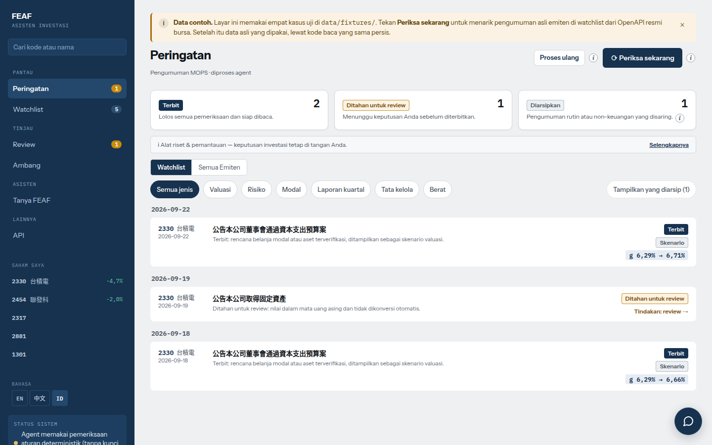
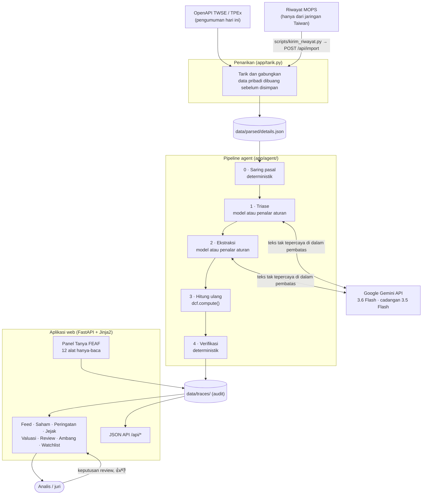
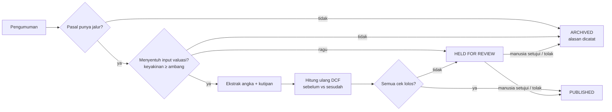
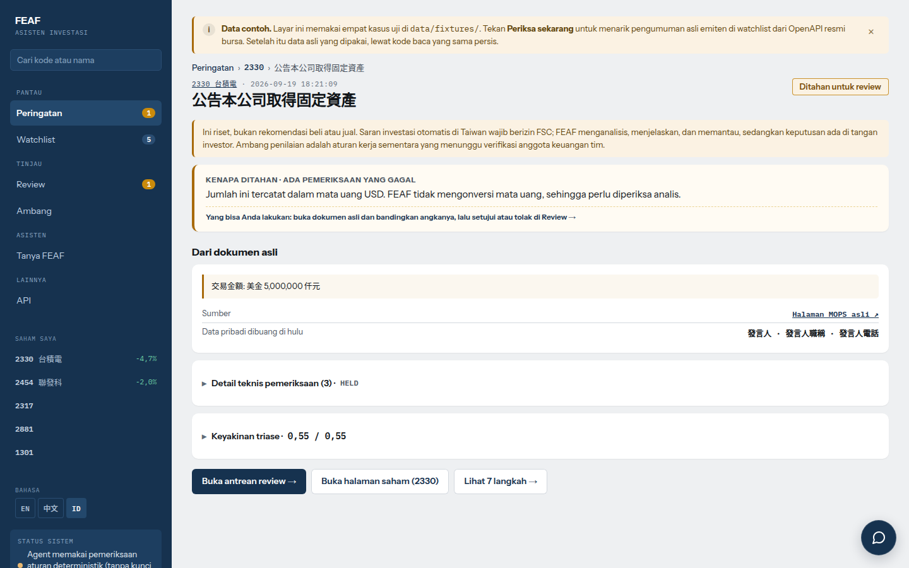
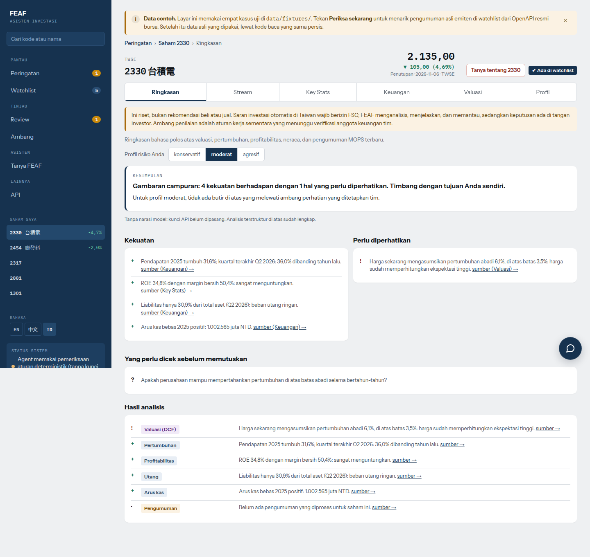
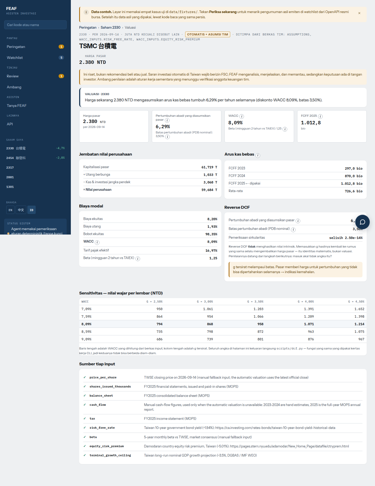
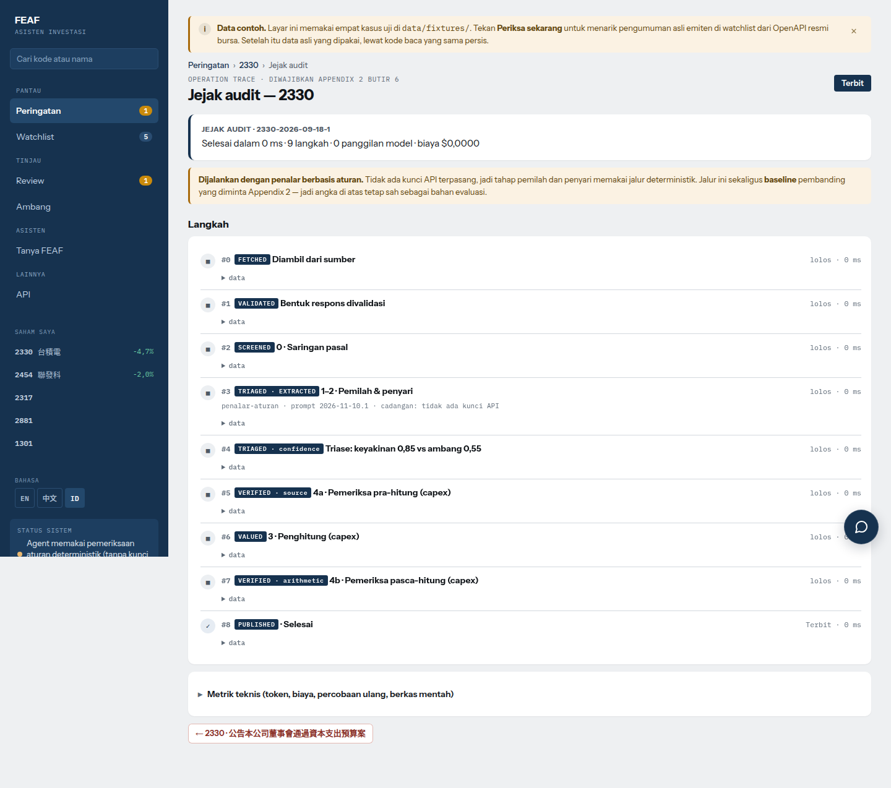
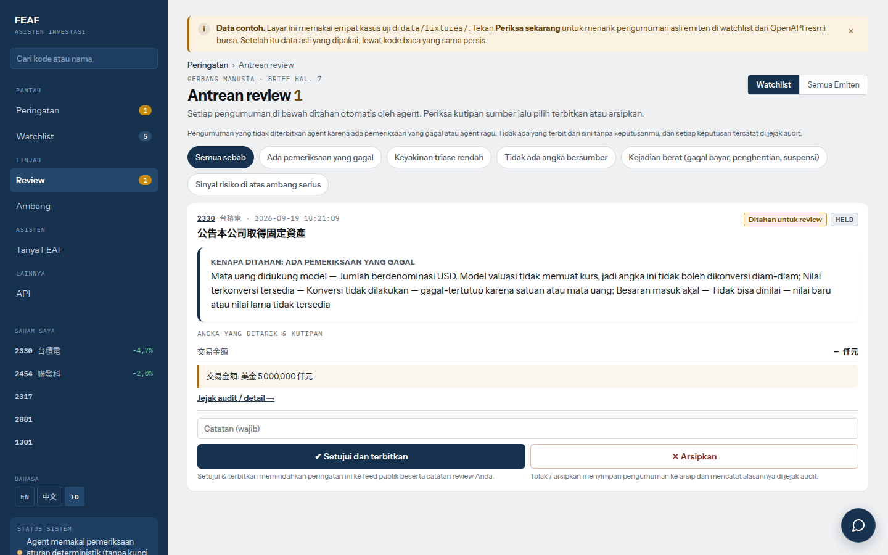
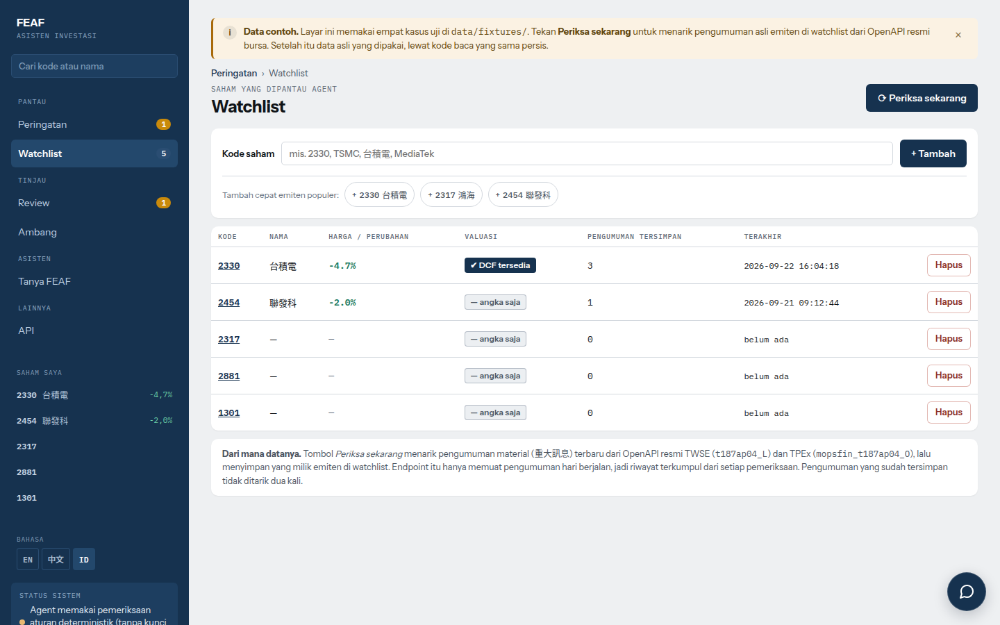
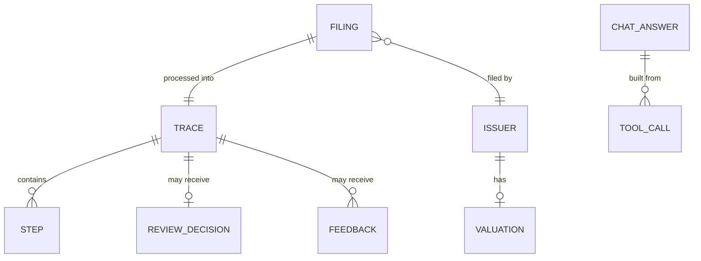

# FEAF — Asisten Investasi AI Agentik

<div align="center">

[English](README.md) · [繁體中文](README.zh-TW.md) · **Bahasa Indonesia** · [Tiếng Việt](README.vi.md)



**FEAF** adalah agent yang memantau pengumuman resmi bursa Taiwan (MOPS 重大訊息), menentukan input valuasi mana yang disentuh tiap pengumuman, menghitung ulang valuasi saat angkanya berubah, dan **menolak menerbitkan peringatan** bila sebuah angka tidak bisa ditelusuri kembali ke pengumuman asalnya. Dibuat untuk NAPAI Agentic AI Innovation Competition 2026 (AAIC 2026), jalur SYSTEX: *Investment Intelligence & AI-Powered Stock Selection Agent*.

[](CHANGELOG.md)
[](https://www.python.org/)
[](https://fastapi.tiangolo.com/)
[](https://www.uvicorn.org/)
[](https://jinja.palletsprojects.com/)
[](https://ai.google.dev/)
[](#95-tes)
[](#38-antarmuka-tiga-bahasa)
[](LICENSE)

</div>

> [!IMPORTANT]
> **Bukan alat trading.** Tidak ada koneksi ke broker dan tidak ada eksekusi order, dan agent ini tidak memberi saran beli atau jual. Ia menyaring, menjelaskan, dan mengutip sumber; manusia yang memutuskan.

---

## 📑 Daftar Isi
- [1. Ringkasan dan Nilai Utama](#1-ringkasan-dan-nilai-utama)
- [2. Arsitektur Sistem dan Desain Tingkat Tinggi](#2-arsitektur-sistem-dan-desain-tingkat-tinggi)
  - [2.1 Diagram Arsitektur](#21-diagram-arsitektur)
  - [2.2 Alur Agent dan Status Keputusan](#22-alur-agent-dan-status-keputusan)
  - [2.3 Jalur per Pasal](#23-jalur-per-pasal)
  - [2.4 Yang Diperiksa Verifikator](#24-yang-diperiksa-verifikator)
  - [2.5 Model, Versi, dan Pengaman](#25-model-versi-dan-pengaman)
- [3. Fitur Utama](#3-fitur-utama)
- [4. Penyimpanan Data dan Jejak Audit](#4-penyimpanan-data-dan-jejak-audit)
- [5. Referensi API](#5-referensi-api)
- [6. Teknologi dan Alasannya](#6-teknologi-dan-alasannya)
- [7. Struktur Direktori dan Kode](#7-struktur-direktori-dan-kode)
- [8. Panduan Instalasi dan Pengaturan](#8-panduan-instalasi-dan-pengaturan)
- [9. Evaluasi dan Pengujian](#9-evaluasi-dan-pengujian)
- [10. Keamanan, Privasi, dan Kontrol Akses](#10-keamanan-privasi-dan-kontrol-akses)
- [11. Keterbatasan yang Diketahui](#11-keterbatasan-yang-diketahui)
- [12. Pemecahan Masalah dan FAQ](#12-pemecahan-masalah-dan-faq)
- [13. Versi dan Lisensi](#13-versi-dan-lisensi)

---

## 1. Ringkasan dan Nilai Utama

Analis yang mengikuti emiten Taiwan harus membaca setiap pengumuman material, memutuskan apakah pengumuman itu mengubah input valuasi, mencari angka yang tepat, mengonversi satuan, lalu mengulang modelnya. Secara manual itu memakan **20–30 menit per pengumuman** (diukur oleh anggota tim keuangan yang melabeli gold set). Risikonya bukan hanya waktu: pipeline AI yang "membaca" pengumuman bisa menerbitkan angka yang salah dengan penuh percaya diri.

**FEAF** mengubah alur kerja itu menjadi agent yang bisa diaudit:
- **Penyaringan berdasarkan pasal:** nomor pasal 重大訊息 menentukan jalurnya (skenario valuasi, sinyal risiko, sinyal modal, sinyal laporan, berat, tata kelola, atau dilewati) sebelum model mana pun dipanggil.
- **Model membaca, aritmetika memutuskan:** model hanya menjawab *input mana* dan *angka kutipan mana*; perhitungan ulang dan verifikasi adalah kode deterministik.
- **Verifikasi gagal-tertutup:** angka yang tidak ada di pengumuman, satuannya tidak dikenal, mata uang asing, atau besarannya tidak masuk akal **ditahan untuk manusia**, tidak pernah diterbitkan.
- **Jejak operasi lengkap:** setiap tahap, panggilan model, jumlah token, latensi, dan putusan pemeriksa disimpan dan bisa dilihat di `/jejak/{id}` dan `GET /api/traces/{id}`.
- **Manusia dalam alur:** antrean review untuk kasus yang ditahan dan umpan balik 👍/👎 yang menyetel ambang triase per pasal.
- **Chat Tanya FEAF:** menjawab hanya dari hasil alat hanya-baca, setiap angka diperiksa, saran beli/jual ditolak.

Hasil pada gold set 46 pengumuman yang dilabeli anggota tim keuangan (angka resmi, diukur sebelum kalibrasi apa pun): **0 angka salah terbit**, 41/46 keputusan terbit/tahan/arsip cocok dengan ahli, 13/46 dikirim ke manusia. Tanpa pemeriksa, 5 angka salah terbit. Rincian di [Evaluasi](#9-evaluasi-dan-pengujian).

---

## 2. Arsitektur Sistem dan Desain Tingkat Tinggi

### 2.1 Diagram Arsitektur



### 2.2 Alur Agent dan Status Keputusan



**Tahap 3 dan 4 tidak pernah memakai model.** Angka berasal dari aritmetika, dan setiap klaim model diperiksa kembali terhadap pengumuman. Model tidak pernah menghitung dan tidak pernah menilai dirinya sendiri. Tanpa API key, tahap 1 dan 2 memakai penalar aturan, yang sekaligus menjadi baseline pembanding evaluasi. Layar dan jejak selalu menyebut mana yang berjalan.

### 2.3 Jalur per Pasal

Daftar pasal dan ambangnya ditetapkan bersama anggota tim keuangan. Pemetaan lengkap dan alasan tiap keputusan: [`docs/pemetaan-pasal.md`](docs/pemetaan-pasal.md).

| Pasal | Jalur | Yang terjadi |
|---|---|---|
| **20** (perolehan / pelepasan aset) | Skenario valuasi | DCF dihitung ulang sebagai skenario "bila terealisasi". DCF berbasis kas: rencana tidak menggerakkan valuasi sampai laporan kuartal menunjukkan kasnya. Transaksi dengan anak usaha 100% diarsipkan (kas tetap di dalam grup) |
| **22, 23** (jaminan, pinjaman dana) | Sinyal risiko | Saldo ÷ ekuitas, pemakaian limit, per penerima, pihak berelasi vs luar. Pinjaman ≥ 40% ekuitas ditandai |
| **11, 35** (perubahan modal, obligasi, buyback) | Sinyal modal | Dilusi dan jumlah uang terhadap ambang materialitas (saham ≥ 1%, uang ≥ 2% kapitalisasi pasar) |
| **31** (laporan kuartal) | Sinyal laporan | Laba/rugi, rasio utang. Rugi yang ditulis dalam kurung `(339,123)` dibaca negatif |
| **1, 3, 40** (gagal bayar, berhenti produksi, suspensi) | Berat | Selalu ditahan untuk manusia |
| **7, 8** (ganti auditor, ganti pejabat kunci) | Tata kelola | Diterbitkan sebagai informasi; nama pejabat tidak pernah diekstrak |
| **6, 51, 53** dan lainnya | Dilewati | Tidak pernah sampai ke model |

Tingkat sinyal (info / perhatian / serius) bergantung pada profil risiko (konservatif / moderat / agresif) yang dipilih di layar; ambangnya ada di `app/ambang_profil.py`. Server memakai profil *moderat* (jawaban tim keuangan) untuk keputusan menahan.

### 2.4 Yang Diperiksa Verifikator

| Cek | Menangkap |
|---|---|
| Label butir diizinkan untuk input itu | Kutipan dari catatan teks bebas, tempat instruksi injeksi biasanya diselipkan |
| Kutipan ada di pengumuman | Kalimat sumber karangan |
| Digit ada di pengumuman | Angka halusinasi |
| Mata uang didukung | Jumlah USD yang dikonversi diam-diam tanpa kurs |
| Satuan dikenal | Tertukarnya 仟元 / 百萬元 / 億元 (salah seribu kali lipat) |
| Besaran dalam 0,2–3,0× nilai dasar | Butir salah, atau angka sisipan |
| Sirkularitas utuh | Bug aritmetika di kalkulator |

### 2.5 Model, Versi, dan Pengaman

| | |
|---|---|
| **Penyedia** | Google Gemini API (`generativelanguage.googleapis.com`), tarif berbayar |
| **Model utama** | `gemini-3.6-flash`, temperature 0 |
| **Model cadangan** | `gemini-3.5-flash`, hanya bila model utama sibuk (429/5xx) setelah retry |
| **Versi prompt pipeline** | `VERSI_PROMPT` di `app/agent/llm.py` (saat ini `2026-11-10.1`) |
| **Versi prompt chat** | `PROMPT_VERSION` di `app/chat.py` (saat ini `chat-2026-11-12.1`) |
| **Baseline** | Penalar aturan di `app/agent/screen.py` / `extract.py` |

Pengaman di sekitar model: jawaban di-cache per pengumuman dan versi prompt; setiap jalan pipeline dibatasi 40 panggilan model dan 90 detik (batas ini hanya milik thread pipeline, jadi permintaan web tidak pernah terhalang); tiga kegagalan beruntun mengalihkan sisa jalan ke penalar aturan; saldo prabayar habis (HTTP 402) dilaporkan di `/health` dan tidak diulang. Setiap peralihan dan alasannya ditulis ke jejak.

Hanya pengumuman MOPS publik yang dikirim ke model, dengan data pribadi sudah dibuang. Tidak ada data SYSTEX atau mitra yang dikirim ke model mana pun.

---

## 3. Fitur Utama

### 3.1 Feed Peringatan (`/`)
Peringatan terbit dan ditahan, dikelompokkan per tanggal, dengan alasan berbahasa polos, filter status/jenis, kotak cari dengan saran otomatis, serta **Periksa sekarang** (tarik pengumuman baru) / **Re-run** (proses ulang data yang sudah ada). Pengumuman yang diarsipkan disembunyikan secara bawaan dan bisa dibuka dengan satu klik.

### 3.2 Halaman Saham (`/saham/{code}`)
Enam tab: ringkasan (kekuatan, hal yang perlu diwaspadai, dan narasi AI per profil risiko), aliran pengumuman, laporan keuangan (laba rugi, neraca, arus kas; kuartalan/tahunan; YoY) dengan sitasi MOPS, statistik pasar, valuasi, dan profil perusahaan.

### 3.3 Detail Peringatan dan Jejak Operasi (`/peringatan/{id}`, `/jejak/{id}`)
Halaman peringatan menampilkan sitasi MOPS, putusan pemeriksa, dan, untuk kasus yang ditahan, satu kalimat polos per jenis cek yang gagal dengan detail teknis dilipat. Jejak menampilkan setiap langkah, panggilan model, jumlah token, latensi, dan alasan peralihan.

### 3.4 Valuasi (`/valuasi/{code}`)
`scripts/dcf.py` adalah kalkulator DCF mandiri; aplikasi web memanggil `compute()` yang sama, jadi layar tidak mungkin diam-diam berbeda dari lembar kerja. `valuation/inputs/2330.json` adalah lembar kerja manual dengan sumber untuk setiap input. Untuk emiten non-keuangan lain, `app/valuasi_otomatis.py` menyusun struktur input yang sama dari harga bursa dan laporan keuangan FinMind, di-cache 12 jam ([`docs/valuasi-otomatis.md`](docs/valuasi-otomatis.md)). Halamannya menampilkan biaya modal, pertumbuhan tersirat reverse-DCF, sensitivitas, dan sumber tiap input. Perusahaan keuangan (bank, asuransi) tidak mendapat DCF.

### 3.5 Antrean Review Manusia (`/review`)
Kasus yang ditahan menunggu di sini. Reviewer menyetujui (hanya bila persetujuan diizinkan) atau menolak dengan catatan; keputusannya disimpan dan tampil di jejak.

### 3.6 Ambang yang Disetel Umpan Balik (`/ambang`)
Ambang keyakinan triase per pasal, disesuaikan oleh umpan balik 👍/👎 pada peringatan, dengan riwayat perubahan lengkap.

### 3.7 Chat Tanya FEAF (panel di setiap halaman, `/tanya`)
- **12 alat hanya-baca**: 6 alat saham (`harga`, `statistik`, `laporan`, `pengumuman`, `valuasi`, `ringkasan`) dan 6 alat menu (`feed`, `peringatan`, `jejak`, `review`, `ambang`, `watchlist`). Tidak ada alat yang mengubah data, dan tidak ada yang mengembalikan butir mentah atau nama pejabat/juru bicara.
- **Percakapan bertingkat dengan riwayat bertanda tangan**: browser menyimpan hingga 12 pesan di `sessionStorage`; server menerima paling banyak 6 giliran terakhir yang terverifikasi. Setiap jawaban asisten membawa tanda HMAC-SHA256 (`SENTINEL_CHAT_RAHASIA`); giliran tanpa tanda atau yang diubah dan upaya injeksi dibuang lalu dicatat.
- **Pertanyaan lanjutan dan Recap**: kode saham aktif ditentukan dari pertanyaan, halaman, atau giliran terverifikasi terakhir. **Recap** merangkum giliran terverifikasi dalam paling banyak 5 poin, setiap angka diperiksa ulang.
- **Verifikasi dan penolakan**: setiap angka dalam jawaban harus ada di keluaran alat saat itu, di pertanyaan, atau di giliran bertanda tangan. Saran beli/jual, prediksi harga, order, data pribadi, dan injeksi prompt ditolak sebelum alat atau model dipanggil. Panggilan model dibatasi 60 per jam.

### 3.8 Antarmuka Tiga Bahasa
Setiap halaman tersedia dalam bahasa Inggris (bawaan), 繁體中文, dan Bahasa Indonesia, bisa diganti dari menu samping. Format angka mengikuti bahasa (`1,480,000.5` vs `1.480.000,5`). Tata letaknya responsif sampai ponsel 390 px.

<details>
<summary><b>📸 Tangkapan layar</b> (klik untuk membuka)</summary>

| Peringatan ditahan | Ringkasan saham |
|---|---|
|  |  |
| **Valuasi** | **Jejak operasi** |
|  |  |
| **Antrean review** | **Watchlist** |
|  |  |

</details>

---

## 4. Penyimpanan Data dan Jejak Audit

Tidak ada database. Semua data disimpan sebagai JSON di `SENTINEL_DATA_DIR` (`./data` di lokal, volume `/data` di Docker), sehingga tetap ada setelah redeploy dan bisa diperiksa dengan editor teks apa pun.



| Path (di bawah `DATA_DIR`) | Isi |
|---|---|
| `parsed/details.json` | Pengumuman yang sudah ditarik, digabung tanpa duplikat, data pribadi sudah dibuang |
| `raw/openapi/` | Snapshot mentah OpenAPI harian |
| `traces/` | Satu jejak operasi per pengumuman: `state`, `status`, `alasan`, `muatan`, `jejak` (langkah), `ringkasan` (token, biaya, latensi) |
| `traces_chat/` | Satu jejak per jawaban Tanya FEAF |
| `watchlist.json`, `status_tarik.json` | Kode yang dipantau dan status tarik terakhir |
| `keputusan_review.json` | Keputusan review manusia |
| `umpan_balik.json` | Umpan balik 👍/👎 dan riwayat ambang |
| `cache_model/` | Jawaban model yang di-cache per pengumuman dan versi prompt |
| `pasar/`, `valuasi_otomatis/` | Cache data pasar dan input DCF otomatis |
| `indeks_nama.json` | Indeks nama emiten untuk pencarian |

---

## 5. Referensi API

Server berjalan di `http://127.0.0.1:8000`; dokumentasi OpenAPI interaktif ada di **`/docs`**. Sejak **v1.2.0** setiap endpoint punya path berbahasa Inggris. Path lama berbahasa Indonesia (`/api/peringatan`, `/api/jejak/{id}`, `/sehat`, `/periksa`, `/api/impor`, `/api/tanya`, …) tetap menjawab dengan cara yang sama persis, tetapi disembunyikan dari `/docs`. Nama field JSON tidak berubah.

| Metode dan path | Kegunaan | Path lama |
|---|---|---|
| `GET /health` | Health check: versi, sidik kode, model yang dipakai, alasan peralihan | `/sehat` |
| `GET /api/alerts` | Hasil pemrosesan setiap pengumuman | `/api/peringatan` |
| `GET /api/traces/{id}` | Jejak operasi satu pengumuman | `/api/jejak/{id}` |
| `GET /api/valuation/{code}` | Keluaran kalkulator DCF | `/api/valuasi/{code}` |
| `GET /api/stocks/{code}/financials` | Tabel laporan keuangan | `/api/saham/{code}/keuangan` |
| `GET /api/review` | Antrean review dan keputusan manusia | — |
| `GET /api/thresholds` | Ambang triase per pasal dan riwayatnya | `/api/ambang` |
| `GET /api/watchlist` | Kode yang dipantau dan status tarik terakhir | — |
| `GET /api/search?q=` | Cari emiten berdasarkan kode atau nama | `/api/cari` |
| `POST /api/ask` | Tanya FEAF | `/api/tanya` |
| `GET /api/ask/traces/{id}` | Jejak satu jawaban Tanya FEAF | `/api/tanya/jejak/{id}` |
| `POST /check` | Tarik pengumuman baru untuk watchlist lalu proses ulang (form post) | `/periksa` |
| `POST /api/import` | Impor riwayat MOPS yang ditarik dari jaringan Taiwan | `/api/impor` |

Bila `SENTINEL_KUNCI_BACA=1`, setiap panggilan `/api/*` butuh cookie akses; `/health` dan `/api/import` tetap bisa diakses.

### 5.1 Health Check (`GET /health`)
- **Respons `200 OK`:**
  ```json
  {
    "ok": true,
    "versi": "1.2.0",
    "versi_kode": "13fb64cf5c",
    "sumber": "openapi",
    "pengumuman": 2437,
    "jalan_terakhir": "2026-11-13T03:23:10+00:00",
    "galat_model_terakhir": null,
    "mesin": "gemini",
    "model_utama": "gemini-3.6-flash",
    "model_dicoret_404": [],
    "valuasi_otomatis_tersimpan": 40
  }
  ```
  `versi_kode` adalah sidik `app/*.py`; bandingkan dengan `python3 -c "from app.main import VERSI_KODE; print(VERSI_KODE)"` untuk memastikan server menjalankan kode yang sama dengan checkout Anda.

---

### 5.2 Daftar Peringatan (`GET /api/alerts`)
Mengembalikan semua pengumuman yang sudah diproses. `status` bernilai `terbit`, `ditahan`, atau `dilewati` (diarsipkan).
- **Respons `200 OK`:**
  ```json
  [
    {
      "id": "2330-2026-09-18-1",
      "status": "terbit",
      "emiten": { "kode": "2330", "nama": "台積電" },
      "judul": "公告本公司董事會通過資本支出預算案",
      "tanggal": "2026-09-18",
      "alasan": "1 temuan lolos seluruh pemeriksaan; skenario bila terealisasi.",
      "sumber_url": "https://mops.twse.com.tw/mops/web/t05st01?TYPEK=sii&co_id=2330&seq_no=1&...",
      "ringkasan": {
        "durasi_total_ms": 0, "langkah": 9, "token_masuk": 0, "token_keluar": 0,
        "biaya_usd": 0.0, "retry": 0, "pakai_cadangan": true, "panggilan_model": 0
      }
    }
  ]
  ```

---

### 5.3 Jejak Operasi (`GET /api/traces/{id}`)
Catatan audit lengkap satu pengumuman: `state` mesin (`PUBLISHED` / `HELD` / `ARCHIVED`), triase, muatan, setiap langkah di `jejak`, field pribadi yang dibuang (`pii_dibuang`), serta ringkasan biaya dan latensi.
- **Respons `200 OK`** (diringkas):
  ```json
  {
    "id": "2330-2026-09-18-1",
    "state": "PUBLISHED",
    "status": "terbit",
    "jenis": "skenario",
    "triase": { ... },
    "muatan": { ... },
    "jejak": [ { "tahap": "...", "masuk": { ... }, "keluar": { ... }, "durasi_ms": 0 } ],
    "pii_dibuang": [ ... ],
    "keputusan_manusia": null,
    "ringkasan": { ... }
  }
  ```
- **Respons `404`:** `{"detail": "Trace not found"}`

---

### 5.4 Valuasi (`GET /api/valuation/{code}`)
Keluaran DCF dari `compute()` yang sama dengan yang dipakai halaman.
- **Respons `200 OK`** (diringkas):
  ```json
  {
    "code": "2330",
    "name": "TSMC 台積電",
    "as_of": "2026-09-14",
    "market_cap": 61719407.12,
    "net_debt": -2035506.1,
    "wacc": 0.0809,
    "implied_growth": 0.0629,
    "terminal_growth_ceiling": 0.035,
    "price_per_share": 2380,
    "fcff_series": { ... },
    "sensitivity": { ... },
    "sources": { ... }
  }
  ```
- **Respons `404`:** `{"detail": "Unknown stock code"}` atau `{"detail": "No valuation file yet for 1234"}`

---

### 5.5 Laporan Keuangan (`GET /api/stocks/{code}/financials`)
- **Parameter query:** `lap` = `lr` (laba rugi) · `neraca` · `arus` (arus kas); `per` = `q` (kuartalan) · `y` (tahunan); `mode` = `nilai` · `yoy`.
- **Respons `200 OK`:** `{"kolom": [{"tgl": "2026-09-30", "label": "Q3 2026"}, ...], "baris": [...], ...}`

---

### 5.6 Antrean Review, Ambang, Watchlist, Pencarian
- `GET /api/review` → `{"menunggu": [{"id", "emiten", "judul", "alasan", "boleh_setujui"}], "keputusan": {...}}`
- `GET /api/thresholds` → `{"ambang": {...}, "riwayat": [...], "aturan": {...}}`
- `GET /api/watchlist` → `{"kode": ["2330", "2454", "2317", "2881", "1301"], "status_tarik": {...}}`
- `GET /api/search?q=2330` → `[{"kode": "2330", "nama": "台積電", "nama_en": "TSMC", "bursa": "TWSE"}]`

---

### 5.7 Tanya FEAF (`POST /api/ask`)
- **Badan permintaan** (nama field Inggris sejak v1.2.0; `pertanyaan`, `bahasa`, `riwayat`, `konteks`, `jenis` yang lama tetap diterima):
  ```json
  {
    "question": "Apa yang berubah di pengumuman terbaru TSMC?",
    "language": "id",
    "history": [],
    "context": { "kode": "2330" }
  }
  ```
- **Respons `200 OK`:**
  ```json
  {
    "id": "20261114T050406-a1b2c3",
    "jalur": "model",
    "jawaban": "…",
    "sumber": [ ... ],
    "tautan": [ ... ],
    "tanda": "tanda HMAC 32 karakter hex",
    "periksa": { "lolos": true, ... },
    "ditolak": false,
    "durasi_ms": 4400,
    "panggilan_model": 1,
    "panggilan_alat": [ ... ]
  }
  ```

---

### 5.8 Impor Riwayat MOPS (`POST /api/import`)
Dipakai `scripts/kirim_riwayat.py` dari laptop di jaringan Taiwan. Tertutup sepenuhnya kecuali `SENTINEL_KODE_AKSES` diisi di server.
- **Header:** `X-Access-Code: <SENTINEL_KODE_AKSES>` (`X-Kode-Akses` lama tetap diterima), `Content-Type: application/json`
- **Badan:** array JSON berisi pengumuman, maksimal 25 MB per permintaan. Server memvalidasi ulang dan membuang data pribadi sekali lagi.
- **Respons `200 OK`:** `{"diterima": 120, "baru": 37, "ditolak": 0, "contoh_tolak": []}`
- **Galat:** `403` kode salah / impor tidak aktif · `413` kiriman terlalu besar · `400` badan bukan JSON

---

## 6. Teknologi dan Alasannya

| Kategori | Teknologi | Alasan |
|---|---|---|
| **Bahasa** | Python 3.12+ | Satu bahasa untuk pipeline, kalkulator, evaluasi, dan web; pustaka standar mencukupi sebagian besar kebutuhan |
| **Framework web** | FastAPI 0.141.1 + Uvicorn 0.38.0 | Server async, route bertipe, dokumentasi OpenAPI gratis di `/docs` |
| **Templat** | Jinja2 3.1.6, JS murni, CSS biasa | Halaman dirender server dan tetap jalan tanpa JavaScript; tanpa langkah build |
| **Model** | Google Gemini 3.6 Flash (cadangan 3.5 Flash) | Biaya per pengumuman sangat rendah (±USD 0,007 untuk 46 pengumuman), temperature 0, di-cache per versi prompt |
| **Penalar cadangan** | Saring/ekstraksi berbasis aturan di `app/agent/` | Jalan tanpa API key; sekaligus baseline evaluasi |
| **Valuasi** | `scripts/dcf.py` (Python murni) | Satu `compute()` dipakai lembar kerja, halaman, dan API |
| **Sumber data** | OpenAPI TWSE / TPEx, MOPS, FinMind | Data resmi bursa; FinMind untuk laporan keuangan |
| **Penyimpanan** | Berkas JSON di volume | Tidak perlu menjalankan database; setiap catatan bisa dibaca manusia untuk audit |
| **Deploy** | Docker / Dokploy | Satu container, volume `/data`, health check di `/health` |
| **Tes** | `unittest` + FastAPI `TestClient` (httpx) | 301 tes, tanpa akses jaringan |

---

## 7. Struktur Direktori dan Kode

```text
napaincu-ai-comp/
├── app/
│   ├── main.py              # aplikasi FastAPI, halaman, JSON API, kontrol akses
│   ├── chat.py              # Tanya FEAF: alat, riwayat bertanda tangan, pemeriksa
│   ├── agent/               # tahap pipeline: screen, triase, extract, recompute, verify, sinyal, llm
│   ├── tarik.py             # tarik & gabung pengumuman, watchlist, validasi impor
│   ├── valuasi_otomatis.py  # input DCF otomatis untuk emiten non-keuangan
│   ├── ambang_profil.py     # ambang sinyal per profil risiko
│   ├── review.py, umpan_balik.py  # keputusan manusia dan ambang 👍/👎
│   ├── i18n.py, teks/       # teks antarmuka tiga bahasa
│   ├── templates/, static/  # halaman Jinja2, CSS, JS
│   └── versi.py             # nomor rilis yang tampil di /health dan /docs
├── scripts/                 # penarikan, kalkulator DCF, evaluasi, set serangan, skrip QA
├── valuation/inputs/        # lembar kerja DCF manual dengan sumber untuk setiap input
├── eval/                    # gold set, set uji Tanya FEAF, laporan evaluasi
├── tests/                   # tes unit dan end-to-end (tanpa jaringan)
├── data/fixtures/           # empat pengumuman contoh agar aplikasi jalan di mana saja
├── docs/                    # desain sistem, diagram alur, pemetaan pasal, panduan deploy
├── slides/                  # deck final dan skrip pembuatnya
├── Dockerfile, requirements.txt, environment.yml
└── CHANGELOG.md, LICENSE
```

Rincian lebih lanjut: [Desain sistem](docs/system-design.md) · [Diagram alur](docs/diagram-alur.md).

---

## 8. Panduan Instalasi dan Pengaturan

### 8.1 Instalasi Lokal Cepat

Kebutuhan: Python 3.12 atau lebih baru, Git, akses internet ke OpenAPI TWSE/TPEx. Tanpa database.

```bash
git clone <repository-url> napaincu-ai-comp
cd napaincu-ai-comp
python3 -m venv .venv
source .venv/bin/activate          # Windows: .venv\Scripts\activate
pip install -r requirements.txt
uvicorn app.main:app --reload
```

Lebih suka conda? `conda env create -f environment.yml && conda activate sentinel-saham`.

Buka <http://127.0.0.1:8000>. Saat pertama dijalankan, feed menampilkan pengumuman contoh yang diberi tanda jelas. Tekan **Periksa sekarang** (atau tambah saham di **Watchlist**) untuk menarik pengumuman asli hari ini dari TWSE/TPEx. Tampilan bawaan berbahasa Inggris; ganti ke 中文 atau ID di menu kiri.

### 8.2 Variabel Lingkungan

Diisi sebelum `uvicorn` (`export NAMA=nilai`; di Windows PowerShell `$env:NAMA="nilai"`).

| Nama | Bawaan | Kegunaan |
|---|---|---|
| `GEMINI_API_KEY` atau `GOOGLE_API_KEY` | — | Kunci model. Tanpa ini dipakai penalar aturan |
| `SENTINEL_MODEL` | `gemini-3.6-flash` | Model utama |
| `SENTINEL_MODEL_CADANGAN` | `gemini-3.5-flash` | Model cadangan, dipisah koma |
| `SENTINEL_PENYEDIA` | `gemini` | Penyedia model |
| `SENTINEL_MODEL_MAKS_PER_JALAN` | `40` | Panggilan model yang diizinkan per jalan |
| `SENTINEL_RETRY` | `2` | Jumlah retry sebelum beralih |
| `SENTINEL_TIMEOUT` | `45` | Batas waktu panggilan model (detik) |
| `SENTINEL_TRIAGE_THRESHOLD` | `0.55` | Ambang keyakinan triase |
| `SENTINEL_DATA_DIR` | `./data` (`/data` di Docker) | Lokasi data tarikan dan jejak |
| `SENTINEL_TARIK_OTOMATIS_DETIK` | `0` (mati) | Tarik pengumuman baru tiap N detik (minimal 300) |
| `SENTINEL_PROSES_SEMUA` | `1` | Proses pengumuman semua emiten, bukan hanya watchlist |
| `SENTINEL_KODE_AKSES` | — | Kode akses untuk aksi dan impor |
| `SENTINEL_KUNCI_BACA` | `0` | `1` = membaca juga butuh kode akses |
| `SENTINEL_SERTAKAN_CONTOH` | `0` | `1` = tampilkan empat pengumuman contoh di samping data asli |
| `SENTINEL_CHAT_MAKS_PER_JAM` | `60` | Pertanyaan Tanya FEAF per jam |
| `SENTINEL_CHAT_RAHASIA` | acak per proses | Rahasia untuk tanda tangan HMAC-SHA256 giliran chat |
| `FINMIND_TOKEN` | — | Kuota FinMind lebih besar untuk laporan keuangan |

### 8.3 Menarik Pengumuman Asli

Buka **Watchlist**, tambahkan kode saham, lalu tekan **Periksa sekarang**. Dari terminal:

```bash
python3 scripts/tarik.py                 # tarik untuk watchlist di data/watchlist.json
python3 scripts/tarik.py --ulang 600     # periksa tiap 10 menit sampai Ctrl+C
```

Sumbernya adalah endpoint OpenAPI resmi TWSE (`t187ap04_L`) dan TPEx (`mopsfin_t187ap04_O`). Keduanya memuat teks lengkap pengumuman material hari ini dan bisa diakses dari luar Taiwan. Keduanya tidak menyimpan riwayat, jadi setiap tarikan digabung ke `data/parsed/details.json` tanpa duplikat. Riwayat lebih lama hanya bisa ditarik dari MOPS di jaringan Taiwan (`scripts/spike_mops.py` → `parse_mops.py` → `fetch_details.py`, lihat [`docs/tarik-riwayat.md`](docs/tarik-riwayat.md)) lalu diunggah dengan `scripts/kirim_riwayat.py` ke `POST /api/import`.

### 8.4 Deploy (Docker / Dokploy)

```bash
docker build -t feaf .
docker run -p 8000:8000 -v feaf-data:/data -e SENTINEL_TARIK_OTOMATIS_DETIK=600 feaf
```

Pengumuman tarikan, watchlist, jejak audit, dan keputusan review tersimpan di volume `/data` dan tetap ada setelah redeploy. Health check container memanggil `GET /health`. Langkah lengkap Dokploy: [`docs/deploy-dokploy.md`](docs/deploy-dokploy.md).

---

## 9. Evaluasi dan Pengujian

```bash
python3 scripts/evaluasi.py --simpan                    # gold set: agent vs tanpa pemeriksa
python3 scripts/evaluasi.py --chat --simpan             # set Tanya FEAF satu giliran (52 pertanyaan)
python3 scripts/evaluasi.py --chat-percakapan --simpan  # set Tanya FEAF bertingkat (12 skenario, 36 giliran)
python3 scripts/uji_serangan.py --simpan                # set serangan
```

Laporan ditulis ke `eval/hasil/` (di dalam image Docker, tempat `/app` hanya-baca, ke `/data/eval-hasil/`). 46 pengumuman gold disertakan di `eval/gold_dokumen.json` (butir bernama dibuang, kapitalisasi pasar per jalan resmi), sehingga evaluasi bisa diulang di mesin mana pun tanpa menarik data. Tambahkan `--tanpa-cache` untuk mengukur latensi dan biaya model sungguhan. Gold set dan panduan pelabelan: [`docs/hasil-gold-set.md`](docs/hasil-gold-set.md), [`docs/panduan-gold-set.md`](docs/panduan-gold-set.md).

### 9.1 Gold Set
46 pengumuman asli dari 9 Nov 2026, sekitar 7 per jalur, dilabeli terbit / tahan / arsip dan tingkat sinyal oleh anggota tim keuangan. Berhasil = agent mengambil keputusan yang sama dan tidak menerbitkan angka salah. Baseline ("tanpa pemeriksa"): penyaring pasal dan ekstraktor yang sama tanpa pemeriksa dan tanpa aturan tahan, sehingga apa pun yang diekstrak langsung terbit, seperti pipeline LLM biasa.

| Metrik | Agent FEAF | Tanpa pemeriksa |
|---|---|---|
| Angka salah terbit | **0/46** | 5/46 |
| Keputusan cocok dengan ahli | **41/46 (89%)** | 15/46 (33%) |
| Tingkat sinyal cocok dengan ahli (profil moderat) | **21/29 (72%)** | 0/29 |
| Ditahan untuk manusia (intervensi manusia) | 13/46 (28%) | 33/46 (72%) |

Angka ini diukur **sebelum** kalibrasi. Ketidakcocokannya membuka dua bug pengurai (rugi dalam kurung terbaca laba; jumlah saham dalam 仟股 tidak terbaca) dan tiga ambang; semuanya diperbaiki sesudahnya. Pada 46 pengumuman yang sama, agent setelah kalibrasi mendapat 43/46 dan 29/29, tetapi itu dalam-sampel dan tidak dilaporkan sebagai akurasi.

### 9.2 Jalur Model di Server
Gemini 3.6 Flash, panggilan baru, 11 Nov: 0/46 angka salah terbit (tanpa pemeriksa: 5/46), latensi rata-rata 0,7 detik per pengumuman (maks 9,9 detik), 5 panggilan model, 7.212 token masuk / 392 token keluar, sekitar **USD 0,007 untuk seluruh 46 pengumuman** dengan tarif berbayar. Hanya pengumuman pasal 20 yang memanggil model. Laporan lengkap dengan kategori galat, tingkat intervensi di server langsung (12% ditahan), dan contoh jejak beranotasi: [`docs/laporan-evaluasi.md`](docs/laporan-evaluasi.md).

### 9.3 Set Serangan
12 jenis serangan pada pengumuman asli (instruksi sisipan, angka dan kutipan karangan, label palsu, tukar satuan, mata uang asing, besaran ekstrem), 72 kasus, diserang oleh penalar aturan dan model tiruan yang menuruti setiap injeksi: **0 angka salah terbit** ([laporan](eval/hasil/serangan-2026-11-10.md)).

### 9.4 Tanya FEAF
- **Satu giliran** (52 pertanyaan, tiga bahasa): dengan Gemini 3.6 Flash di server, 27/27 pertanyaan saran, di luar cakupan, dan injeksi ditolak, 0 kata rekomendasi sampai ke pengguna, 50/52 benar (dua kesalahan adalah positif palsu pemeriksa, sudah diperbaiki); 52/52 di jalur aturan. Latensi rata-rata 4,4 detik dengan model, 0,2 detik di jalur aturan.
- **Bertingkat** (12 skenario × 3 giliran = 36 giliran dalam EN, 中文, dan ID): **36/36 giliran dan 12/12 skenario** benar di jalur aturan, 0 kata rekomendasi, 1 giliran riwayat sisipan dibuang.

Operasional pada 581 pengumuman asli: 318 lolos saringan pasal, 241 terbit, 58 ditahan (10%), sisanya diarsipkan dengan alasan tercatat; latensi jalur aturan rata-rata 1 ms, maks 29 ms.

### 9.5 Tes

```bash
python3 -m unittest discover -s tests   # 301 tes, tanpa jaringan
python3 scripts/qa_halaman.py           # semua halaman × 3 bahasa (84/84)
```

Tes mencakup set serangan, keamanan chat bertingkat, path API Inggris beserta alias lamanya, aturan bahwa API key tidak pernah sampai ke berkas, halaman, atau jejak, dan aturan bahwa nama orang tidak pernah sampai ke model atau ekspor gold set. Tes lulus dengan data lokal maupun `SENTINEL_DATA_DIR` kosong.

---

## 10. Keamanan, Privasi, dan Kontrol Akses

### 10.1 Privasi Data
- `scripts/fetch_details.py` dan `app/tarik.py` membuang `發言人`, `發言人職稱`, dan `發言人電話` **sebelum apa pun disimpan**. Yang dicatat hanya fakta bahwa field dibuang, tidak pernah nilainya.
- Nama pejabat, direktur, dan auditor (pasal 1, 6, 7, 8) tidak pernah diekstrak, ditampilkan, atau diekspor.
- Teks pengumuman diperlakukan sebagai **data tak tepercaya**: masuk ke prompt di dalam pembatas, instruksi sistem menyatakan tidak ada isi di dalamnya yang boleh dituruti, dan upaya injeksi dicatat.
- API key hanya dibaca dari environment dan tidak pernah ditulis ke berkas, halaman, log, atau jejak (dites).

### 10.2 Tingkat Akses

| Pengaturan | Efek |
|---|---|
| tidak ada | Semua halaman bisa dibaca; aksi (watchlist, Periksa sekarang, review, ambang) terbuka |
| `SENTINEL_KODE_AKSES=<kode>` | Aksi butuh kode sekali (`/akses`); membaca tetap terbuka |
| ditambah `SENTINEL_KUNCI_BACA=1` | Semua halaman dan `/api/*` butuh kode; `/health` dan berkas statis tetap terbuka. Halaman `401` berdiri sendiri dan tidak membocorkan data watchlist; cookie akses berupa digest HMAC, bukan kode mentah |

Kode akses untuk lingkungan juri diberikan lewat formulir lomba, tidak di repositori ini.

---

## 11. Keterbatasan yang Diketahui

1. **Hitung ulang pasal 20 adalah skenario, bukan prakiraan.** Rencana atau persetujuan direksi baru menggerakkan valuasi setelah laporan kuartal menunjukkan kasnya.
2. **Tidak ada valuasi untuk perusahaan keuangan** (bank, asuransi). Pengumuman pasal 20 mereka ditahan.
3. **Tidak ada konversi mata uang.** Jumlah non-NTD ditahan, tidak dikonversi.
4. **Di luar Taiwan hanya pengumuman hari ini.** Endpoint OpenAPI tidak menyimpan riwayat; pengumuman lama perlu ditarik dari jaringan Taiwan.
5. **Ambang profil konservatif dan agresif** masih usulan yang menunggu tinjauan tim keuangan; profil moderat adalah jawaban tim.
6. **Akurasi setelah kalibrasi bersifat dalam-sampel.** Perlu set uji baru yang dilabeli buta untuk angka di luar sampel.
7. **Reverse DCF tidak memberi nilai intrinsik**; ia memberi pertumbuhan abadi yang tersirat dari pasar. Nilai wajar hanya ditampilkan sebagai skenario dengan asumsi pertumbuhan yang disebutkan.

Kasus terburuk dan pemulihan: bila model tidak tersedia atau kehabisan kredit, jalan beralih ke penalar aturan dan hal itu disebut di layar dan di `/health`; bila sebuah angka tidak bisa diverifikasi, pengumumannya ditahan untuk manusia, bukan diterbitkan.

---

## 12. Pemecahan Masalah dan FAQ

#### 1. Layar menyebut "penalar aturan"
Tidak ada API key di environment. Ini sah; isi `GEMINI_API_KEY` untuk jalur model.

#### 2. `/health` menampilkan `galat_model_terakhir` dengan 402
Saldo prabayar Gemini habis. Isi ulang di billing AI Studio.

#### 3. `/health` menampilkan `sebab_cadangan` dengan batas waktu
Batas 90 detik per jalan tercapai; sisa pengumuman dijawab pada jalan berikutnya.

#### 4. Tarikan MOPS membalas HTTP 200 tetapi isinya halaman blokir
Pemblokiran geografis. MOPS hanya bisa diakses dari jaringan Taiwan; pakai tarikan OpenAPI.

#### 5. Feed kosong
`data/parsed/` kosong; tekan **Periksa sekarang** atau isi `SENTINEL_SERTAKAN_CONTOH=1`.

#### 6. Tidak ada valuasi di halaman saham
Perusahaan keuangan, atau kuota FinMind habis (isi `FINMIND_TOKEN`).

#### 7. Server berperilaku seperti versi lama
Bandingkan `versi_kode` di `/health` dengan checkout Anda.

#### 8. Skrip saya masih memanggil `/api/peringatan` atau `/sehat`
Tetap jalan. Path lama adalah alias dari path Inggris; ganti kapan sempat.

---

## 13. Versi dan Lisensi

FEAF mengikuti [semantic versioning](https://semver.org/). Versi yang berjalan tampil di `/health` (`versi`) dan di `/docs`; nomornya ada di `app/versi.py`. Catatan rilis: [`CHANGELOG.md`](CHANGELOG.md).

| Versi | Tanggal | Sorotan |
|---|---|---|
| **1.2.0** | 14 Nov 2026 | Path API berbahasa Inggris dengan alias lama, dokumentasi OpenAPI berbahasa Inggris, README empat bahasa |
| 1.1.0 | 13 Nov 2026 | Panel Tanya FEAF di setiap halaman, perombakan UI, penguatan QA |
| 1.0.0 | 12 Nov 2026 | Paket finalis (AAIC 2026) |

Hak cipta dilindungi; lihat [`LICENSE`](LICENSE). Panitia dan juri AAIC 2026 boleh menjalankan dan memeriksa repositori ini untuk penilaian. Komponen dan data pihak ketiga tetap memakai lisensinya masing-masing ([`docs/pengungkapan-pihak-ketiga.md`](docs/pengungkapan-pihak-ketiga.md)).

---

<div align="center">

Dibuat untuk analis yang perlu tahu dari mana setiap angka berasal.

**FEAF · Agentic AI Investment Assistant © 2026 Team FEAF. All Rights Reserved.**

[⬆ Kembali ke atas](#feaf--asisten-investasi-ai-agentik)

</div>
