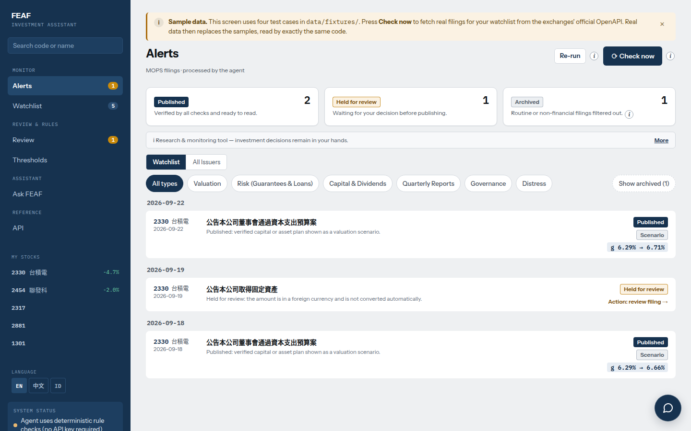
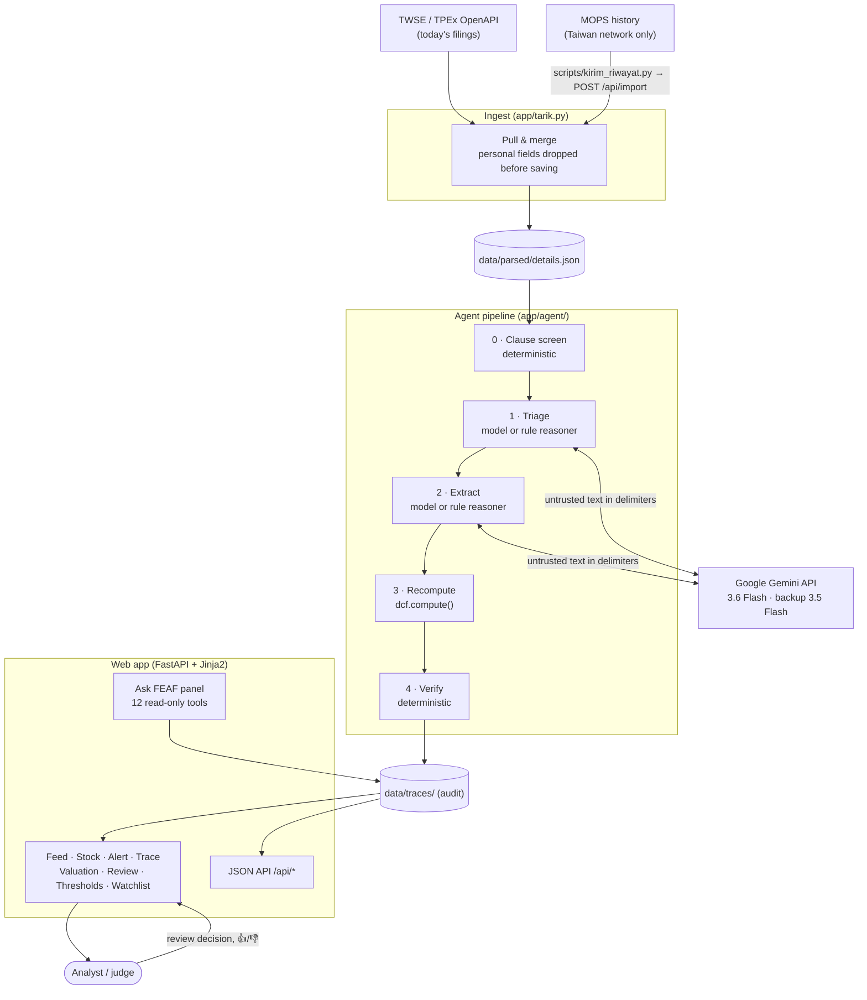
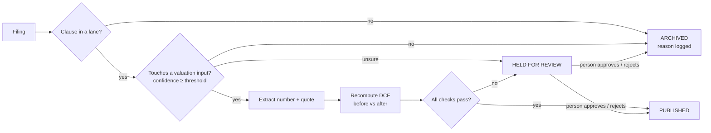
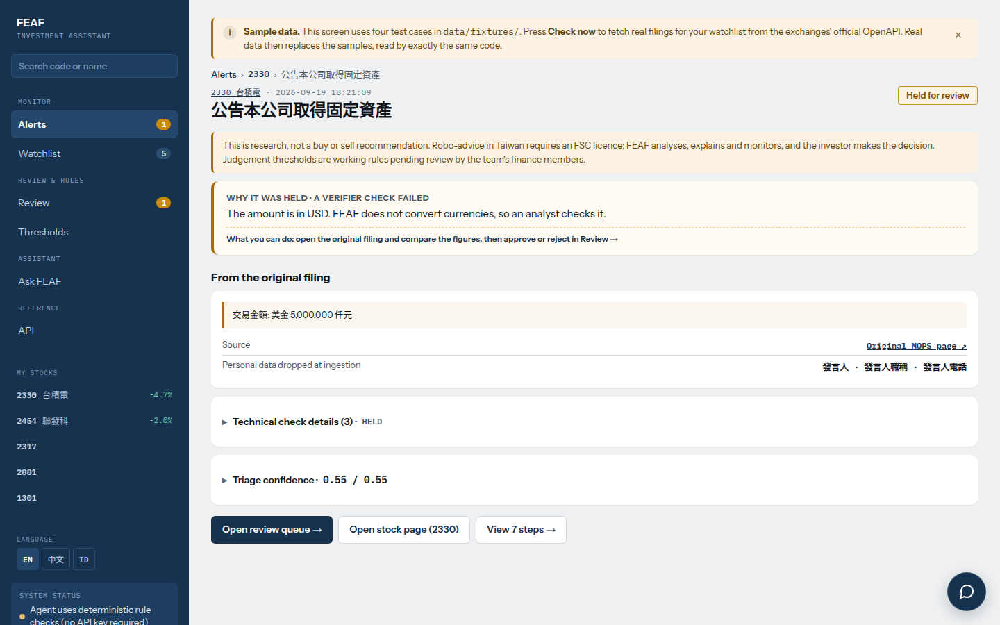
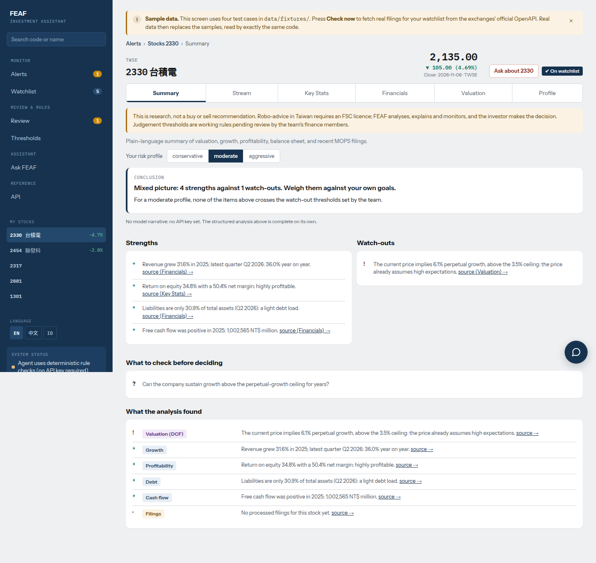
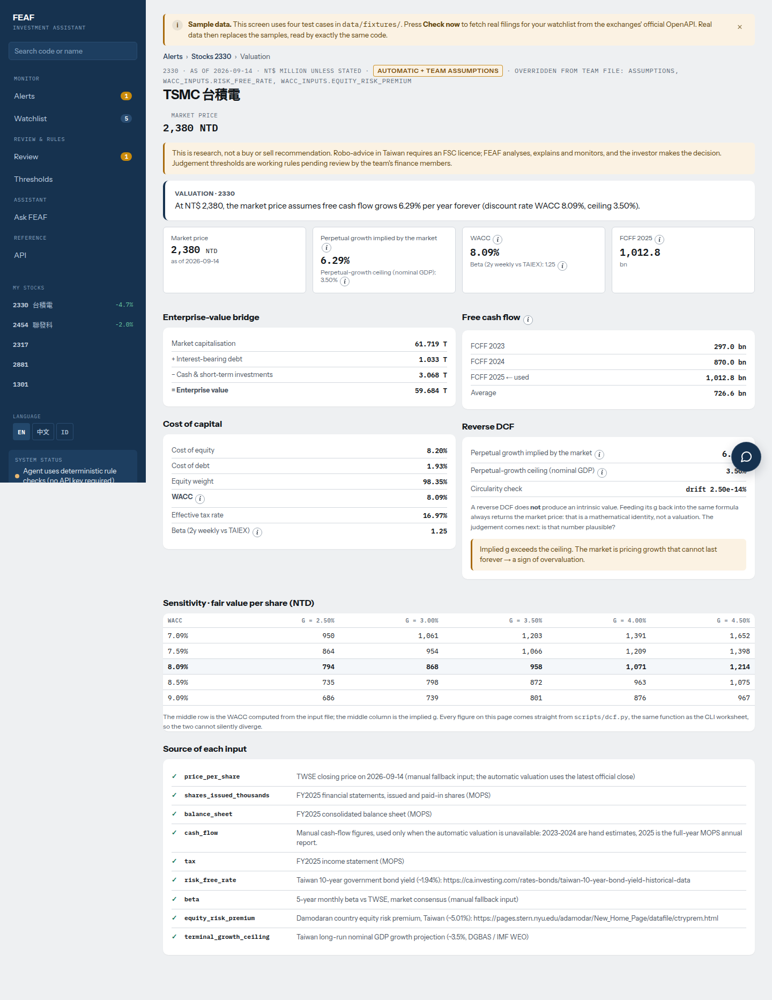
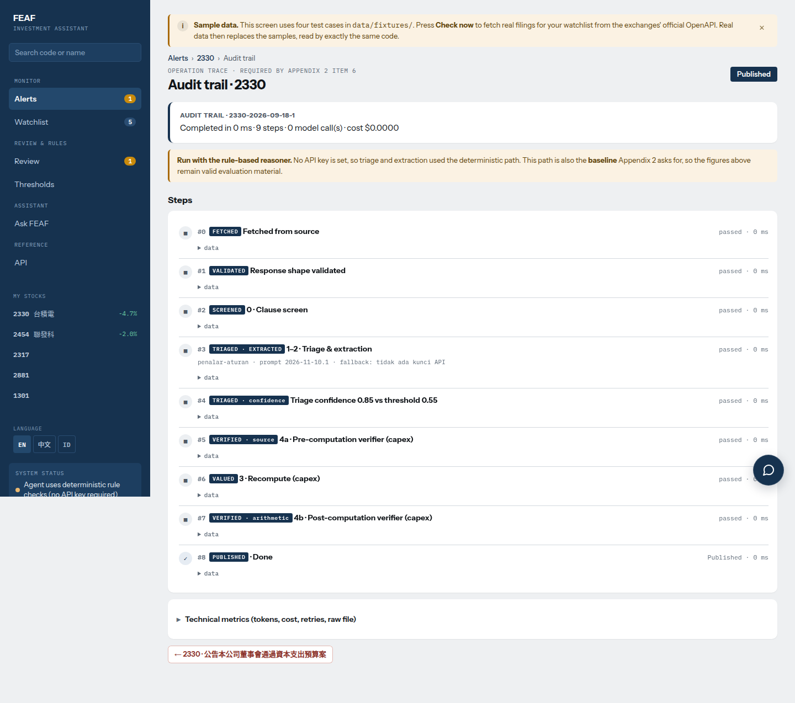
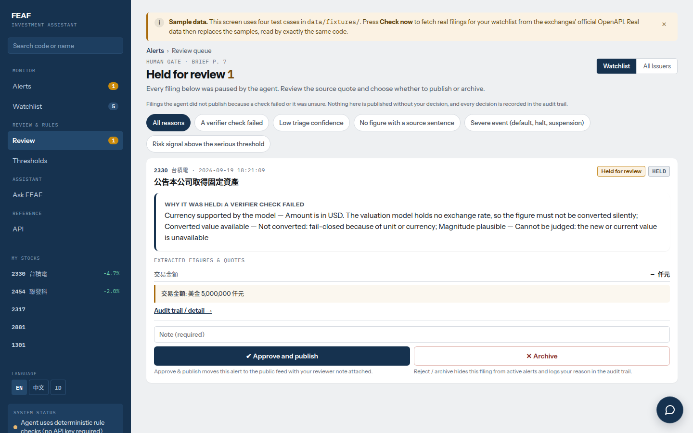
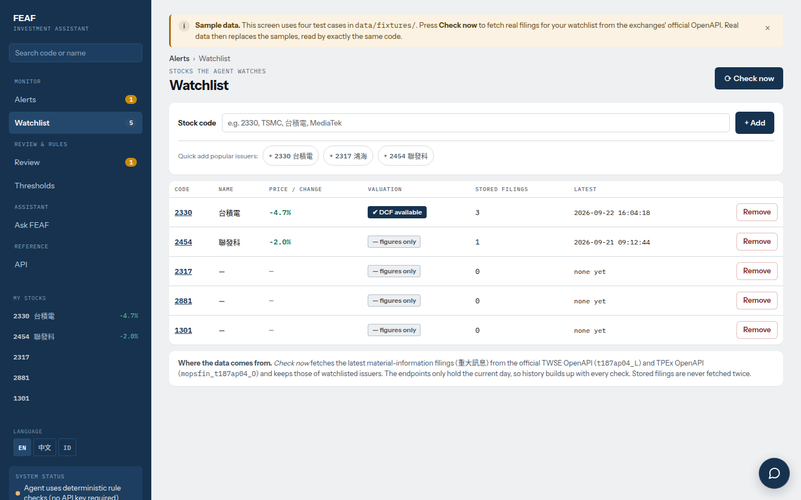
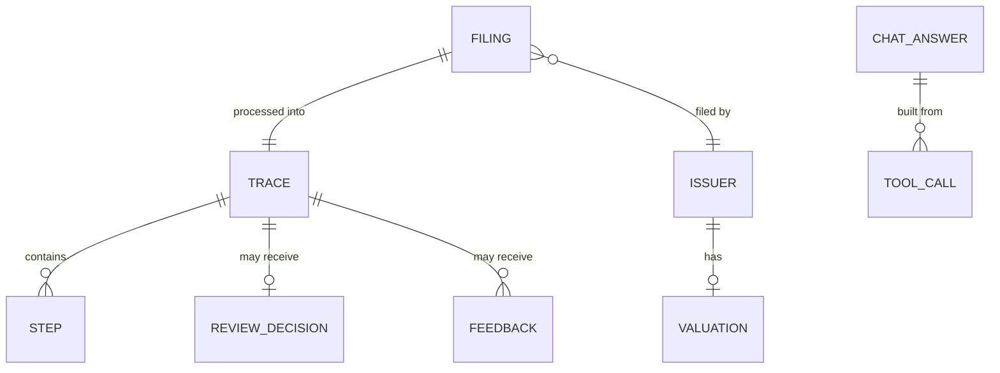

# FEAF — Agentic AI Investment Assistant

<div align="center">

**English** · [繁體中文](README.zh-TW.md) · [Bahasa Indonesia](README.id.md) · [Tiếng Việt](README.vi.md)



**FEAF** is an agent that watches official Taiwan exchange filings (MOPS 重大訊息), works out which valuation input each filing touches, recalculates the valuation when the numbers change, and **refuses to publish an alert** when a number cannot be traced back to the filing it came from. Built for the NAPAI Agentic AI Innovation Competition 2026 (AAIC 2026), SYSTEX track: *Investment Intelligence & AI-Powered Stock Selection Agent*.

[](CHANGELOG.md)
[](https://www.python.org/)
[](https://fastapi.tiangolo.com/)
[](https://www.uvicorn.org/)
[](https://jinja.palletsprojects.com/)
[](https://ai.google.dev/)
[](#95-tests)
[](#38-three-language-interface)
[](LICENSE)

</div>

> [!IMPORTANT]
> **Not a trading tool.** There is no broker connection and no order execution, and the agent gives no buy or sell advice. It screens, explains and cites; a person decides.

---

## 📑 Table of Contents
- [1. Executive Summary & Value Proposition](#1-executive-summary--value-proposition)
- [2. System Architecture & High-Level Design](#2-system-architecture--high-level-design)
  - [2.1 High-Level Architecture Diagram](#21-high-level-architecture-diagram)
  - [2.2 Agent Pipeline & Decision States](#22-agent-pipeline--decision-states)
  - [2.3 Lanes by Clause](#23-lanes-by-clause)
  - [2.4 What the Verifier Checks](#24-what-the-verifier-checks)
  - [2.5 Model, Versions & Safeguards](#25-model-versions--safeguards)
- [3. Core Features & Capabilities](#3-core-features--capabilities)
- [4. Data Storage & Audit Trail](#4-data-storage--audit-trail)
- [5. API Reference](#5-api-reference)
- [6. Technology Stack & Technical Rationale](#6-technology-stack--technical-rationale)
- [7. Directory & Codebase Structure](#7-directory--codebase-structure)
- [8. Installation & Setup Guide](#8-installation--setup-guide)
- [9. Evaluation & Testing](#9-evaluation--testing)
- [10. Security, Privacy & Access Control](#10-security-privacy--access-control)
- [11. Known Limitations](#11-known-limitations)
- [12. Troubleshooting & Common FAQs](#12-troubleshooting--common-faqs)
- [13. Versioning & License](#13-versioning--license)

---

## 1. Executive Summary & Value Proposition

An analyst who follows Taiwan-listed companies has to read every material filing, decide whether it changes a valuation input, find the exact number, convert units, and redo the model. By hand that takes **20–30 minutes per filing** (measured by the finance team member who labelled the gold set). The risk is not only time: an AI pipeline that "reads" filings can publish a wrong number with full confidence.

**FEAF** turns that workflow into an auditable agent:
- **Clause-aware screening:** the 重大訊息 clause number decides the lane (valuation scenario, risk signal, capital signal, report signal, severe, governance, or skip) before any model is called.
- **Model reads, arithmetic decides:** the model only says *which input* and *which quoted number*; recomputation and verification are deterministic code.
- **Fail-closed verification:** a number that is not in the filing, has an unknown unit, a foreign currency, or an implausible magnitude is **held for a person**, never published.
- **Full operation trace:** every stage, model call, token count, latency and checker verdict is stored and viewable at `/jejak/{id}` and `GET /api/traces/{id}`.
- **Human in the loop:** a review queue for held cases and 👍/👎 feedback that tunes per-clause triage thresholds.
- **Ask FEAF chat:** answers only from read-only tool results, every number checked, buy/sell advice refused.

Results on a 46-filing gold set labelled by a finance team member (official numbers, measured before any tuning): **0 wrong numbers published**, 41/46 publish/hold/archive decisions match the expert, 13/46 sent to a person. Without the checker, 5 wrong numbers were published. Details in [Evaluation](#9-evaluation--testing).

---

## 2. System Architecture & High-Level Design

### 2.1 High-Level Architecture Diagram



### 2.2 Agent Pipeline & Decision States



**Stages 3 and 4 never use a model.** Numbers come from arithmetic, and every claim the model makes is checked back against the filing. The model never calculates and never grades itself. Without an API key, stages 1 and 2 fall back to a rule-based reasoner, which is also the baseline the evaluation compares against. The screen and the trace always say which one ran.

### 2.3 Lanes by Clause

The clause list and thresholds were set with the team's finance members. Full mapping and the reasoning behind each decision: [`docs/pemetaan-pasal.md`](docs/pemetaan-pasal.md).

| Clause | Lane | What happens |
|---|---|---|
| **20** (asset acquisition / disposal) | Valuation scenario | DCF recomputed as an "if this is realised" scenario. DCF is cash-based: a plan does not move the valuation until a quarterly report shows the cash. Deals with a 100%-owned subsidiary are archived (cash stays in the group) |
| **22, 23** (guarantees, loans of funds) | Risk signal | Balance ÷ equity, limit usage, per recipient, related vs outside party. Loans ≥ 40% of equity are flagged |
| **11, 35** (capital changes, bonds, buybacks) | Capital signal | Dilution and money amounts against materiality thresholds (shares ≥ 1%, money ≥ 2% of market cap) |
| **31** (quarterly reports) | Report signal | Profit/loss, debt ratio. Losses written in brackets `(339,123)` are read as negative |
| **1, 3, 40** (default, halt of production, trading suspension) | Severe | Always held for a person |
| **7, 8** (auditor change, key officer change) | Governance | Published as information; officer names are never extracted |
| **6, 51, 53** and others | Skipped | Never reach the model |

Signal level (info / attention / serious) depends on a risk profile (conservative / moderate / aggressive) chosen on screen; thresholds live in `app/ambang_profil.py`. The server uses *moderate* (the finance team's answers) for hold decisions.

### 2.4 What the Verifier Checks

| Check | Catches |
|---|---|
| Item label allowed for the input | Quotes taken from free-text notes, where injected instructions usually sit |
| Quote exists in the filing | Invented source sentences |
| Digits exist in the filing | Hallucinated numbers |
| Supported currency | USD amounts silently converted without an exchange rate |
| Known unit | 仟元 / 百萬元 / 億元 mix-ups (thousand-fold errors) |
| Magnitude within 0.2–3.0× of the base | Wrong item, or an injected number |
| Circularity intact | Arithmetic bugs in the calculator |

### 2.5 Model, Versions & Safeguards

| | |
|---|---|
| **Provider** | Google Gemini API (`generativelanguage.googleapis.com`), paid tier |
| **Main model** | `gemini-3.6-flash`, temperature 0 |
| **Backup model** | `gemini-3.5-flash`, used only when the main model is busy (429/5xx) after retries |
| **Pipeline prompt version** | `VERSI_PROMPT` in `app/agent/llm.py` (currently `2026-11-10.1`) |
| **Chat prompt version** | `PROMPT_VERSION` in `app/chat.py` (currently `chat-2026-11-12.1`) |
| **Baseline** | Rule-based reasoner in `app/agent/screen.py` / `extract.py` |

Safeguards around the model: answers are cached per filing and prompt version; each pipeline run is capped at 40 model calls and 90 seconds (the cap belongs to the pipeline thread only, so web requests are never blocked by it); three failures in a row switch the rest of the run to the rule-based reasoner; an exhausted prepaid balance (HTTP 402) is reported in `/health` and never retried. Each fallback and its reason is written to the trace.

Only public MOPS filings are sent to the model, with personal fields already removed. No SYSTEX or partner data is sent to any model.

---

## 3. Core Features & Capabilities

### 3.1 Alert Feed (`/`)
Published and held alerts grouped by date, with plain-language reasons, status/type filters, a search box with autocomplete, and **Check now** (pull new filings) / **Re-run** (reprocess existing data). Archived filings are hidden by default and one click away.

### 3.2 Stock Page (`/saham/{code}`)
Six tabs: summary (strengths, watch-outs and an AI narrative per risk profile), filing stream, financial statements (income, balance sheet, cash flow; quarterly/yearly; YoY) with MOPS citations, market statistics, valuation, and company profile.

### 3.3 Alert Detail & Operation Trace (`/peringatan/{id}`, `/jejak/{id}`)
The alert shows the MOPS citation, the checker verdict, and — for held cases — one plain sentence per failed check type, with the technical detail folded away. The trace lists every step, model call, token count, latency and fallback reason.

### 3.4 Valuation (`/valuasi/{code}`)
`scripts/dcf.py` is a standalone DCF calculator; the web app calls the same `compute()`, so the screen cannot silently differ from the worksheet. `valuation/inputs/2330.json` is a manual worksheet with a source for every input. For other non-financial issuers, `app/valuasi_otomatis.py` builds the same input structure from exchange prices and FinMind financial statements, cached for 12 hours ([`docs/valuasi-otomatis.md`](docs/valuasi-otomatis.md)). The page shows cost of capital, reverse-DCF implied growth, sensitivity, and the source of each input. Financial companies (banks, insurers) get no DCF.

### 3.5 Human Review Queue (`/review`)
Held cases wait here. A person approves (only where approval is allowed) or rejects with a note; the decision is stored and shown in the trace.

### 3.6 Feedback-Tuned Thresholds (`/ambang`)
Triage confidence thresholds per clause, adjusted by 👍/👎 feedback on alerts, with full change history.

### 3.7 Ask FEAF Chat (panel on every page, `/tanya`)
- **12 read-only tools**: 6 stock tools (`harga`, `statistik`, `laporan`, `pengumuman`, `valuasi`, `ringkasan`) and 6 menu tools (`feed`, `peringatan`, `jejak`, `review`, `ambang`, `watchlist`). No tool changes data, and none returns raw items or officer/spokesperson names.
- **Multi-turn with signed history**: the browser keeps up to 12 messages in `sessionStorage`; the server accepts at most the last 6 verified turns. Every assistant answer carries an HMAC-SHA256 tag (`SENTINEL_CHAT_RAHASIA`); unsigned or modified turns and injection attempts are dropped and logged.
- **Follow-ups and Recap**: the active stock code is resolved from the question, the page, or the last verified turn. **Recap** summarises verified turns in at most 5 bullets, every number re-checked.
- **Verification and refusal**: every number in an answer must exist in the current tool output, the question, or a signed turn. Buy/sell advice, price predictions, orders, personal data and prompt injections are refused before any tool or model call. Model calls are capped at 60 per hour.

### 3.8 Three-Language Interface
Every page is available in English (default), 繁體中文 and Bahasa Indonesia, switchable from the side menu. Numbers follow the language (`1,480,000.5` vs `1.480.000,5`). The layout is responsive down to 390 px phones.

<details>
<summary><b>📸 Screenshots</b> (click to expand)</summary>

| Held alert | Stock summary |
|---|---|
|  |  |
| **Valuation** | **Operation trace** |
|  |  |
| **Review queue** | **Watchlist** |
|  |  |

</details>

---

## 4. Data Storage & Audit Trail

There is no database. Everything lives as JSON under `SENTINEL_DATA_DIR` (`./data` locally, the `/data` volume in Docker), so it survives redeploys and can be inspected with any text editor.



| Path (under `DATA_DIR`) | Content |
|---|---|
| `parsed/details.json` | Pulled filings, merged without duplicates, personal fields already removed |
| `raw/openapi/` | Raw daily OpenAPI snapshots |
| `traces/` | One operation trace per filing: `state`, `status`, `alasan`, `muatan`, `jejak` (steps), `ringkasan` (tokens, cost, latency) |
| `traces_chat/` | One trace per Ask FEAF answer |
| `watchlist.json`, `status_tarik.json` | Watched codes and the last pull status |
| `keputusan_review.json` | Human review decisions |
| `umpan_balik.json` | 👍/👎 feedback and threshold history |
| `cache_model/` | Model answers cached per filing and prompt version |
| `pasar/`, `valuasi_otomatis/` | Market data cache and auto-built DCF inputs |
| `indeks_nama.json` | Issuer name index for search |

---

## 5. API Reference

The server runs on `http://127.0.0.1:8000`; interactive OpenAPI docs are at **`/docs`**. Since **v1.2.0** every endpoint has an English path. The old Indonesian paths (`/api/peringatan`, `/api/jejak/{id}`, `/sehat`, `/periksa`, `/api/impor`, `/api/tanya`, …) still answer exactly the same way but are hidden from `/docs`. JSON field names are unchanged.

| Method & path | Purpose | Legacy path |
|---|---|---|
| `GET /health` | Health check: version, code hash, model in use, fallback reasons | `/sehat` |
| `GET /api/alerts` | Processing result of every filing | `/api/peringatan` |
| `GET /api/traces/{id}` | Operation trace of one filing | `/api/jejak/{id}` |
| `GET /api/valuation/{code}` | DCF calculator output | `/api/valuasi/{code}` |
| `GET /api/stocks/{code}/financials` | Financial statement table | `/api/saham/{code}/keuangan` |
| `GET /api/review` | Review queue and human decisions | — |
| `GET /api/thresholds` | Triage thresholds per clause and history | `/api/ambang` |
| `GET /api/watchlist` | Watched codes and last pull status | — |
| `GET /api/search?q=` | Search issuers by code or name | `/api/cari` |
| `POST /api/ask` | Ask FEAF | `/api/tanya` |
| `GET /api/ask/traces/{id}` | Trace of one Ask FEAF answer | `/api/tanya/jejak/{id}` |
| `POST /check` | Pull new filings for the watchlist and reprocess (form post) | `/periksa` |
| `POST /api/import` | Import MOPS history pulled on a Taiwan network | `/api/impor` |

When `SENTINEL_KUNCI_BACA=1`, every `/api/*` call needs the access cookie; `/health` and `/api/import` stay reachable.

### 5.1 Health Check (`GET /health`)
- **Response `200 OK`:**
  ```json
  {
    "ok": true,
    "versi": "1.2.0",
    "versi_kode": "13fb64cf5c",
    "sumber": "openapi",
    "pengumuman": 2437,
    "jalan_terakhir": "2026-11-13T03:23:10+00:00",
    "galat_model_terakhir": null,
    "mesin": "gemini",
    "model_utama": "gemini-3.6-flash",
    "model_dicoret_404": [],
    "valuasi_otomatis_tersimpan": 40
  }
  ```
  `versi_kode` is a hash of `app/*.py`; compare it with `python3 -c "from app.main import VERSI_KODE; print(VERSI_KODE)"` to confirm the server runs your checkout.

---

### 5.2 List Alerts (`GET /api/alerts`)
Returns every processed filing. `status` is `terbit` (published), `ditahan` (held) or `dilewati` (archived).
- **Response `200 OK`:**
  ```json
  [
    {
      "id": "2330-2026-09-18-1",
      "status": "terbit",
      "emiten": { "kode": "2330", "nama": "台積電" },
      "judul": "公告本公司董事會通過資本支出預算案",
      "tanggal": "2026-09-18",
      "alasan": "1 temuan lolos seluruh pemeriksaan; skenario bila terealisasi.",
      "sumber_url": "https://mops.twse.com.tw/mops/web/t05st01?TYPEK=sii&co_id=2330&seq_no=1&...",
      "ringkasan": {
        "durasi_total_ms": 0, "langkah": 9, "token_masuk": 0, "token_keluar": 0,
        "biaya_usd": 0.0, "retry": 0, "pakai_cadangan": true, "panggilan_model": 0
      }
    }
  ]
  ```

---

### 5.3 Operation Trace (`GET /api/traces/{id}`)
Full audit record of one filing: machine `state` (`PUBLISHED` / `HELD` / `ARCHIVED`), triage, payload, every step in `jejak`, personal fields dropped (`pii_dibuang`), and cost/latency summary.
- **Response `200 OK`** (abridged):
  ```json
  {
    "id": "2330-2026-09-18-1",
    "state": "PUBLISHED",
    "status": "terbit",
    "jenis": "skenario",
    "triase": { ... },
    "muatan": { ... },
    "jejak": [ { "tahap": "...", "masuk": { ... }, "keluar": { ... }, "durasi_ms": 0 } ],
    "pii_dibuang": [ ... ],
    "keputusan_manusia": null,
    "ringkasan": { ... }
  }
  ```
- **Response `404`:** `{"detail": "Trace not found"}`

---

### 5.4 Valuation (`GET /api/valuation/{code}`)
DCF output from the same `compute()` the page uses.
- **Response `200 OK`** (abridged):
  ```json
  {
    "code": "2330",
    "name": "TSMC 台積電",
    "as_of": "2026-09-14",
    "market_cap": 61719407.12,
    "net_debt": -2035506.1,
    "wacc": 0.0809,
    "implied_growth": 0.0629,
    "terminal_growth_ceiling": 0.035,
    "price_per_share": 2380,
    "fcff_series": { ... },
    "sensitivity": { ... },
    "sources": { ... }
  }
  ```
- **Response `404`:** `{"detail": "Unknown stock code"}` or `{"detail": "No valuation file yet for 1234"}`

---

### 5.5 Financial Statements (`GET /api/stocks/{code}/financials`)
- **Query parameters:** `lap` = `lr` (income) · `neraca` (balance sheet) · `arus` (cash flow); `per` = `q` (quarterly) · `y` (yearly); `mode` = `nilai` (values) · `yoy` (year-on-year).
- **Response `200 OK`:** `{"kolom": [{"tgl": "2026-09-30", "label": "Q3 2026"}, ...], "baris": [...], ...}`

---

### 5.6 Review Queue, Thresholds, Watchlist, Search
- `GET /api/review` → `{"menunggu": [{"id", "emiten", "judul", "alasan", "boleh_setujui"}], "keputusan": {...}}`
- `GET /api/thresholds` → `{"ambang": {...}, "riwayat": [...], "aturan": {...}}`
- `GET /api/watchlist` → `{"kode": ["2330", "2454", "2317", "2881", "1301"], "status_tarik": {...}}`
- `GET /api/search?q=2330` → `[{"kode": "2330", "nama": "台積電", "nama_en": "TSMC", "bursa": "TWSE"}]`

---

### 5.7 Ask FEAF (`POST /api/ask`)
- **Request body** (English field names since v1.2.0; the old `pertanyaan`, `bahasa`, `riwayat`, `konteks`, `jenis` still work):
  ```json
  {
    "question": "What changed in TSMC's latest filing?",
    "language": "en",
    "history": [],
    "context": { "kode": "2330" }
  }
  ```
- **Response `200 OK`:**
  ```json
  {
    "id": "20261114T050406-a1b2c3",
    "jalur": "model",
    "jawaban": "…",
    "sumber": [ ... ],
    "tautan": [ ... ],
    "tanda": "32-hex HMAC tag",
    "periksa": { "lolos": true, ... },
    "ditolak": false,
    "durasi_ms": 4400,
    "panggilan_model": 1,
    "panggilan_alat": [ ... ]
  }
  ```

---

### 5.8 Import MOPS History (`POST /api/import`)
Used by `scripts/kirim_riwayat.py` from a laptop on a Taiwan network. Closed entirely unless `SENTINEL_KODE_AKSES` is set on the server.
- **Headers:** `X-Access-Code: <SENTINEL_KODE_AKSES>` (legacy `X-Kode-Akses` accepted), `Content-Type: application/json`
- **Body:** JSON array of filings, max 25 MB per request. The server re-validates and drops personal fields again.
- **Response `200 OK`:** `{"diterima": 120, "baru": 37, "ditolak": 0, "contoh_tolak": []}`
- **Errors:** `403` wrong code / import disabled · `413` payload too large · `400` body is not JSON

---

## 6. Technology Stack & Technical Rationale

| Category | Technology | Rationale |
|---|---|---|
| **Language** | Python 3.12+ | One language for pipeline, calculator, evaluation and web; standard library covers most needs |
| **Web framework** | FastAPI 0.141.1 + Uvicorn 0.38.0 | Async server, typed routes, free OpenAPI docs at `/docs` |
| **Templating** | Jinja2 3.1.6, vanilla JS, plain CSS | Server-rendered pages work without JavaScript; no build step |
| **Model** | Google Gemini 3.6 Flash (backup 3.5 Flash) | Low cost per filing (~USD 0.007 for 46 filings), temperature 0, cached per prompt version |
| **Fallback reasoner** | Rule-based screen/extract in `app/agent/` | Runs with no API key; doubles as the evaluation baseline |
| **Valuation** | `scripts/dcf.py` (pure Python) | One `compute()` shared by worksheet, page and API |
| **Data sources** | TWSE / TPEx OpenAPI, MOPS, FinMind | Official exchange data; FinMind for financial statements |
| **Storage** | JSON files on a volume | No database to run; every record is human-readable for audit |
| **Deploy** | Docker / Dokploy | Single container, `/data` volume, health check on `/health` |
| **Tests** | `unittest` + FastAPI `TestClient` (httpx) | 301 tests, no network access |

---

## 7. Directory & Codebase Structure

```text
napaincu-ai-comp/
├── app/
│   ├── main.py              # FastAPI app, pages, JSON API, access control
│   ├── chat.py              # Ask FEAF: tools, signed history, checker
│   ├── agent/               # pipeline stages: screen, triase, extract, recompute, verify, sinyal, llm
│   ├── tarik.py             # pull & merge filings, watchlist, import validation
│   ├── valuasi_otomatis.py  # auto-built DCF inputs for non-financial issuers
│   ├── ambang_profil.py     # signal thresholds per risk profile
│   ├── review.py, umpan_balik.py  # human decisions and 👍/👎 thresholds
│   ├── i18n.py, teks/       # interface text in three languages
│   ├── templates/, static/  # Jinja2 pages, CSS, JS
│   └── versi.py             # release number shown in /health and /docs
├── scripts/                 # pulls, DCF calculator, evaluation, attack set, QA scripts
├── valuation/inputs/        # manual DCF worksheets with a source for every input
├── eval/                    # gold set, Ask FEAF test sets, evaluation reports
├── tests/                   # unit and end-to-end tests (no network)
├── data/fixtures/           # four sample filings so the app runs anywhere
├── docs/                    # system design, flow diagrams, clause mapping, deploy guide
├── slides/                  # final deck and its build scripts
├── Dockerfile, requirements.txt, environment.yml
└── CHANGELOG.md, LICENSE
```

More detail: [System design](docs/system-design.md) · [Flow diagrams](docs/diagram-alur.md).

---

## 8. Installation & Setup Guide

### 8.1 Quick Local Setup

Requirements: Python 3.12 or newer, Git, internet access (TWSE/TPEx OpenAPI). No database.

```bash
git clone <repository-url> napaincu-ai-comp
cd napaincu-ai-comp
python3 -m venv .venv
source .venv/bin/activate          # Windows: .venv\Scripts\activate
pip install -r requirements.txt
uvicorn app.main:app --reload
```

Prefer conda? `conda env create -f environment.yml && conda activate sentinel-saham`.

Open <http://127.0.0.1:8000>. On the first run the feed shows clearly marked sample filings. Press **Check now** (or add a stock on **Watchlist**) to pull today's real filings from TWSE/TPEx. The interface defaults to English; switch to 中文 or ID in the left menu.

### 8.2 Environment Variables

Set before `uvicorn` (`export NAME=value`; on Windows PowerShell `$env:NAME="value"`).

| Name | Default | Purpose |
|---|---|---|
| `GEMINI_API_KEY` or `GOOGLE_API_KEY` | — | Model key. Without it the rule-based reasoner is used |
| `SENTINEL_MODEL` | `gemini-3.6-flash` | Main model |
| `SENTINEL_MODEL_CADANGAN` | `gemini-3.5-flash` | Backup models, comma-separated |
| `SENTINEL_PENYEDIA` | `gemini` | Model provider |
| `SENTINEL_MODEL_MAKS_PER_JALAN` | `40` | Model calls allowed per run |
| `SENTINEL_RETRY` | `2` | Retries before falling back |
| `SENTINEL_TIMEOUT` | `45` | Model call timeout (seconds) |
| `SENTINEL_TRIAGE_THRESHOLD` | `0.55` | Triage confidence threshold |
| `SENTINEL_DATA_DIR` | `./data` (`/data` in Docker) | Where pulled data and traces live |
| `SENTINEL_TARIK_OTOMATIS_DETIK` | `0` (off) | Pull new filings every N seconds (minimum 300) |
| `SENTINEL_PROSES_SEMUA` | `1` | Process filings of all issuers, not only the watchlist |
| `SENTINEL_KODE_AKSES` | — | Access code for actions and import |
| `SENTINEL_KUNCI_BACA` | `0` | `1` = access code also required for reading |
| `SENTINEL_SERTAKAN_CONTOH` | `0` | `1` = show the four sample filings next to real data |
| `SENTINEL_CHAT_MAKS_PER_JAM` | `60` | Ask FEAF questions per hour |
| `SENTINEL_CHAT_RAHASIA` | random per process | Secret for HMAC-SHA256 signing of chat turns |
| `FINMIND_TOKEN` | — | Higher FinMind quota for financial statements |

### 8.3 Pulling Real Filings

Open **Watchlist**, add a stock code, then press **Check now**. From a terminal:

```bash
python3 scripts/tarik.py                 # pull for the watchlist in data/watchlist.json
python3 scripts/tarik.py --ulang 600     # check every 10 minutes until Ctrl+C
```

The sources are the official TWSE (`t187ap04_L`) and TPEx (`mopsfin_t187ap04_O`) OpenAPI endpoints. They carry the full text of today's material filings and are reachable from outside Taiwan. They keep no history, so every pull is merged into `data/parsed/details.json` without duplicates. Older history can only be pulled from MOPS on a Taiwan network (`scripts/spike_mops.py` → `parse_mops.py` → `fetch_details.py`, see [`docs/tarik-riwayat.md`](docs/tarik-riwayat.md)) and uploaded with `scripts/kirim_riwayat.py` to `POST /api/import`.

### 8.4 Deploy (Docker / Dokploy)

```bash
docker build -t feaf .
docker run -p 8000:8000 -v feaf-data:/data -e SENTINEL_TARIK_OTOMATIS_DETIK=600 feaf
```

Pulled filings, the watchlist, audit traces and review decisions live in the `/data` volume and survive redeploys. The container health check calls `GET /health`. Full Dokploy steps: [`docs/deploy-dokploy.md`](docs/deploy-dokploy.md).

---

## 9. Evaluation & Testing

```bash
python3 scripts/evaluasi.py --simpan                    # gold set: agent vs no checker
python3 scripts/evaluasi.py --chat --simpan             # Ask FEAF single-turn set (52 questions)
python3 scripts/evaluasi.py --chat-percakapan --simpan  # Ask FEAF multi-turn set (12 scenarios, 36 turns)
python3 scripts/uji_serangan.py --simpan                # attack set
```

Reports are written to `eval/hasil/` (inside the Docker image, where `/app` is read-only, to `/data/eval-hasil/`). The 46 gold filings ship in `eval/gold_dokumen.json` (name-bearing items removed, market caps as of the official run), so the evaluation reproduces on any machine without pulling data. Add `--tanpa-cache` to measure real model latency and cost. Gold set and labelling guide: [`docs/hasil-gold-set.md`](docs/hasil-gold-set.md), [`docs/panduan-gold-set.md`](docs/panduan-gold-set.md).

### 9.1 Gold Set
46 real filings from 9 Nov 2026, about 7 per lane, labelled publish / hold / archive and signal level by a finance team member. Success = the agent makes the same decision and publishes no wrong number. Baseline ("without checker"): the same clause screen and extractor with no checker and no hold rules, so anything extracted is published, as a plain LLM pipeline would.

| Metric | FEAF agent | Without checker |
|---|---|---|
| Wrong numbers published | **0/46** | 5/46 |
| Decision matches expert | **41/46 (89%)** | 15/46 (33%) |
| Signal level matches expert (moderate profile) | **21/29 (72%)** | 0/29 |
| Held for a person (human intervention) | 13/46 (28%) | 33/46 (72%) |

These numbers were measured **before** tuning. The disagreements exposed two parser bugs (losses in brackets read as profits; share counts in 仟股 not read) and three thresholds; all were fixed afterwards. On the same 46 filings the tuned agent scores 43/46 and 29/29, but that is in-sample and is not reported as accuracy.

### 9.2 Model Path on the Server
Gemini 3.6 Flash, fresh calls, 11 Nov: 0/46 wrong numbers published (without checker: 5/46), mean latency 0.7 s per filing (max 9.9 s), 5 model calls, 7,212 input / 392 output tokens, about **USD 0.007 for all 46 filings** at paid-tier prices. Only clause-20 filings call the model. Full write-up with error categories, the live-server intervention rate (12% held) and an annotated trace: [`docs/laporan-evaluasi.md`](docs/laporan-evaluasi.md).

### 9.3 Attack Set
12 attack types on real filings (injected instructions, invented numbers and quotes, fake labels, unit swaps, foreign currency, extreme magnitudes), 72 cases, attacked by both the rule-based reasoner and a simulated model that obeys every injection: **0 wrong numbers published** ([report](eval/hasil/serangan-2026-11-10.md)).

### 9.4 Ask FEAF
- **Single-turn** (52 questions, three languages): with Gemini 3.6 Flash on the server, 27/27 advice, out-of-scope and injection questions refused, 0 recommendation words reached the user, 50/52 correct (the two misses were checker false positives, since fixed); 52/52 on the rule path. Mean latency 4.4 s with the model, 0.2 s on the rule path.
- **Multi-turn** (12 scenarios × 3 turns = 36 turns in EN, 中文 and ID): **36/36 turns and 12/12 scenarios** on the rule path, 0 recommendation words, 1 injected history turn dropped.

Operations on 581 real filings: 318 passed the clause screen, 241 published, 58 held (10%), the rest archived with a logged reason; rule-path latency mean 1 ms, max 29 ms.

### 9.5 Tests

```bash
python3 -m unittest discover -s tests   # 301 tests, no network
python3 scripts/qa_halaman.py           # every page × 3 languages (84/84)
```

The tests include the attack set, multi-turn chat security, the English API paths and their legacy aliases, the rule that API keys never reach a file, page or trace, and the rule that personal names never reach the model or the gold-set export. They pass on local data and on an empty `SENTINEL_DATA_DIR`.

---

## 10. Security, Privacy & Access Control

### 10.1 Data Privacy
- `scripts/fetch_details.py` and `app/tarik.py` drop `發言人`, `發言人職稱` and `發言人電話` **before anything is saved**. Only the fact that a field was dropped is logged, never its value.
- Names of officers, directors and auditors (clauses 1, 6, 7, 8) are never extracted, shown or exported.
- Filing text is treated as **untrusted data**: it enters the prompt inside delimiters, the system instruction says nothing inside may be followed, and injection attempts are logged.
- API keys are read from the environment only and never written to a file, page, log or trace (tested).

### 10.2 Access Levels

| Setting | Effect |
|---|---|
| none | Every page readable; actions (watchlist, Check now, review, thresholds) open |
| `SENTINEL_KODE_AKSES=<code>` | Actions need the code once (`/akses`); reading stays open |
| plus `SENTINEL_KUNCI_BACA=1` | Every page and `/api/*` need the code; `/health` and static files stay open. The `401` page is standalone and leaks no watchlist data; the access cookie is an HMAC digest, never the raw code |

The access code for the judges' environment is given through the competition form, not in this repository.

---

## 11. Known Limitations

1. **Clause 20 recalculations are scenarios, not forecasts.** A plan or board approval moves the valuation only once a quarterly report shows the cash.
2. **No valuation for financial companies** (banks, insurers). Their clause-20 filings are held.
3. **No currency conversion.** Non-NTD amounts are held, not converted.
4. **Today's filings only, outside Taiwan.** The OpenAPI endpoints keep no history; older filings need a pull from a Taiwan network.
5. **Conservative and aggressive profile thresholds** are proposals awaiting the finance team's review; the moderate profile is the team's answer.
6. **The tuned accuracy is in-sample.** A fresh, blind-labelled test set is needed for an out-of-sample figure.
7. **Reverse DCF gives no intrinsic value**; it gives the perpetual growth the market implies. Fair value is shown only as a scenario with a stated growth assumption.

Worst case and recovery: if the model is unavailable or out of credit, the run switches to the rule-based reasoner and says so on screen and in `/health`; if a number cannot be verified, the filing is held for a person rather than published.

---

## 12. Troubleshooting & Common FAQs

#### 1. The screen says "rule-based reasoner"
No API key in the environment. This is valid; set `GEMINI_API_KEY` for the model path.

#### 2. `/health` shows `galat_model_terakhir` with 402
The Gemini prepaid balance is empty. Top up in AI Studio billing.

#### 3. `/health` shows `sebab_cadangan` with a time limit
The 90-second run cap was reached; remaining filings are answered on the next runs.

#### 4. MOPS pull returns HTTP 200 but a block page
Geo-blocking. MOPS is only reachable from a Taiwan network; use the OpenAPI pull instead.

#### 5. The feed is empty
`data/parsed/` is empty; press **Check now** or set `SENTINEL_SERTAKAN_CONTOH=1`.

#### 6. No valuation on a stock page
Financial company, or FinMind quota reached (set `FINMIND_TOKEN`).

#### 7. The server behaves like an older version
Compare `versi_kode` in `/health` with your checkout.

#### 8. My script still calls `/api/peringatan` or `/sehat`
It keeps working. Legacy paths are aliases of the English ones; switch when convenient.

---

## 13. Versioning & License

FEAF follows [semantic versioning](https://semver.org/). The running version is shown in `/health` (`versi`) and in `/docs`; the number lives in `app/versi.py`. Release notes: [`CHANGELOG.md`](CHANGELOG.md).

| Version | Date | Highlights |
|---|---|---|
| **1.2.0** | 14 Nov 2026 | English API paths with legacy aliases, English OpenAPI docs, four-language README |
| 1.1.0 | 13 Nov 2026 | Ask FEAF panel on every page, UI overhaul, QA hardening |
| 1.0.0 | 12 Nov 2026 | Finalist package (AAIC 2026) |

All rights reserved. See [`LICENSE`](LICENSE). AAIC 2026 organisers and judges may run and inspect this repository to evaluate the entry. Third-party components and data keep their own licences ([`docs/pengungkapan-pihak-ketiga.md`](docs/pengungkapan-pihak-ketiga.md)).

---

<div align="center">

Built for analysts who need to know where every number came from.

**FEAF · Agentic AI Investment Assistant © 2026 Team FEAF. All Rights Reserved.**

[⬆ Back to top](#feaf--agentic-ai-investment-assistant)

</div>
