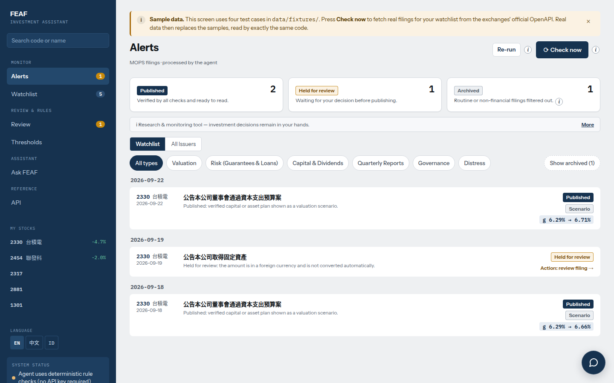
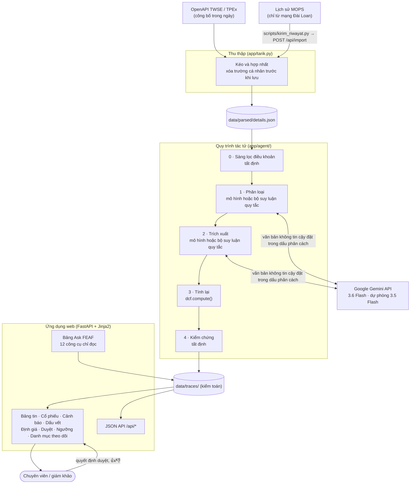
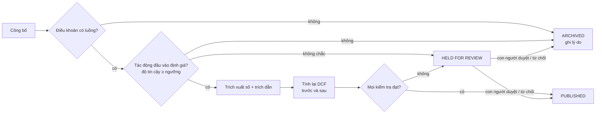
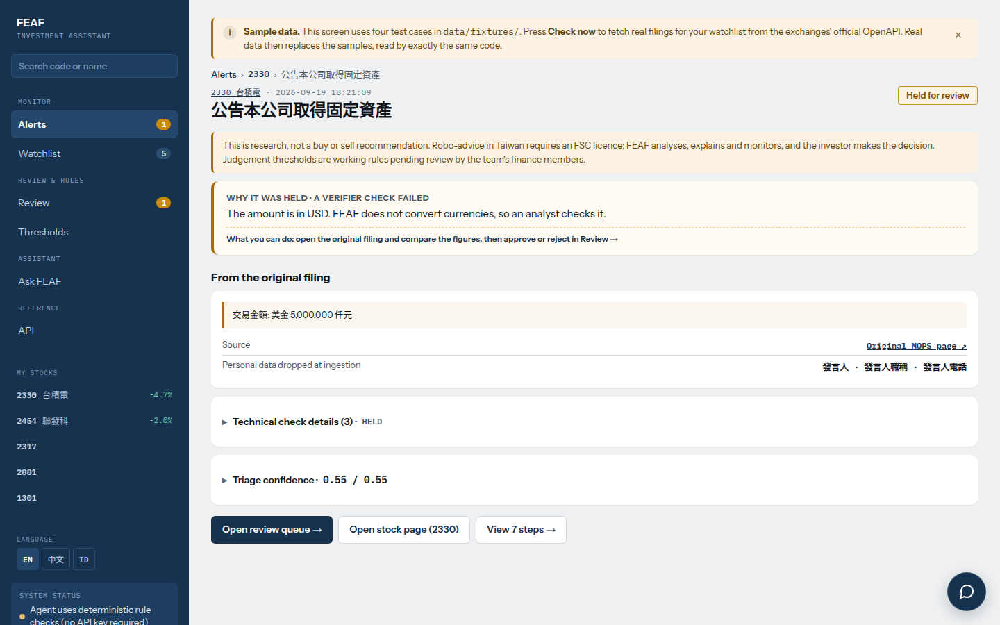
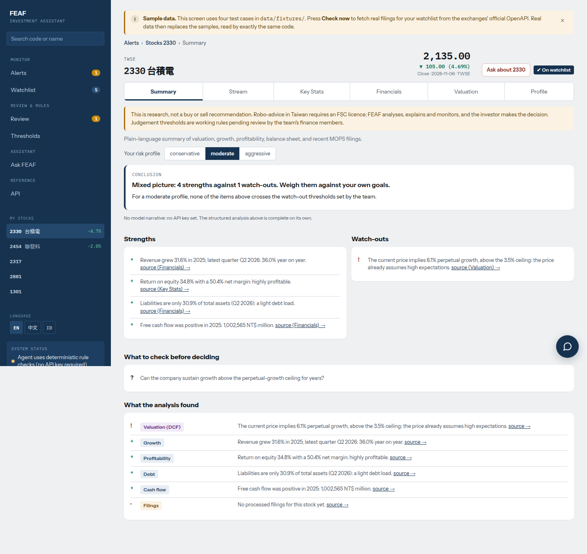
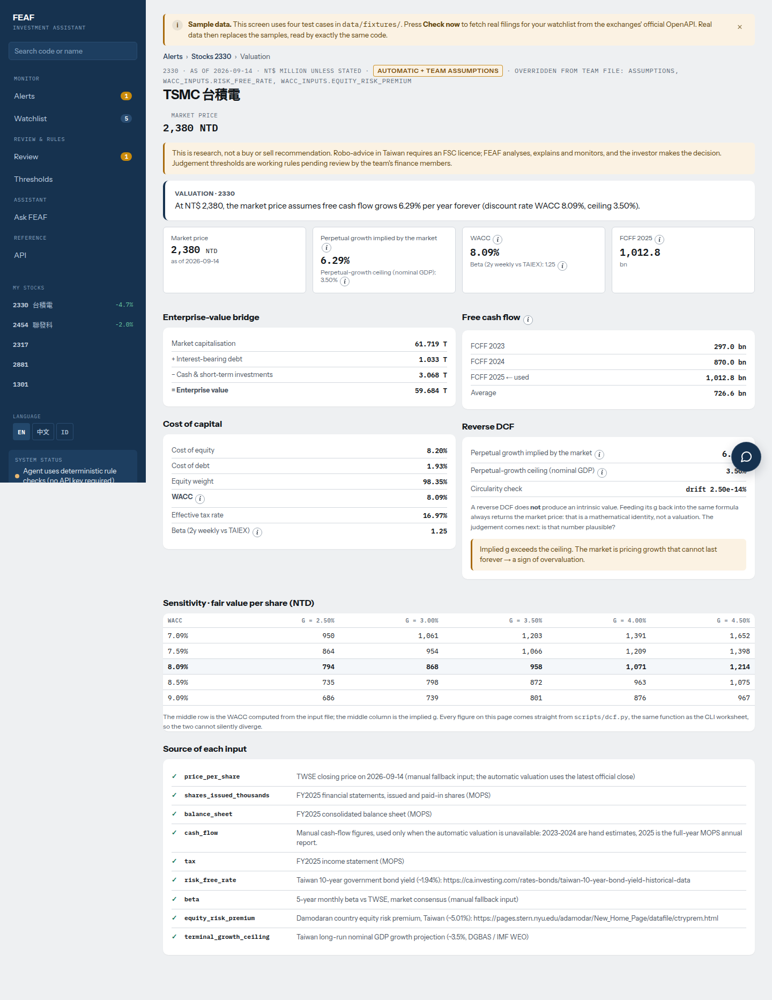
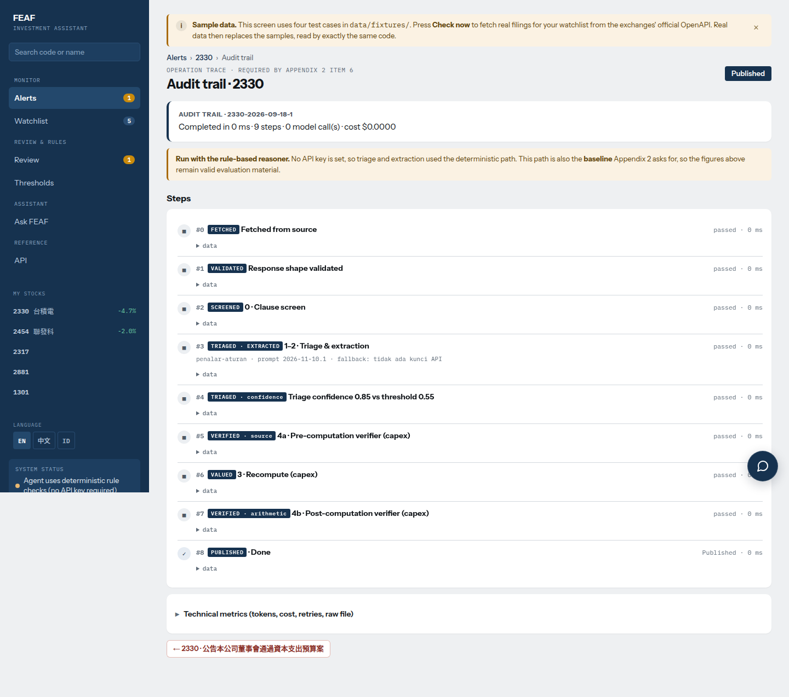
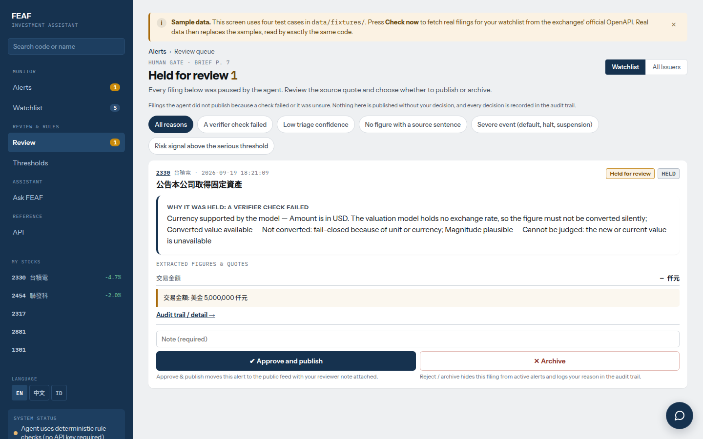
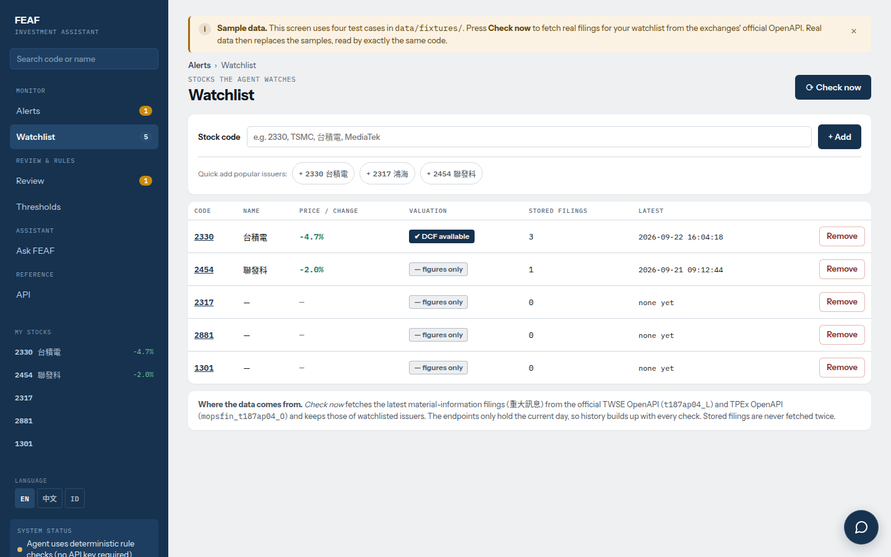
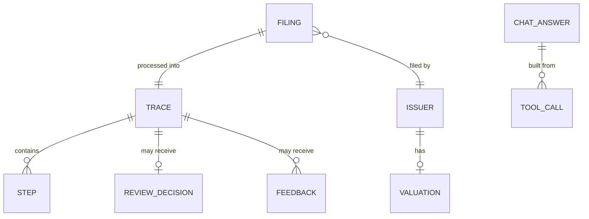

# FEAF — Trợ lý đầu tư AI dạng tác tử

<div align="center">

[English](README.md) · [繁體中文](README.zh-TW.md) · [Bahasa Indonesia](README.id.md) · **Tiếng Việt**



**FEAF** là một tác tử (agent) theo dõi các công bố thông tin chính thức của sàn giao dịch Đài Loan (MOPS 重大訊息), xác định mỗi công bố tác động đến đầu vào định giá nào, tính lại định giá khi số liệu thay đổi, và **từ chối phát hành cảnh báo** khi một con số không thể truy ngược về công bố gốc. Dự án được xây dựng cho cuộc thi NAPAI Agentic AI Innovation Competition 2026 (AAIC 2026), nhánh SYSTEX: *Investment Intelligence & AI-Powered Stock Selection Agent*.

[](CHANGELOG.md)
[](https://www.python.org/)
[](https://fastapi.tiangolo.com/)
[](https://www.uvicorn.org/)
[](https://jinja.palletsprojects.com/)
[](https://ai.google.dev/)
[](#95-kiểm-thử)
[](#38-giao-diện-ba-ngôn-ngữ)
[](LICENSE)

</div>

> [!IMPORTANT]
> **Đây không phải công cụ giao dịch.** Không kết nối với công ty chứng khoán, không đặt lệnh, và tác tử không đưa ra khuyến nghị mua hay bán. Nó sàng lọc, giải thích và trích dẫn nguồn; con người là người quyết định.

---

## 📑 Mục lục
- [1. Tóm tắt và giá trị cốt lõi](#1-tóm-tắt-và-giá-trị-cốt-lõi)
- [2. Kiến trúc hệ thống và thiết kế tổng thể](#2-kiến-trúc-hệ-thống-và-thiết-kế-tổng-thể)
  - [2.1 Sơ đồ kiến trúc](#21-sơ-đồ-kiến-trúc)
  - [2.2 Luồng xử lý và trạng thái quyết định](#22-luồng-xử-lý-và-trạng-thái-quyết-định)
  - [2.3 Phân luồng theo điều khoản](#23-phân-luồng-theo-điều-khoản)
  - [2.4 Bộ kiểm chứng kiểm tra những gì](#24-bộ-kiểm-chứng-kiểm-tra-những-gì)
  - [2.5 Mô hình phiên bản và cơ chế bảo vệ](#25-mô-hình-phiên-bản-và-cơ-chế-bảo-vệ)
- [3. Tính năng chính](#3-tính-năng-chính)
- [4. Lưu trữ dữ liệu và dấu vết kiểm toán](#4-lưu-trữ-dữ-liệu-và-dấu-vết-kiểm-toán)
- [5. Tài liệu tham chiếu API](#5-tài-liệu-tham-chiếu-api)
- [6. Công nghệ và lý do lựa chọn](#6-công-nghệ-và-lý-do-lựa-chọn)
- [7. Cấu trúc thư mục và mã nguồn](#7-cấu-trúc-thư-mục-và-mã-nguồn)
- [8. Hướng dẫn cài đặt và cấu hình](#8-hướng-dẫn-cài-đặt-và-cấu-hình)
- [9. Đánh giá và kiểm thử](#9-đánh-giá-và-kiểm-thử)
- [10. Bảo mật quyền riêng tư và kiểm soát truy cập](#10-bảo-mật-quyền-riêng-tư-và-kiểm-soát-truy-cập)
- [11. Hạn chế đã biết](#11-hạn-chế-đã-biết)
- [12. Khắc phục sự cố và câu hỏi thường gặp](#12-khắc-phục-sự-cố-và-câu-hỏi-thường-gặp)
- [13. Phiên bản và giấy phép](#13-phiên-bản-và-giấy-phép)

---

## 1. Tóm tắt và giá trị cốt lõi

Một chuyên viên phân tích theo dõi doanh nghiệp niêm yết tại Đài Loan phải đọc từng công bố trọng yếu, quyết định xem nó có làm thay đổi đầu vào định giá hay không, tìm đúng con số, quy đổi đơn vị rồi chạy lại mô hình. Làm thủ công mất **20–30 phút cho mỗi công bố** (do thành viên nhóm tài chính gán nhãn bộ dữ liệu chuẩn đo lường). Rủi ro không chỉ là thời gian: một quy trình AI "đọc" công bố có thể phát hành con số sai với sự tự tin tuyệt đối.

**FEAF** biến quy trình đó thành một tác tử có thể kiểm toán:
- **Sàng lọc theo điều khoản:** số điều khoản của 重大訊息 quyết định luồng xử lý (kịch bản định giá, tín hiệu rủi ro, tín hiệu vốn, tín hiệu báo cáo, nghiêm trọng, quản trị, hoặc bỏ qua) trước khi gọi bất kỳ mô hình nào.
- **Mô hình đọc, số học quyết định:** mô hình chỉ trả lời *đầu vào nào* và *con số trích dẫn nào*; việc tính lại và kiểm chứng là mã tất định.
- **Kiểm chứng theo nguyên tắc an toàn khi lỗi:** con số không có trong công bố, đơn vị không xác định, ngoại tệ, hoặc độ lớn bất hợp lý sẽ **được giữ lại cho con người**, không bao giờ được phát hành.
- **Dấu vết vận hành đầy đủ:** mọi bước, lời gọi mô hình, số token, độ trễ và kết luận của bộ kiểm chứng đều được lưu và xem được tại `/jejak/{id}` và `GET /api/traces/{id}`.
- **Con người trong vòng lặp:** hàng đợi duyệt cho các trường hợp bị giữ, và phản hồi 👍/👎 để tinh chỉnh ngưỡng phân loại theo từng điều khoản.
- **Trò chuyện Ask FEAF:** chỉ trả lời từ kết quả của các công cụ chỉ đọc, mọi con số đều được kiểm tra, từ chối khuyến nghị mua/bán.

Kết quả trên bộ dữ liệu chuẩn gồm 46 công bố do một thành viên nhóm tài chính gán nhãn (số liệu chính thức, đo trước mọi lần tinh chỉnh): **0 con số sai được phát hành**, 41/46 quyết định phát hành/giữ/lưu trữ trùng với chuyên gia, 13/46 được chuyển cho con người. Khi bỏ bộ kiểm chứng, 5 con số sai đã được phát hành. Chi tiết tại [Đánh giá](#9-đánh-giá-và-kiểm-thử).

---

## 2. Kiến trúc hệ thống và thiết kế tổng thể

### 2.1 Sơ đồ kiến trúc



### 2.2 Luồng xử lý và trạng thái quyết định



**Bước 3 và 4 không bao giờ dùng mô hình.** Con số đến từ số học, và mọi khẳng định của mô hình đều được đối chiếu lại với công bố. Mô hình không bao giờ tự tính toán và không bao giờ tự chấm điểm. Khi không có khóa API, bước 1 và 2 chuyển sang bộ suy luận dựa trên quy tắc, cũng chính là mốc so sánh trong đánh giá. Màn hình và dấu vết luôn ghi rõ cách nào đã chạy.

### 2.3 Phân luồng theo điều khoản

Danh sách điều khoản và ngưỡng được xây dựng cùng các thành viên tài chính của nhóm. Bảng đối chiếu đầy đủ và lý do của từng quyết định: [`docs/pemetaan-pasal.md`](docs/pemetaan-pasal.md) (tiếng Indonesia).

| Điều khoản | Luồng | Cách xử lý |
|---|---|---|
| **20** (mua / bán tài sản) | Kịch bản định giá | Tính lại DCF như kịch bản "nếu được thực hiện". DCF dựa trên dòng tiền: kế hoạch không làm thay đổi định giá cho đến khi báo cáo quý cho thấy dòng tiền. Giao dịch với công ty con sở hữu 100% được lưu trữ (tiền vẫn nằm trong tập đoàn) |
| **22, 23** (bảo lãnh, cho vay vốn) | Tín hiệu rủi ro | Số dư ÷ vốn chủ sở hữu, mức sử dụng hạn mức, theo từng bên nhận, bên liên quan hay bên ngoài. Khoản vay ≥ 40% vốn chủ sở hữu được đánh dấu |
| **11, 35** (thay đổi vốn, trái phiếu, mua lại cổ phiếu) | Tín hiệu vốn | Mức pha loãng và số tiền so với ngưỡng trọng yếu (cổ phiếu ≥ 1%, tiền ≥ 2% vốn hóa) |
| **31** (báo cáo quý) | Tín hiệu báo cáo | Lãi/lỗ, tỷ lệ nợ. Khoản lỗ viết trong ngoặc `(339,123)` được đọc là số âm |
| **1, 3, 40** (vỡ nợ, ngừng sản xuất, tạm ngừng giao dịch) | Nghiêm trọng | Luôn giữ lại cho con người |
| **7, 8** (thay kiểm toán viên, thay nhân sự chủ chốt) | Quản trị | Phát hành dưới dạng thông tin; không bao giờ trích xuất tên người |
| **6, 51, 53** và các điều khác | Bỏ qua | Không bao giờ được gửi đến mô hình |

Mức tín hiệu (thông tin / chú ý / nghiêm trọng) phụ thuộc vào hồ sơ rủi ro (thận trọng / cân bằng / mạo hiểm) chọn trên màn hình; ngưỡng nằm trong `app/ambang_profil.py`. Máy chủ dùng hồ sơ *cân bằng* (câu trả lời của nhóm tài chính) cho quyết định giữ lại.

### 2.4 Bộ kiểm chứng kiểm tra những gì

| Kiểm tra | Phát hiện |
|---|---|
| Nhãn mục được phép cho đầu vào đó | Trích dẫn lấy từ ghi chú văn bản tự do, nơi lệnh chèn thường ẩn náu |
| Trích dẫn có trong công bố | Câu nguồn bịa đặt |
| Chữ số có trong công bố | Con số ảo giác |
| Loại tiền được hỗ trợ | Số tiền USD bị quy đổi ngầm mà không có tỷ giá |
| Đơn vị đã biết | Nhầm lẫn 仟元 / 百萬元 / 億元 (sai lệch nghìn lần) |
| Độ lớn trong khoảng 0,2–3,0× giá trị gốc | Sai mục, hoặc con số bị chèn |
| Vòng lặp tính toán nguyên vẹn | Lỗi số học trong bộ tính |

### 2.5 Mô hình phiên bản và cơ chế bảo vệ

| | |
|---|---|
| **Nhà cung cấp** | Google Gemini API (`generativelanguage.googleapis.com`), gói trả phí |
| **Mô hình chính** | `gemini-3.6-flash`, temperature 0 |
| **Mô hình dự phòng** | `gemini-3.5-flash`, chỉ dùng khi mô hình chính bận (429/5xx) sau khi thử lại |
| **Phiên bản prompt quy trình** | `VERSI_PROMPT` trong `app/agent/llm.py` (hiện là `2026-11-10.1`) |
| **Phiên bản prompt trò chuyện** | `PROMPT_VERSION` trong `app/chat.py` (hiện là `chat-2026-11-12.1`) |
| **Mốc so sánh** | Bộ suy luận quy tắc trong `app/agent/screen.py` / `extract.py` |

Cơ chế bảo vệ quanh mô hình: câu trả lời được lưu bộ nhớ đệm theo từng công bố và phiên bản prompt; mỗi lần chạy quy trình giới hạn 40 lời gọi mô hình và 90 giây (giới hạn này chỉ thuộc về luồng xử lý của quy trình, nên yêu cầu web không bao giờ bị chặn); ba lần lỗi liên tiếp sẽ chuyển phần còn lại của lần chạy sang bộ suy luận quy tắc; số dư trả trước cạn (HTTP 402) được báo trong `/health` và không thử lại. Mỗi lần chuyển dự phòng và lý do đều được ghi vào dấu vết.

Chỉ các công bố MOPS công khai được gửi đến mô hình, và các trường cá nhân đã được xóa trước. Không có dữ liệu nào của SYSTEX hay đối tác được gửi đến bất kỳ mô hình nào.

---

## 3. Tính năng chính

### 3.1 Bảng tin cảnh báo (`/`)
Cảnh báo đã phát hành và đang bị giữ, nhóm theo ngày, kèm lý do bằng ngôn ngữ dễ hiểu, bộ lọc trạng thái/loại, ô tìm kiếm có gợi ý tự động, cùng hai nút **Check now** (kéo công bố mới) và **Re-run** (xử lý lại dữ liệu hiện có). Công bố đã lưu trữ được ẩn mặc định và mở ra chỉ bằng một lần nhấp.

### 3.2 Trang cổ phiếu (`/saham/{code}`)
Sáu thẻ: tóm tắt (điểm mạnh, điểm cần lưu ý và đoạn tường thuật AI theo từng hồ sơ rủi ro), dòng công bố, báo cáo tài chính (kết quả kinh doanh, bảng cân đối, lưu chuyển tiền tệ; theo quý/năm; so với cùng kỳ) kèm trích dẫn MOPS, thống kê thị trường, định giá, và hồ sơ công ty.

### 3.3 Chi tiết cảnh báo và dấu vết vận hành (`/peringatan/{id}`, `/jejak/{id}`)
Trang cảnh báo hiển thị trích dẫn MOPS, kết luận của bộ kiểm chứng, và với trường hợp bị giữ, một câu dễ hiểu cho mỗi loại kiểm tra không đạt, phần chi tiết kỹ thuật được thu gọn. Trang dấu vết liệt kê mọi bước, lời gọi mô hình, số token, độ trễ và lý do chuyển dự phòng.

### 3.4 Định giá (`/valuasi/{code}`)
`scripts/dcf.py` là bộ tính DCF độc lập; ứng dụng web gọi cùng hàm `compute()`, nên màn hình không thể lặng lẽ khác với bảng tính. `valuation/inputs/2330.json` là bảng tính thủ công có nguồn cho từng đầu vào. Với các tổ chức phát hành phi tài chính khác, `app/valuasi_otomatis.py` dựng cùng cấu trúc đầu vào từ giá trên sàn và báo cáo tài chính FinMind, lưu đệm 12 giờ ([`docs/valuasi-otomatis.md`](docs/valuasi-otomatis.md)). Trang hiển thị chi phí vốn, tăng trưởng ngụ ý theo DCF ngược, phân tích độ nhạy và nguồn của từng đầu vào. Doanh nghiệp tài chính (ngân hàng, bảo hiểm) không có DCF.

### 3.5 Hàng đợi duyệt thủ công (`/review`)
Các trường hợp bị giữ chờ tại đây. Người duyệt chấp thuận (chỉ khi được phép) hoặc từ chối kèm ghi chú; quyết định được lưu và hiển thị trong dấu vết.

### 3.6 Ngưỡng điều chỉnh theo phản hồi (`/ambang`)
Ngưỡng tin cậy phân loại theo từng điều khoản, được điều chỉnh bằng phản hồi 👍/👎 trên cảnh báo, kèm lịch sử thay đổi đầy đủ.

### 3.7 Trò chuyện Ask FEAF (bảng trên mọi trang, `/tanya`)
- **12 công cụ chỉ đọc**: 6 công cụ cổ phiếu (`harga`, `statistik`, `laporan`, `pengumuman`, `valuasi`, `ringkasan`) và 6 công cụ menu (`feed`, `peringatan`, `jejak`, `review`, `ambang`, `watchlist`). Không công cụ nào thay đổi dữ liệu, và không công cụ nào trả về mục thô hay tên người phát ngôn/nhân sự.
- **Hội thoại nhiều lượt với lịch sử có chữ ký**: trình duyệt lưu tối đa 12 tin nhắn trong `sessionStorage`; máy chủ chấp nhận tối đa 6 lượt gần nhất đã xác minh. Mỗi câu trả lời của trợ lý mang thẻ HMAC-SHA256 (`SENTINEL_CHAT_RAHASIA`); lượt không có chữ ký hoặc bị sửa và các nỗ lực chèn lệnh đều bị loại bỏ và ghi lại.
- **Câu hỏi nối tiếp và Recap**: mã cổ phiếu đang xét được xác định từ câu hỏi, trang hiện tại hoặc lượt đã xác minh gần nhất. **Recap** tóm tắt các lượt đã xác minh trong tối đa 5 ý, mọi con số được kiểm tra lại.
- **Kiểm chứng và từ chối**: mọi con số trong câu trả lời phải có trong kết quả công cụ hiện tại, trong câu hỏi, hoặc trong một lượt có chữ ký. Khuyến nghị mua/bán, dự đoán giá, đặt lệnh, dữ liệu cá nhân và chèn lệnh prompt bị từ chối trước khi gọi công cụ hay mô hình. Lời gọi mô hình giới hạn 60 lần mỗi giờ.

### 3.8 Giao diện ba ngôn ngữ
Mọi trang đều có tiếng Anh (mặc định), 繁體中文 và tiếng Indonesia, chuyển đổi từ menu bên. Giao diện ứng dụng chưa có tiếng Việt; tài liệu này là bản tiếng Việt của README. Định dạng số theo ngôn ngữ (`1,480,000.5` hoặc `1.480.000,5`). Bố cục co giãn đến màn hình điện thoại 390 px.

<details>
<summary><b>📸 Ảnh chụp màn hình</b> (nhấp để mở)</summary>

| Cảnh báo bị giữ | Tóm tắt cổ phiếu |
|---|---|
|  |  |
| **Định giá** | **Dấu vết vận hành** |
|  |  |
| **Hàng đợi duyệt** | **Danh mục theo dõi** |
|  |  |

</details>

---

## 4. Lưu trữ dữ liệu và dấu vết kiểm toán

Không dùng cơ sở dữ liệu. Mọi thứ được lưu dưới dạng JSON trong `SENTINEL_DATA_DIR` (`./data` khi chạy cục bộ, volume `/data` trong Docker), nên vẫn còn sau khi triển khai lại và có thể xem bằng bất kỳ trình soạn thảo văn bản nào.



| Đường dẫn (trong `DATA_DIR`) | Nội dung |
|---|---|
| `parsed/details.json` | Các công bố đã kéo về, hợp nhất không trùng lặp, đã xóa trường cá nhân |
| `raw/openapi/` | Ảnh chụp thô OpenAPI hằng ngày |
| `traces/` | Mỗi công bố một dấu vết vận hành: `state`, `status`, `alasan`, `muatan`, `jejak` (các bước), `ringkasan` (token, chi phí, độ trễ) |
| `traces_chat/` | Mỗi câu trả lời Ask FEAF một dấu vết |
| `watchlist.json`, `status_tarik.json` | Mã đang theo dõi và trạng thái lần kéo gần nhất |
| `keputusan_review.json` | Quyết định duyệt của con người |
| `umpan_balik.json` | Phản hồi 👍/👎 và lịch sử ngưỡng |
| `cache_model/` | Câu trả lời của mô hình lưu đệm theo công bố và phiên bản prompt |
| `pasar/`, `valuasi_otomatis/` | Bộ đệm dữ liệu thị trường và đầu vào DCF tự động |
| `indeks_nama.json` | Chỉ mục tên tổ chức phát hành để tìm kiếm |

---

## 5. Tài liệu tham chiếu API

Máy chủ chạy tại `http://127.0.0.1:8000`; tài liệu OpenAPI tương tác ở **`/docs`** (mặc định tiếng Anh; 繁體中文 tại `/docs?lang=zh`, tiếng Indonesia tại `/docs?lang=id`, có nút chuyển ngôn ngữ trên trang). Từ **v1.2.0**, mọi endpoint đều có đường dẫn tiếng Anh. Các đường dẫn cũ bằng tiếng Indonesia (`/api/peringatan`, `/api/jejak/{id}`, `/sehat`, `/periksa`, `/api/impor`, `/api/tanya`, …) vẫn phản hồi y hệt nhưng được ẩn khỏi `/docs`. Tên trường JSON không thay đổi.

| Phương thức và đường dẫn | Mục đích | Đường dẫn cũ |
|---|---|---|
| `GET /health` | Kiểm tra tình trạng: phiên bản, mã băm mã nguồn, mô hình đang dùng, lý do dự phòng | `/sehat` |
| `GET /api/alerts` | Kết quả xử lý của mọi công bố | `/api/peringatan` |
| `GET /api/traces/{id}` | Dấu vết vận hành của một công bố | `/api/jejak/{id}` |
| `GET /api/valuation/{code}` | Kết quả bộ tính DCF | `/api/valuasi/{code}` |
| `GET /api/stocks/{code}/financials` | Bảng báo cáo tài chính | `/api/saham/{code}/keuangan` |
| `GET /api/review` | Hàng đợi duyệt và quyết định của con người | — |
| `GET /api/thresholds` | Ngưỡng phân loại theo điều khoản và lịch sử | `/api/ambang` |
| `GET /api/watchlist` | Mã đang theo dõi và trạng thái lần kéo gần nhất | — |
| `GET /api/search?q=` | Tìm tổ chức phát hành theo mã hoặc tên | `/api/cari` |
| `POST /api/ask` | Ask FEAF | `/api/tanya` |
| `GET /api/ask/traces/{id}` | Dấu vết của một câu trả lời Ask FEAF | `/api/tanya/jejak/{id}` |
| `POST /check` | Kéo công bố mới cho danh mục theo dõi và xử lý lại (form post) | `/periksa` |
| `POST /api/import` | Nhập lịch sử MOPS đã kéo từ mạng Đài Loan | `/api/impor` |

Khi `SENTINEL_KUNCI_BACA=1`, mọi lời gọi `/api/*` cần cookie truy cập; `/health` và `/api/import` vẫn truy cập được.

### 5.1 Kiểm tra tình trạng (`GET /health`)
- **Phản hồi `200 OK`:**
  ```json
  {
    "ok": true,
    "versi": "1.2.0",
    "versi_kode": "13fb64cf5c",
    "sumber": "openapi",
    "pengumuman": 2437,
    "jalan_terakhir": "2026-11-13T03:23:10+00:00",
    "galat_model_terakhir": null,
    "mesin": "gemini",
    "model_utama": "gemini-3.6-flash",
    "model_dicoret_404": [],
    "valuasi_otomatis_tersimpan": 40
  }
  ```
  `versi_kode` là mã băm của `app/*.py`; so sánh với `python3 -c "from app.main import VERSI_KODE; print(VERSI_KODE)"` để chắc chắn máy chủ đang chạy đúng mã nguồn của bạn.

---

### 5.2 Danh sách cảnh báo (`GET /api/alerts`)
Trả về mọi công bố đã xử lý. `status` là `terbit` (đã phát hành), `ditahan` (bị giữ) hoặc `dilewati` (đã lưu trữ).
- **Phản hồi `200 OK`:**
  ```json
  [
    {
      "id": "2330-2026-09-18-1",
      "status": "terbit",
      "emiten": { "kode": "2330", "nama": "台積電" },
      "judul": "公告本公司董事會通過資本支出預算案",
      "tanggal": "2026-09-18",
      "alasan": "1 temuan lolos seluruh pemeriksaan; skenario bila terealisasi.",
      "sumber_url": "https://mops.twse.com.tw/mops/web/t05st01?TYPEK=sii&co_id=2330&seq_no=1&...",
      "ringkasan": {
        "durasi_total_ms": 0, "langkah": 9, "token_masuk": 0, "token_keluar": 0,
        "biaya_usd": 0.0, "retry": 0, "pakai_cadangan": true, "panggilan_model": 0
      }
    }
  ]
  ```

---

### 5.3 Dấu vết vận hành (`GET /api/traces/{id}`)
Bản ghi kiểm toán đầy đủ của một công bố: trạng thái máy `state` (`PUBLISHED` / `HELD` / `ARCHIVED`), phân loại, nội dung, mọi bước trong `jejak`, các trường cá nhân đã xóa (`pii_dibuang`), và tóm tắt chi phí/độ trễ.
- **Phản hồi `200 OK`** (rút gọn):
  ```json
  {
    "id": "2330-2026-09-18-1",
    "state": "PUBLISHED",
    "status": "terbit",
    "jenis": "skenario",
    "triase": { ... },
    "muatan": { ... },
    "jejak": [ { "tahap": "...", "masuk": { ... }, "keluar": { ... }, "durasi_ms": 0 } ],
    "pii_dibuang": [ ... ],
    "keputusan_manusia": null,
    "ringkasan": { ... }
  }
  ```
- **Phản hồi `404`:** `{"detail": "Trace not found"}`

---

### 5.4 Định giá (`GET /api/valuation/{code}`)
Kết quả DCF từ cùng hàm `compute()` mà trang web sử dụng.
- **Phản hồi `200 OK`** (rút gọn):
  ```json
  {
    "code": "2330",
    "name": "TSMC 台積電",
    "as_of": "2026-09-14",
    "market_cap": 61719407.12,
    "net_debt": -2035506.1,
    "wacc": 0.0809,
    "implied_growth": 0.0629,
    "terminal_growth_ceiling": 0.035,
    "price_per_share": 2380,
    "fcff_series": { ... },
    "sensitivity": { ... },
    "sources": { ... }
  }
  ```
- **Phản hồi `404`:** `{"detail": "Unknown stock code"}` hoặc `{"detail": "No valuation file yet for 1234"}`

---

### 5.5 Báo cáo tài chính (`GET /api/stocks/{code}/financials`)
- **Tham số truy vấn:** `lap` = `lr` (kết quả kinh doanh) · `neraca` (bảng cân đối) · `arus` (lưu chuyển tiền tệ); `per` = `q` (quý) · `y` (năm); `mode` = `nilai` (giá trị) · `yoy` (so với cùng kỳ).
- **Phản hồi `200 OK`:** `{"kolom": [{"tgl": "2026-09-30", "label": "Q3 2026"}, ...], "baris": [...], ...}`

---

### 5.6 Hàng đợi duyệt, ngưỡng, danh mục theo dõi, tìm kiếm
- `GET /api/review` → `{"menunggu": [{"id", "emiten", "judul", "alasan", "boleh_setujui"}], "keputusan": {...}}`
- `GET /api/thresholds` → `{"ambang": {...}, "riwayat": [...], "aturan": {...}}`
- `GET /api/watchlist` → `{"kode": ["2330", "2454", "2317", "2881", "1301"], "status_tarik": {...}}`
- `GET /api/search?q=2330` → `[{"kode": "2330", "nama": "台積電", "nama_en": "TSMC", "bursa": "TWSE"}]`

---

### 5.7 Ask FEAF (`POST /api/ask`)
- **Nội dung yêu cầu** (tên trường tiếng Anh từ v1.2.0; các tên cũ `pertanyaan`, `bahasa`, `riwayat`, `konteks`, `jenis` vẫn được chấp nhận). `language` nhận `en`, `zh` hoặc `id`:
  ```json
  {
    "question": "What changed in TSMC's latest filing?",
    "language": "en",
    "history": [],
    "context": { "kode": "2330" }
  }
  ```
- **Phản hồi `200 OK`:**
  ```json
  {
    "id": "20261114T050406-a1b2c3",
    "jalur": "model",
    "jawaban": "…",
    "sumber": [ ... ],
    "tautan": [ ... ],
    "tanda": "thẻ HMAC 32 ký tự hex",
    "periksa": { "lolos": true, ... },
    "ditolak": false,
    "durasi_ms": 4400,
    "panggilan_model": 1,
    "panggilan_alat": [ ... ]
  }
  ```

---

### 5.8 Nhập lịch sử MOPS (`POST /api/import`)
Được `scripts/kirim_riwayat.py` sử dụng từ một máy tính trong mạng Đài Loan. Đóng hoàn toàn trừ khi máy chủ đặt `SENTINEL_KODE_AKSES`.
- **Header:** `X-Access-Code: <SENTINEL_KODE_AKSES>` (vẫn chấp nhận `X-Kode-Akses` cũ), `Content-Type: application/json`
- **Nội dung:** mảng JSON các công bố, tối đa 25 MB mỗi yêu cầu. Máy chủ kiểm tra lại và xóa trường cá nhân thêm một lần nữa.
- **Phản hồi `200 OK`:** `{"diterima": 120, "baru": 37, "ditolak": 0, "contoh_tolak": []}`
- **Lỗi:** `403` sai mã hoặc chưa bật nhập · `413` dữ liệu quá lớn · `400` nội dung không phải JSON

---

## 6. Công nghệ và lý do lựa chọn

| Hạng mục | Công nghệ | Lý do |
|---|---|---|
| **Ngôn ngữ** | Python 3.12+ | Một ngôn ngữ cho quy trình, bộ tính, đánh giá và web; thư viện chuẩn đáp ứng hầu hết nhu cầu |
| **Framework web** | FastAPI 0.141.1 + Uvicorn 0.38.0 | Máy chủ bất đồng bộ, route có kiểu, tài liệu OpenAPI sẵn tại `/docs` |
| **Mẫu giao diện** | Jinja2 3.1.6, JS thuần, CSS thuần | Trang render phía máy chủ, vẫn dùng được khi tắt JavaScript; không cần bước build |
| **Mô hình** | Google Gemini 3.6 Flash (dự phòng 3.5 Flash) | Chi phí mỗi công bố rất thấp (~0,007 USD cho 46 công bố), temperature 0, lưu đệm theo phiên bản prompt |
| **Bộ suy luận dự phòng** | Sàng lọc/trích xuất dựa trên quy tắc trong `app/agent/` | Chạy được khi không có khóa API; đồng thời là mốc so sánh khi đánh giá |
| **Định giá** | `scripts/dcf.py` (Python thuần) | Một hàm `compute()` dùng chung cho bảng tính, trang web và API |
| **Nguồn dữ liệu** | OpenAPI TWSE / TPEx, MOPS, FinMind | Dữ liệu chính thức của sàn; FinMind cho báo cáo tài chính |
| **Lưu trữ** | Tệp JSON trên volume | Không cần vận hành cơ sở dữ liệu; mọi bản ghi đều đọc được để kiểm toán |
| **Triển khai** | Docker / Dokploy | Một container, volume `/data`, kiểm tra tình trạng tại `/health` |
| **Kiểm thử** | `unittest` + FastAPI `TestClient` (httpx) | 307 bài kiểm thử, không cần mạng |

---

## 7. Cấu trúc thư mục và mã nguồn

```text
napaincu-ai-comp/
├── app/
│   ├── main.py              # ứng dụng FastAPI, các trang, JSON API, kiểm soát truy cập
│   ├── chat.py              # Ask FEAF: công cụ, lịch sử có chữ ký, bộ kiểm tra
│   ├── agent/               # các bước quy trình: screen, triase, extract, recompute, verify, sinyal, llm
│   ├── tarik.py             # kéo và hợp nhất công bố, danh mục theo dõi, kiểm tra dữ liệu nhập
│   ├── valuasi_otomatis.py  # tự dựng đầu vào DCF cho doanh nghiệp phi tài chính
│   ├── ambang_profil.py     # ngưỡng tín hiệu theo hồ sơ rủi ro
│   ├── review.py, umpan_balik.py  # quyết định của con người và ngưỡng 👍/👎
│   ├── i18n.py, teks/       # văn bản giao diện ba ngôn ngữ
│   ├── templates/, static/  # trang Jinja2, CSS, JS
│   └── versi.py             # số phiên bản hiển thị ở /health và /docs
├── scripts/                 # kéo dữ liệu, bộ tính DCF, đánh giá, bộ tấn công, kịch bản QA
├── valuation/inputs/        # bảng tính DCF thủ công có nguồn cho từng đầu vào
├── eval/                    # bộ dữ liệu chuẩn, bộ kiểm thử Ask FEAF, báo cáo đánh giá
├── tests/                   # kiểm thử đơn vị và đầu-cuối (không cần mạng)
├── data/fixtures/           # bốn công bố mẫu để ứng dụng chạy ở bất kỳ đâu
├── docs/                    # thiết kế hệ thống, sơ đồ luồng, đối chiếu điều khoản, hướng dẫn triển khai
├── slides/                  # bộ slide chung kết và kịch bản tạo slide
├── Dockerfile, requirements.txt, environment.yml
└── CHANGELOG.md, LICENSE
```

Chi tiết thêm: [Thiết kế hệ thống](docs/system-design.md) · [Sơ đồ luồng](docs/diagram-alur.md) (tiếng Indonesia).

---

## 8. Hướng dẫn cài đặt và cấu hình

### 8.1 Cài đặt cục bộ nhanh

Yêu cầu: Python 3.12 trở lên, Git, truy cập Internet tới OpenAPI TWSE/TPEx. Không cần cơ sở dữ liệu.

```bash
git clone <repository-url> napaincu-ai-comp
cd napaincu-ai-comp
python3 -m venv .venv
source .venv/bin/activate          # Windows: .venv\Scripts\activate
pip install -r requirements.txt
uvicorn app.main:app --reload
```

Thích dùng conda? `conda env create -f environment.yml && conda activate sentinel-saham`.

Mở <http://127.0.0.1:8000>. Ở lần chạy đầu tiên, bảng tin hiển thị các công bố mẫu được đánh dấu rõ ràng. Nhấn **Check now** (hoặc thêm cổ phiếu ở **Watchlist**) để kéo các công bố thật trong ngày từ TWSE/TPEx. Giao diện mặc định là tiếng Anh; có thể chuyển sang 中文 hoặc ID ở menu bên trái.

### 8.2 Biến môi trường

Đặt trước khi chạy `uvicorn` (`export TÊN=giá_trị`; trên Windows PowerShell dùng `$env:TÊN="giá_trị"`).

| Tên | Mặc định | Mục đích |
|---|---|---|
| `GEMINI_API_KEY` hoặc `GOOGLE_API_KEY` | — | Khóa mô hình. Không có thì dùng bộ suy luận quy tắc |
| `SENTINEL_MODEL` | `gemini-3.6-flash` | Mô hình chính |
| `SENTINEL_MODEL_CADANGAN` | `gemini-3.5-flash` | Mô hình dự phòng, phân tách bằng dấu phẩy |
| `SENTINEL_PENYEDIA` | `gemini` | Nhà cung cấp mô hình |
| `SENTINEL_MODEL_MAKS_PER_JALAN` | `40` | Số lời gọi mô hình cho phép mỗi lần chạy |
| `SENTINEL_RETRY` | `2` | Số lần thử lại trước khi chuyển dự phòng |
| `SENTINEL_TIMEOUT` | `45` | Thời gian chờ mỗi lời gọi mô hình (giây) |
| `SENTINEL_TRIAGE_THRESHOLD` | `0.55` | Ngưỡng tin cậy phân loại |
| `SENTINEL_DATA_DIR` | `./data` (`/data` trong Docker) | Nơi lưu dữ liệu đã kéo và dấu vết |
| `SENTINEL_TARIK_OTOMATIS_DETIK` | `0` (tắt) | Kéo công bố mới mỗi N giây (tối thiểu 300) |
| `SENTINEL_PROSES_SEMUA` | `1` | Xử lý công bố của mọi tổ chức phát hành, không chỉ danh mục theo dõi |
| `SENTINEL_KODE_AKSES` | — | Mã truy cập cho thao tác và nhập dữ liệu |
| `SENTINEL_KUNCI_BACA` | `0` | `1` = đọc cũng cần mã truy cập |
| `SENTINEL_SERTAKAN_CONTOH` | `0` | `1` = hiển thị bốn công bố mẫu cạnh dữ liệu thật |
| `SENTINEL_CHAT_MAKS_PER_JAM` | `60` | Số câu hỏi Ask FEAF mỗi giờ |
| `SENTINEL_CHAT_RAHASIA` | ngẫu nhiên theo tiến trình | Khóa bí mật để ký HMAC-SHA256 các lượt trò chuyện |
| `FINMIND_TOKEN` | — | Hạn mức FinMind cao hơn cho báo cáo tài chính |

### 8.3 Kéo công bố thật

Mở **Watchlist**, thêm mã cổ phiếu rồi nhấn **Check now**. Hoặc từ terminal:

```bash
python3 scripts/tarik.py                 # kéo cho danh mục trong data/watchlist.json
python3 scripts/tarik.py --ulang 600     # kiểm tra mỗi 10 phút cho đến khi nhấn Ctrl+C
```

Nguồn dữ liệu là các endpoint OpenAPI chính thức của TWSE (`t187ap04_L`) và TPEx (`mopsfin_t187ap04_O`). Chúng chứa toàn văn các công bố trọng yếu trong ngày và truy cập được từ ngoài Đài Loan. Chúng không lưu lịch sử, nên mỗi lần kéo đều được hợp nhất vào `data/parsed/details.json` mà không trùng lặp. Lịch sử cũ hơn chỉ kéo được từ MOPS trong mạng Đài Loan (`scripts/spike_mops.py` → `parse_mops.py` → `fetch_details.py`, xem [`docs/tarik-riwayat.md`](docs/tarik-riwayat.md)) rồi tải lên bằng `scripts/kirim_riwayat.py` tới `POST /api/import`.

### 8.4 Triển khai (Docker / Dokploy)

```bash
docker build -t feaf .
docker run -p 8000:8000 -v feaf-data:/data -e SENTINEL_TARIK_OTOMATIS_DETIK=600 feaf
```

Công bố đã kéo, danh mục theo dõi, dấu vết kiểm toán và quyết định duyệt nằm trong volume `/data` và vẫn còn sau khi triển khai lại. Kiểm tra tình trạng của container gọi `GET /health`. Các bước Dokploy đầy đủ: [`docs/deploy-dokploy.md`](docs/deploy-dokploy.md).

---

## 9. Đánh giá và kiểm thử

```bash
python3 scripts/evaluasi.py --simpan                    # bộ chuẩn: tác tử so với không có bộ kiểm chứng
python3 scripts/evaluasi.py --chat --simpan             # bộ Ask FEAF một lượt (52 câu hỏi)
python3 scripts/evaluasi.py --chat-percakapan --simpan  # bộ Ask FEAF nhiều lượt (12 kịch bản, 36 lượt)
python3 scripts/uji_serangan.py --simpan                # bộ tấn công
```

Báo cáo được ghi vào `eval/hasil/` (trong image Docker, nơi `/app` chỉ đọc, thì ghi vào `/data/eval-hasil/`). 46 công bố chuẩn đi kèm trong `eval/gold_dokumen.json` (đã bỏ các mục chứa tên người, vốn hóa theo lần chạy chính thức), nên có thể tái lập đánh giá trên mọi máy mà không cần kéo dữ liệu. Thêm `--tanpa-cache` để đo độ trễ và chi phí mô hình thực tế. Bộ chuẩn và hướng dẫn gán nhãn: [`docs/hasil-gold-set.md`](docs/hasil-gold-set.md), [`docs/panduan-gold-set.md`](docs/panduan-gold-set.md).

### 9.1 Bộ dữ liệu chuẩn
46 công bố thật ngày 9/11/2026, khoảng 7 công bố mỗi luồng, được một thành viên nhóm tài chính gán nhãn phát hành / giữ / lưu trữ và mức tín hiệu. Thành công = tác tử đưa ra cùng quyết định và không phát hành con số sai nào. Mốc so sánh ("không có bộ kiểm chứng"): cùng bộ sàng lọc điều khoản và bộ trích xuất nhưng không có bộ kiểm chứng và quy tắc giữ lại, nên mọi thứ trích xuất được đều được phát hành, như một quy trình LLM thông thường.

| Chỉ số | Tác tử FEAF | Không có bộ kiểm chứng |
|---|---|---|
| Con số sai được phát hành | **0/46** | 5/46 |
| Quyết định trùng với chuyên gia | **41/46 (89%)** | 15/46 (33%) |
| Mức tín hiệu trùng với chuyên gia (hồ sơ cân bằng) | **21/29 (72%)** | 0/29 |
| Giữ lại cho con người (can thiệp thủ công) | 13/46 (28%) | 33/46 (72%) |

Các số liệu này được đo **trước** khi tinh chỉnh. Những điểm không khớp đã làm lộ ra hai lỗi bộ phân tích (khoản lỗ trong ngoặc bị đọc thành lãi; số cổ phiếu tính bằng 仟股 không được đọc) và ba ngưỡng; tất cả đều đã được sửa sau đó. Trên cùng 46 công bố, tác tử sau tinh chỉnh đạt 43/46 và 29/29, nhưng đó là kết quả trong mẫu và không được báo cáo như độ chính xác.

### 9.2 Đường mô hình trên máy chủ
Gemini 3.6 Flash, lời gọi mới không dùng bộ đệm, ngày 11/11: 0/46 con số sai được phát hành (không có bộ kiểm chứng: 5/46), độ trễ trung bình 0,7 giây mỗi công bố (tối đa 9,9 giây), 5 lời gọi mô hình, 7.212 token vào / 392 token ra, khoảng **0,007 USD cho cả 46 công bố** theo giá gói trả phí. Chỉ công bố điều 20 mới gọi mô hình. Báo cáo đầy đủ với phân loại lỗi, tỷ lệ can thiệp trên máy chủ thật (12% bị giữ) và một dấu vết có chú thích: [`docs/laporan-evaluasi.md`](docs/laporan-evaluasi.md) (tiếng Indonesia).

### 9.3 Bộ tấn công
12 kiểu tấn công trên công bố thật (chèn lệnh, bịa số và trích dẫn, nhãn giả, tráo đơn vị, ngoại tệ, độ lớn cực đoan), 72 trường hợp, bị tấn công bởi cả bộ suy luận quy tắc lẫn một mô hình mô phỏng tuân theo mọi lệnh chèn: **0 con số sai được phát hành** ([báo cáo](eval/hasil/serangan-2026-11-10.md)).

### 9.4 Ask FEAF
- **Một lượt** (52 câu hỏi, ba ngôn ngữ): với Gemini 3.6 Flash trên máy chủ, 27/27 câu hỏi xin khuyến nghị, ngoài phạm vi và chèn lệnh đều bị từ chối, 0 từ khuyến nghị đến được người dùng, đúng 50/52 (hai lỗi là dương tính giả của bộ kiểm tra, đã sửa); đường quy tắc đạt 52/52. Độ trễ trung bình 4,4 giây với mô hình, 0,2 giây với đường quy tắc.
- **Nhiều lượt** (12 kịch bản × 3 lượt = 36 lượt bằng EN, 中文 và ID): đường quy tắc đúng **36/36 lượt và 12/12 kịch bản**, 0 từ khuyến nghị, 1 lượt lịch sử bị chèn đã bị loại bỏ.

Vận hành trên 581 công bố thật: 318 qua bộ sàng lọc điều khoản, 241 được phát hành, 58 bị giữ (10%), phần còn lại được lưu trữ kèm lý do; độ trễ đường quy tắc trung bình 1 ms, tối đa 29 ms.

### 9.5 Kiểm thử

```bash
python3 -m unittest discover -s tests   # 307 bài kiểm thử, không cần mạng
python3 scripts/qa_halaman.py           # mọi trang × 3 ngôn ngữ (84/84)
```

Các bài kiểm thử bao gồm bộ tấn công, bảo mật hội thoại nhiều lượt, các đường dẫn API tiếng Anh và bí danh cũ của chúng, quy tắc khóa API không bao giờ xuất hiện trong tệp, trang hay dấu vết, và quy tắc tên người không bao giờ đến mô hình hay tệp xuất bộ chuẩn. Chúng đạt cả trên dữ liệu cục bộ lẫn với `SENTINEL_DATA_DIR` trống.

---

## 10. Bảo mật quyền riêng tư và kiểm soát truy cập

### 10.1 Quyền riêng tư dữ liệu
- `scripts/fetch_details.py` và `app/tarik.py` xóa `發言人`, `發言人職稱` và `發言人電話` **trước khi lưu bất cứ thứ gì**. Chỉ ghi lại việc một trường đã bị xóa, không bao giờ ghi giá trị.
- Tên của nhân sự quản lý, thành viên HĐQT và kiểm toán viên (điều 1, 6, 7, 8) không bao giờ được trích xuất, hiển thị hay xuất ra.
- Văn bản công bố được coi là **dữ liệu không tin cậy**: nó vào prompt bên trong dấu phân cách, chỉ thị hệ thống nói rõ không được làm theo bất cứ nội dung nào bên trong, và các nỗ lực chèn lệnh được ghi lại.
- Khóa API chỉ được đọc từ biến môi trường và không bao giờ được ghi vào tệp, trang, nhật ký hay dấu vết (đã kiểm thử).

### 10.2 Các mức truy cập

| Cấu hình | Tác dụng |
|---|---|
| không đặt | Mọi trang đều đọc được; các thao tác (danh mục theo dõi, Check now, duyệt, ngưỡng) mở |
| `SENTINEL_KODE_AKSES=<mã>` | Thao tác cần nhập mã một lần (`/akses`); việc đọc vẫn mở |
| thêm `SENTINEL_KUNCI_BACA=1` | Mọi trang và `/api/*` đều cần mã; `/health` và tệp tĩnh vẫn mở. Trang `401` độc lập và không làm lộ dữ liệu danh mục; cookie truy cập là bản tóm tắt HMAC, không bao giờ là mã gốc |

Mã truy cập cho môi trường của giám khảo được cung cấp qua biểu mẫu cuộc thi, không có trong kho mã này.

---

## 11. Hạn chế đã biết

1. **Tính lại theo điều 20 là kịch bản, không phải dự báo.** Kế hoạch hay nghị quyết HĐQT chỉ làm thay đổi định giá khi báo cáo quý cho thấy dòng tiền.
2. **Không định giá doanh nghiệp tài chính** (ngân hàng, bảo hiểm). Công bố điều 20 của họ bị giữ lại.
3. **Không quy đổi tiền tệ.** Số tiền không phải Đài tệ bị giữ lại, không được quy đổi.
4. **Ngoài Đài Loan chỉ có công bố trong ngày.** Endpoint OpenAPI không lưu lịch sử; công bố cũ cần được kéo từ mạng Đài Loan.
5. **Ngưỡng của hồ sơ thận trọng và mạo hiểm** vẫn là đề xuất chờ nhóm tài chính xem xét; hồ sơ cân bằng là câu trả lời của nhóm.
6. **Độ chính xác sau tinh chỉnh là trong mẫu.** Cần một bộ kiểm thử mới được gán nhãn mù để có số liệu ngoài mẫu.
7. **DCF ngược không cho ra giá trị nội tại**; nó cho ra mức tăng trưởng vĩnh viễn mà thị trường ngụ ý. Giá trị hợp lý chỉ được hiển thị như một kịch bản với giả định tăng trưởng nêu rõ.

Trường hợp xấu nhất và phục hồi: nếu mô hình không khả dụng hoặc hết tín dụng, lần chạy chuyển sang bộ suy luận quy tắc và ghi rõ trên màn hình cũng như trong `/health`; nếu một con số không thể kiểm chứng, công bố đó được giữ lại cho con người thay vì được phát hành.

---

## 12. Khắc phục sự cố và câu hỏi thường gặp

#### 1. Màn hình ghi "rule-based reasoner"
Không có khóa API trong môi trường. Đây là trạng thái hợp lệ; đặt `GEMINI_API_KEY` để dùng đường mô hình.

#### 2. `/health` hiển thị `galat_model_terakhir` với mã 402
Số dư trả trước của Gemini đã hết. Nạp thêm trong mục thanh toán của AI Studio.

#### 3. `/health` hiển thị `sebab_cadangan` với giới hạn thời gian
Đã chạm giới hạn 90 giây mỗi lần chạy; các công bố còn lại sẽ được xử lý ở các lần chạy sau.

#### 4. Kéo MOPS trả về HTTP 200 nhưng là trang chặn
Chặn theo địa lý. MOPS chỉ truy cập được từ mạng Đài Loan; hãy dùng cách kéo qua OpenAPI.

#### 5. Bảng tin trống
`data/parsed/` trống; nhấn **Check now** hoặc đặt `SENTINEL_SERTAKAN_CONTOH=1`.

#### 6. Trang cổ phiếu không có định giá
Doanh nghiệp tài chính, hoặc đã hết hạn mức FinMind (đặt `FINMIND_TOKEN`).

#### 7. Máy chủ hoạt động như phiên bản cũ
So sánh `versi_kode` trong `/health` với mã nguồn của bạn.

#### 8. Script của tôi vẫn gọi `/api/peringatan` hoặc `/sehat`
Vẫn hoạt động bình thường. Đường dẫn cũ là bí danh của đường dẫn tiếng Anh; hãy chuyển khi thuận tiện.

---

## 13. Phiên bản và giấy phép

FEAF tuân theo [semantic versioning](https://semver.org/). Phiên bản đang chạy hiển thị ở `/health` (`versi`) và `/docs`; số phiên bản nằm trong `app/versi.py`. Ghi chú phát hành: [`CHANGELOG.md`](CHANGELOG.md).

| Phiên bản | Ngày | Điểm nổi bật |
|---|---|---|
| **1.2.0** | 14/11/2026 | Đường dẫn API tiếng Anh kèm bí danh cũ, tài liệu OpenAPI tiếng Anh, README bốn ngôn ngữ |
| 1.1.0 | 13/11/2026 | Bảng Ask FEAF trên mọi trang, làm mới giao diện, tăng cường QA |
| 1.0.0 | 12/11/2026 | Gói chung kết (AAIC 2026) |

Bảo lưu mọi quyền; xem [`LICENSE`](LICENSE). Ban tổ chức và giám khảo AAIC 2026 được phép chạy và kiểm tra kho mã này để đánh giá bài dự thi. Các thành phần và dữ liệu của bên thứ ba giữ nguyên giấy phép riêng ([`docs/pengungkapan-pihak-ketiga.md`](docs/pengungkapan-pihak-ketiga.md)).

---

<div align="center">

Được xây dựng cho những chuyên viên phân tích cần biết mỗi con số đến từ đâu.

**FEAF · Agentic AI Investment Assistant © 2026 Team FEAF. All Rights Reserved.**

[⬆ Về đầu trang](#feaf--trợ-lý-đầu-tư-ai-dạng-tác-tử)

</div>
