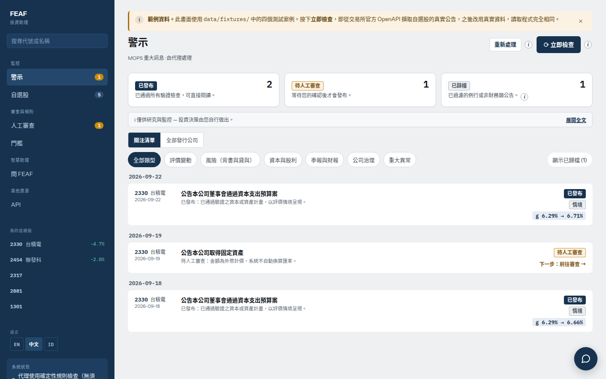
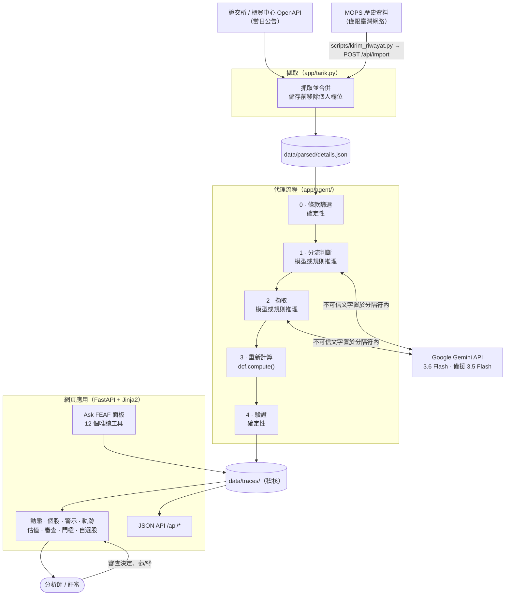
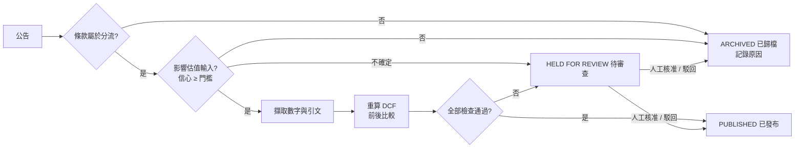
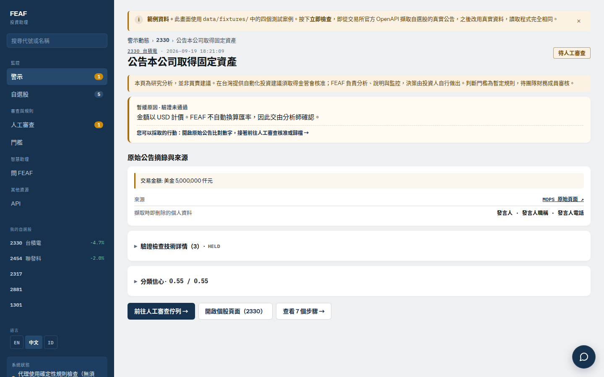
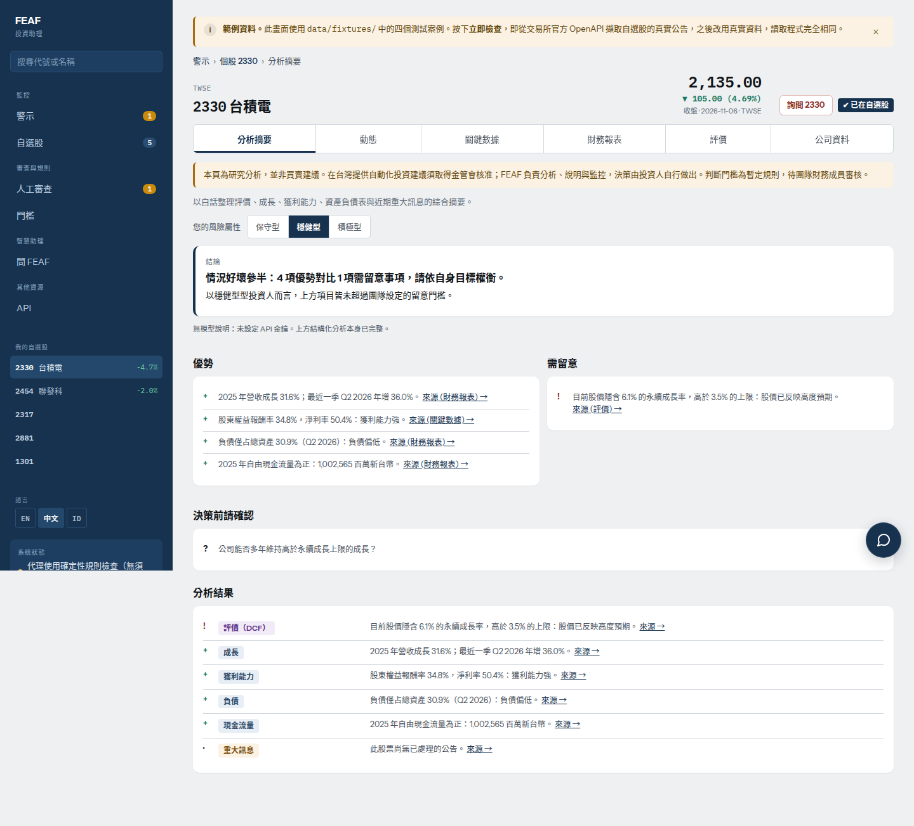
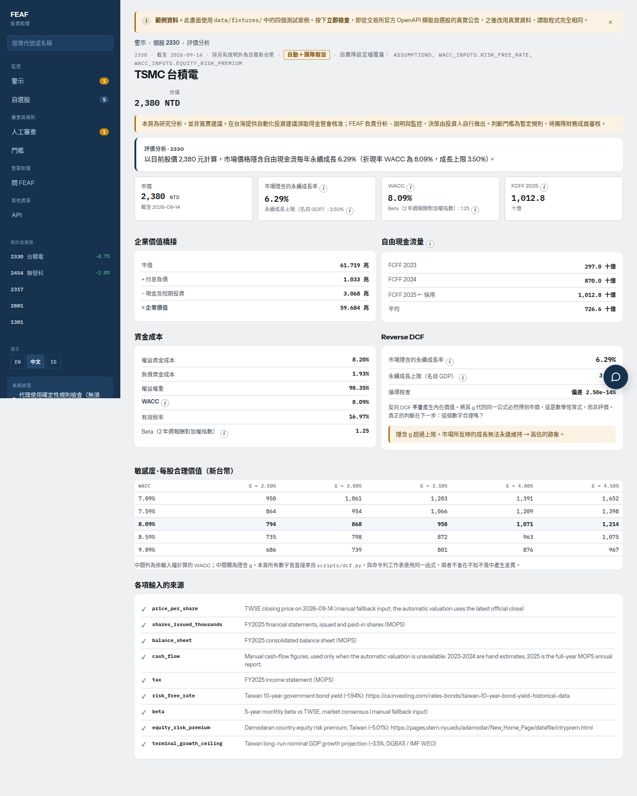
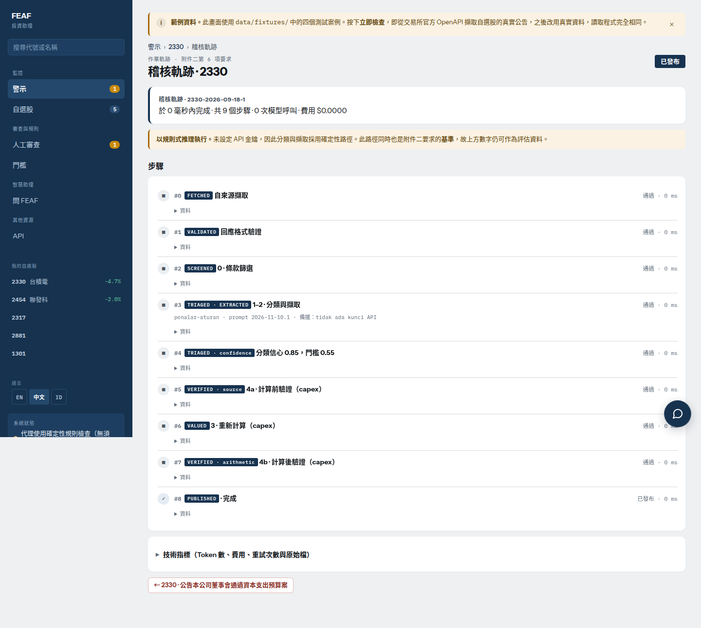
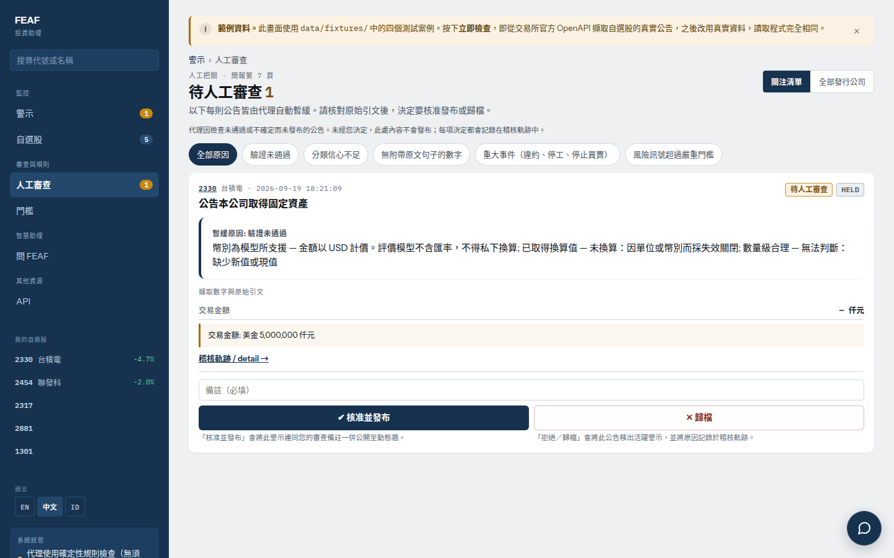
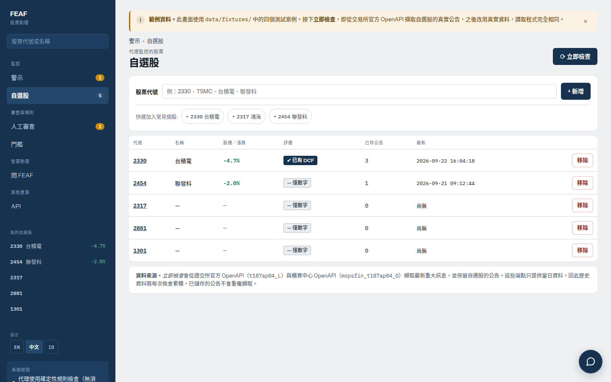
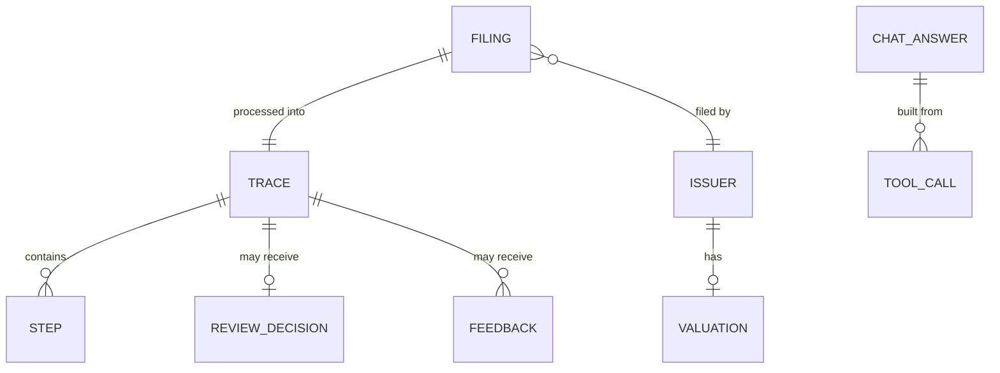

# FEAF — 代理式 AI 投資助理

<div align="center">

[English](README.md) · **繁體中文** · [Bahasa Indonesia](README.id.md) · [Tiếng Việt](README.vi.md)



**FEAF** 是一個監看臺灣證交所官方重大訊息（MOPS）的代理：判斷每則公告影響哪一項估值輸入、數字變動時重新計算估值，並且在數字**無法追溯回原始公告時拒絕發布警示**。本專案為 NAPAI 2026 代理式 AI 創新競賽（AAIC 2026）SYSTEX 賽道作品：*Investment Intelligence & AI-Powered Stock Selection Agent*。

[](CHANGELOG.md)
[](https://www.python.org/)
[](https://fastapi.tiangolo.com/)
[](https://www.uvicorn.org/)
[](https://jinja.palletsprojects.com/)
[](https://ai.google.dev/)
[](#95-測試)
[](#38-三語介面)
[](LICENSE)

</div>

> [!IMPORTANT]
> **這不是交易工具。** 不連接券商、不下單，代理也不提供任何買進或賣出建議。它只負責篩選、說明與引用來源；由人做決定。

---

## 📑 目錄
- [1. 摘要與價值主張](#1-摘要與價值主張)
- [2. 系統架構與高階設計](#2-系統架構與高階設計)
  - [2.1 高階架構圖](#21-高階架構圖)
  - [2.2 代理流程與決策狀態](#22-代理流程與決策狀態)
  - [2.3 依條款分流](#23-依條款分流)
  - [2.4 驗證器檢查項目](#24-驗證器檢查項目)
  - [2.5 模型 版本與防護](#25-模型-版本與防護)
- [3. 核心功能](#3-核心功能)
- [4. 資料儲存與稽核軌跡](#4-資料儲存與稽核軌跡)
- [5. API 參考](#5-api-參考)
- [6. 技術堆疊與選型理由](#6-技術堆疊與選型理由)
- [7. 目錄與程式碼結構](#7-目錄與程式碼結構)
- [8. 安裝與設定指南](#8-安裝與設定指南)
- [9. 評估與測試](#9-評估與測試)
- [10. 安全 隱私與存取控制](#10-安全-隱私與存取控制)
- [11. 已知限制](#11-已知限制)
- [12. 疑難排解與常見問題](#12-疑難排解與常見問題)
- [13. 版本與授權](#13-版本與授權)

---

## 1. 摘要與價值主張

追蹤臺股的分析師必須閱讀每一則重大訊息，判斷它是否改變估值輸入、找出確切數字、換算單位，再重做模型。人工處理每則公告約需 **20–30 分鐘**（由標註黃金資料集的財務團隊成員實測）。風險不只是時間：會「閱讀」公告的 AI 流程可能信心十足地發布錯誤數字。

**FEAF** 把這套流程變成可稽核的代理：
- **依條款篩選：** 在呼叫任何模型之前，先由重大訊息的條款編號決定分流（估值情境、風險訊號、資本訊號、財報訊號、重大事件、公司治理或略過）。
- **模型負責閱讀，算術負責決定：** 模型只回答「影響哪個輸入」與「引用哪個數字」；重新計算與驗證都是確定性程式。
- **失敗即保留：** 數字不在公告中、單位不明、外幣，或量級不合理時，一律**保留給人工審查**，絕不發布。
- **完整操作軌跡：** 每個階段、模型呼叫、token 數、延遲與驗證結果都會保存，可在 `/jejak/{id}` 與 `GET /api/traces/{id}` 查看。
- **人在迴路中：** 保留案件的審查佇列，以及以 👍/👎 回饋調整各條款的分流門檻。
- **Ask FEAF 對話：** 只依唯讀工具的結果作答，每個數字都經檢查，拒絕買賣建議。

在由財務團隊成員標註的 46 則黃金資料集上（官方數字，於任何調整之前測得）：**發布錯誤數字 0 則**，發布／保留／歸檔決策與專家一致 41/46，交由人工 13/46。若拿掉驗證器，會發布 5 則錯誤數字。詳見[評估](#9-評估與測試)。

---

## 2. 系統架構與高階設計

### 2.1 高階架構圖



### 2.2 代理流程與決策狀態



**第 3、4 階段從不使用模型。** 數字來自算術，模型的每一項主張都會回頭與公告比對。模型不計算，也不替自己打分數。沒有 API 金鑰時，第 1、2 階段改用規則推理器，這也是評估所比較的基準。畫面與軌跡都會標示實際使用的是哪一種。

### 2.3 依條款分流

條款清單與門檻由團隊財務成員共同訂定。完整對照與每項決定的理由：[`docs/pemetaan-pasal.md`](docs/pemetaan-pasal.md)。

| 條款 | 分流 | 處理方式 |
|---|---|---|
| **20**（取得或處分資產） | 估值情境 | 以「若實現」情境重算 DCF。DCF 以現金為基礎：計畫在季報出現現金之前不會改變估值。與 100% 持股子公司的交易予以歸檔（現金仍在集團內） |
| **22、23**（背書保證、資金貸與） | 風險訊號 | 餘額 ÷ 淨值、額度使用率、逐一對象、關係人或非關係人。貸與 ≥ 淨值 40% 時標示 |
| **11、35**（資本變動、公司債、庫藏股） | 資本訊號 | 稀釋比例與金額對照重大性門檻（股數 ≥ 1%、金額 ≥ 市值 2%） |
| **31**（季報） | 財報訊號 | 損益、負債比率。以括號表示的虧損 `(339,123)` 讀為負數 |
| **1、3、40**（違約、停工、停止買賣） | 重大事件 | 一律保留給人工 |
| **7、8**（會計師變更、重要經理人異動） | 公司治理 | 以資訊發布；從不擷取人名 |
| **6、51、53** 及其他 | 略過 | 不會送到模型 |

訊號等級（資訊／注意／嚴重）依畫面上選擇的風險屬性（保守／穩健／積極）而定；門檻位於 `app/ambang_profil.py`。伺服器的保留決策使用*穩健*屬性（財務團隊的答案）。

### 2.4 驗證器檢查項目

| 檢查 | 攔截 |
|---|---|
| 項目標籤是否允許用於該輸入 | 取自自由文字附註的引文（注入指令通常藏在這裡） |
| 引文存在於公告中 | 捏造的來源句子 |
| 數字存在於公告中 | 幻覺數字 |
| 幣別受支援 | 未經匯率就被默默換算的美元金額 |
| 單位已知 | 仟元／百萬元／億元混淆（千倍誤差） |
| 量級在基準的 0.2–3.0 倍之內 | 取錯項目或被注入的數字 |
| 循環計算完整 | 計算器的算術錯誤 |

### 2.5 模型 版本與防護

| | |
|---|---|
| **供應商** | Google Gemini API（`generativelanguage.googleapis.com`），付費方案 |
| **主要模型** | `gemini-3.6-flash`，temperature 0 |
| **備援模型** | `gemini-3.5-flash`，僅在主要模型忙碌（429/5xx）且重試後使用 |
| **流程提示版本** | `app/agent/llm.py` 中的 `VERSI_PROMPT`（目前為 `2026-11-10.1`） |
| **對話提示版本** | `app/chat.py` 中的 `PROMPT_VERSION`（目前為 `chat-2026-11-12.1`） |
| **基準** | `app/agent/screen.py` / `extract.py` 中的規則推理器 |

模型的防護措施：答案依公告與提示版本快取；每次流程執行上限 40 次模型呼叫、90 秒（此上限只屬於流程執行緒，不會阻擋網頁請求）；連續三次失敗後，該次執行其餘部分改用規則推理器；預付餘額用盡（HTTP 402）會顯示在 `/health` 且不再重試。每次備援及其原因都會寫入軌跡。

只有公開的 MOPS 公告會送到模型，且個人欄位已事先移除。不會將任何 SYSTEX 或合作夥伴資料送到模型。

---

## 3. 核心功能

### 3.1 警示動態（`/`）
依日期分組的已發布與待審查警示，附白話原因、狀態／類型篩選、具自動完成的搜尋框，以及 **立即檢查**（抓取新公告）／**重新執行**（重新處理現有資料）。已歸檔的公告預設隱藏，點一下即可展開。

### 3.2 個股頁（`/saham/{code}`）
六個分頁：摘要（優勢、注意事項，以及依風險屬性產生的 AI 敘述）、公告串流、財務報表（損益表、資產負債表、現金流量表；季／年；年增率）附 MOPS 引用、市場統計、估值、公司概況。

### 3.3 警示詳情與操作軌跡（`/peringatan/{id}`、`/jejak/{id}`）
警示頁顯示 MOPS 引用與驗證結果；待審查案件會針對每種未通過的檢查給一句白話說明，技術細節則收合起來。軌跡頁列出每個步驟、模型呼叫、token 數、延遲與備援原因。

### 3.4 估值（`/valuasi/{code}`）
`scripts/dcf.py` 是獨立的 DCF 計算器；網頁呼叫同一個 `compute()`，畫面不可能與工作表不一致。`valuation/inputs/2330.json` 是每項輸入都附來源的人工工作表。其他非金融業發行公司由 `app/valuasi_otomatis.py` 以交易所價格與 FinMind 財報建立相同的輸入結構，並快取 12 小時（[`docs/valuasi-otomatis.md`](docs/valuasi-otomatis.md)）。頁面顯示資金成本、反向 DCF 隱含成長率、敏感度分析與每項輸入的來源。金融業（銀行、保險）不提供 DCF。

### 3.5 人工審查佇列（`/review`）
待審查案件在此等候。審查者可核准（僅限允許核准的案件）或附註駁回；決定會被保存並顯示在軌跡中。

### 3.6 由回饋調整的門檻（`/ambang`）
各條款的分流信心門檻，依警示的 👍/👎 回饋調整，並保留完整變更紀錄。

### 3.7 Ask FEAF 對話（每頁的面板與 `/tanya`）
- **12 個唯讀工具**：6 個個股工具（`harga`、`statistik`、`laporan`、`pengumuman`、`valuasi`、`ringkasan`）與 6 個選單工具（`feed`、`peringatan`、`jejak`、`review`、`ambang`、`watchlist`）。沒有工具會修改資料，也不會回傳原始項目或經理人、發言人姓名。
- **具簽章歷史的多輪對話**：瀏覽器在 `sessionStorage` 保存最多 12 則訊息；伺服器最多接受最後 6 輪已驗證的對話。每則助理回答都帶有 HMAC-SHA256 標記（`SENTINEL_CHAT_RAHASIA`）；未簽章或被竄改的輪次與注入嘗試會被丟棄並記錄。
- **追問與 Recap**：從問題、所在頁面或上一輪已驗證的對話判斷目前的股票代號。**Recap** 以最多 5 點摘要已驗證的對話，並重新檢查每個數字。
- **驗證與拒答**：回答中的每個數字都必須出現在當次工具輸出、問題或已簽章的輪次中。買賣建議、股價預測、下單、個人資料與提示注入會在呼叫任何工具或模型前被拒絕。模型呼叫每小時上限 60 次。

### 3.8 三語介面
每一頁都提供英文（預設）、繁體中文與印尼文，可從側邊選單切換。數字格式隨語言調整（`1,480,000.5` 與 `1.480.000,5`）。版面可響應至 390 px 手機寬度。

<details>
<summary><b>📸 畫面截圖</b>（點擊展開）</summary>

| 待審查警示 | 個股摘要 |
|---|---|
|  |  |
| **估值** | **操作軌跡** |
|  |  |
| **審查佇列** | **自選股** |
|  |  |

</details>

---

## 4. 資料儲存與稽核軌跡

不使用資料庫。所有資料都以 JSON 存放在 `SENTINEL_DATA_DIR`（本機為 `./data`，Docker 中為 `/data` volume），重新部署後仍會保留，且可用任何文字編輯器檢視。



| 路徑（位於 `DATA_DIR` 下） | 內容 |
|---|---|
| `parsed/details.json` | 已抓取的公告，去重合併，個人欄位已移除 |
| `raw/openapi/` | 每日 OpenAPI 原始快照 |
| `traces/` | 每則公告一份操作軌跡：`state`、`status`、`alasan`、`muatan`、`jejak`（步驟）、`ringkasan`（token、成本、延遲） |
| `traces_chat/` | 每則 Ask FEAF 回答一份軌跡 |
| `watchlist.json`、`status_tarik.json` | 自選股代號與最近一次抓取狀態 |
| `keputusan_review.json` | 人工審查決定 |
| `umpan_balik.json` | 👍/👎 回饋與門檻變更紀錄 |
| `cache_model/` | 依公告與提示版本快取的模型答案 |
| `pasar/`、`valuasi_otomatis/` | 市場資料快取與自動建立的 DCF 輸入 |
| `indeks_nama.json` | 搜尋用的發行公司名稱索引 |

---

## 5. API 參考

伺服器執行於 `http://127.0.0.1:8000`；互動式 OpenAPI 文件位於 **`/docs`**（預設英文；繁體中文為 `/docs?lang=zh`，印尼文為 `/docs?lang=id`，頁面上可切換）。自 **v1.2.0** 起，每個端點都有英文路徑。舊的印尼文路徑（`/api/peringatan`、`/api/jejak/{id}`、`/sehat`、`/periksa`、`/api/impor`、`/api/tanya`……）仍以完全相同的方式回應，但不會出現在 `/docs`。JSON 欄位名稱不變。

| 方法與路徑 | 用途 | 舊路徑 |
|---|---|---|
| `GET /health` | 健康檢查：版本、程式雜湊、使用中的模型、備援原因 | `/sehat` |
| `GET /api/alerts` | 每則公告的處理結果 | `/api/peringatan` |
| `GET /api/traces/{id}` | 單則公告的操作軌跡 | `/api/jejak/{id}` |
| `GET /api/valuation/{code}` | DCF 計算器輸出 | `/api/valuasi/{code}` |
| `GET /api/stocks/{code}/financials` | 財務報表 | `/api/saham/{code}/keuangan` |
| `GET /api/review` | 審查佇列與人工決定 | — |
| `GET /api/thresholds` | 各條款分流門檻與變更紀錄 | `/api/ambang` |
| `GET /api/watchlist` | 自選股代號與最近抓取狀態 | — |
| `GET /api/search?q=` | 依代號或名稱搜尋發行公司 | `/api/cari` |
| `POST /api/ask` | Ask FEAF | `/api/tanya` |
| `GET /api/ask/traces/{id}` | 單則 Ask FEAF 回答的軌跡 | `/api/tanya/jejak/{id}` |
| `POST /check` | 為自選股抓取新公告並重新處理（表單送出） | `/periksa` |
| `POST /api/import` | 匯入在臺灣網路抓取的 MOPS 歷史資料 | `/api/impor` |

當 `SENTINEL_KUNCI_BACA=1` 時，所有 `/api/*` 都需要存取 cookie；`/health` 與 `/api/import` 仍可存取。

### 5.1 健康檢查（`GET /health`）
- **回應 `200 OK`：**
  ```json
  {
    "ok": true,
    "versi": "1.2.0",
    "versi_kode": "13fb64cf5c",
    "sumber": "openapi",
    "pengumuman": 2437,
    "jalan_terakhir": "2026-11-13T03:23:10+00:00",
    "galat_model_terakhir": null,
    "mesin": "gemini",
    "model_utama": "gemini-3.6-flash",
    "model_dicoret_404": [],
    "valuasi_otomatis_tersimpan": 40
  }
  ```
  `versi_kode` 是 `app/*.py` 的雜湊值；與 `python3 -c "from app.main import VERSI_KODE; print(VERSI_KODE)"` 比對即可確認伺服器執行的是你的程式版本。

---

### 5.2 警示清單（`GET /api/alerts`）
回傳所有已處理的公告。`status` 為 `terbit`（已發布）、`ditahan`（待審查）或 `dilewati`（已歸檔）。
- **回應 `200 OK`：**
  ```json
  [
    {
      "id": "2330-2026-09-18-1",
      "status": "terbit",
      "emiten": { "kode": "2330", "nama": "台積電" },
      "judul": "公告本公司董事會通過資本支出預算案",
      "tanggal": "2026-09-18",
      "alasan": "1 temuan lolos seluruh pemeriksaan; skenario bila terealisasi.",
      "sumber_url": "https://mops.twse.com.tw/mops/web/t05st01?TYPEK=sii&co_id=2330&seq_no=1&...",
      "ringkasan": {
        "durasi_total_ms": 0, "langkah": 9, "token_masuk": 0, "token_keluar": 0,
        "biaya_usd": 0.0, "retry": 0, "pakai_cadangan": true, "panggilan_model": 0
      }
    }
  ]
  ```

---

### 5.3 操作軌跡（`GET /api/traces/{id}`）
單則公告的完整稽核紀錄：機器狀態 `state`（`PUBLISHED` / `HELD` / `ARCHIVED`）、分流判斷、內容、`jejak` 中的每個步驟、已移除的個人欄位（`pii_dibuang`）以及成本與延遲摘要。
- **回應 `200 OK`**（節錄）：
  ```json
  {
    "id": "2330-2026-09-18-1",
    "state": "PUBLISHED",
    "status": "terbit",
    "jenis": "skenario",
    "triase": { ... },
    "muatan": { ... },
    "jejak": [ { "tahap": "...", "masuk": { ... }, "keluar": { ... }, "durasi_ms": 0 } ],
    "pii_dibuang": [ ... ],
    "keputusan_manusia": null,
    "ringkasan": { ... }
  }
  ```
- **回應 `404`：** `{"detail": "Trace not found"}`

---

### 5.4 估值（`GET /api/valuation/{code}`）
與頁面相同的 `compute()` 所產生的 DCF 輸出。
- **回應 `200 OK`**（節錄）：
  ```json
  {
    "code": "2330",
    "name": "TSMC 台積電",
    "as_of": "2026-09-14",
    "market_cap": 61719407.12,
    "net_debt": -2035506.1,
    "wacc": 0.0809,
    "implied_growth": 0.0629,
    "terminal_growth_ceiling": 0.035,
    "price_per_share": 2380,
    "fcff_series": { ... },
    "sensitivity": { ... },
    "sources": { ... }
  }
  ```
- **回應 `404`：** `{"detail": "Unknown stock code"}` 或 `{"detail": "No valuation file yet for 1234"}`

---

### 5.5 財務報表（`GET /api/stocks/{code}/financials`）
- **查詢參數：** `lap` = `lr`（損益表）· `neraca`（資產負債表）· `arus`（現金流量表）；`per` = `q`（季）· `y`（年）；`mode` = `nilai`（數值）· `yoy`（年增率）。
- **回應 `200 OK`：** `{"kolom": [{"tgl": "2026-09-30", "label": "Q3 2026"}, ...], "baris": [...], ...}`

---

### 5.6 審查佇列、門檻、自選股、搜尋
- `GET /api/review` → `{"menunggu": [{"id", "emiten", "judul", "alasan", "boleh_setujui"}], "keputusan": {...}}`
- `GET /api/thresholds` → `{"ambang": {...}, "riwayat": [...], "aturan": {...}}`
- `GET /api/watchlist` → `{"kode": ["2330", "2454", "2317", "2881", "1301"], "status_tarik": {...}}`
- `GET /api/search?q=2330` → `[{"kode": "2330", "nama": "台積電", "nama_en": "TSMC", "bursa": "TWSE"}]`

---

### 5.7 Ask FEAF（`POST /api/ask`）
- **請求內容**（自 v1.2.0 起使用英文欄位名稱；舊的 `pertanyaan`、`bahasa`、`riwayat`、`konteks`、`jenis` 仍可使用）：
  ```json
  {
    "question": "台積電最新公告有什麼變化？",
    "language": "zh",
    "history": [],
    "context": { "kode": "2330" }
  }
  ```
- **回應 `200 OK`：**
  ```json
  {
    "id": "20261114T050406-a1b2c3",
    "jalur": "model",
    "jawaban": "…",
    "sumber": [ ... ],
    "tautan": [ ... ],
    "tanda": "32 位十六進位 HMAC 標記",
    "periksa": { "lolos": true, ... },
    "ditolak": false,
    "durasi_ms": 4400,
    "panggilan_model": 1,
    "panggilan_alat": [ ... ]
  }
  ```

---

### 5.8 匯入 MOPS 歷史資料（`POST /api/import`）
由位於臺灣網路的筆電透過 `scripts/kirim_riwayat.py` 使用。伺服器未設定 `SENTINEL_KODE_AKSES` 時完全關閉。
- **標頭：** `X-Access-Code: <SENTINEL_KODE_AKSES>`（仍接受舊的 `X-Kode-Akses`）、`Content-Type: application/json`
- **內容：** 公告的 JSON 陣列，每次最多 25 MB。伺服器會重新驗證並再次移除個人欄位。
- **回應 `200 OK`：** `{"diterima": 120, "baru": 37, "ditolak": 0, "contoh_tolak": []}`
- **錯誤：** `403` 存取碼錯誤或未啟用匯入 · `413` 內容過大 · `400` 內容不是 JSON

---

## 6. 技術堆疊與選型理由

| 類別 | 技術 | 理由 |
|---|---|---|
| **語言** | Python 3.12+ | 流程、計算器、評估與網頁使用同一種語言；標準函式庫即可滿足多數需求 |
| **網頁框架** | FastAPI 0.141.1 + Uvicorn 0.38.0 | 非同步伺服器、型別化路由、`/docs` 內建 OpenAPI 文件 |
| **樣板** | Jinja2 3.1.6、原生 JS、純 CSS | 伺服器端渲染，關閉 JavaScript 也能使用；不需建置步驟 |
| **模型** | Google Gemini 3.6 Flash（備援 3.5 Flash） | 每則公告成本極低（46 則約 0.007 美元），temperature 0，依提示版本快取 |
| **備援推理器** | `app/agent/` 中的規則式篩選與擷取 | 沒有 API 金鑰也能運作；同時作為評估基準 |
| **估值** | `scripts/dcf.py`（純 Python） | 工作表、頁面與 API 共用同一個 `compute()` |
| **資料來源** | 證交所／櫃買中心 OpenAPI、MOPS、FinMind | 官方交易所資料；財報取自 FinMind |
| **儲存** | volume 上的 JSON 檔案 | 不需維運資料庫；每筆紀錄皆可直接閱讀以供稽核 |
| **部署** | Docker / Dokploy | 單一容器、`/data` volume、以 `/health` 做健康檢查 |
| **測試** | `unittest` + FastAPI `TestClient`（httpx） | 307 項測試，不需網路 |

---

## 7. 目錄與程式碼結構

```text
napaincu-ai-comp/
├── app/
│   ├── main.py              # FastAPI 應用、頁面、JSON API、存取控制
│   ├── chat.py              # Ask FEAF：工具、簽章歷史、檢查器
│   ├── agent/               # 流程階段：screen、triase、extract、recompute、verify、sinyal、llm
│   ├── tarik.py             # 抓取與合併公告、自選股、匯入驗證
│   ├── valuasi_otomatis.py  # 為非金融業自動建立 DCF 輸入
│   ├── ambang_profil.py     # 各風險屬性的訊號門檻
│   ├── review.py, umpan_balik.py  # 人工決定與 👍/👎 門檻
│   ├── i18n.py, teks/       # 三種語言的介面文字
│   ├── templates/, static/  # Jinja2 頁面、CSS、JS
│   └── versi.py             # 顯示於 /health 與 /docs 的版本號
├── scripts/                 # 抓取、DCF 計算器、評估、攻擊測試集、QA 腳本
├── valuation/inputs/        # 每項輸入都附來源的人工 DCF 工作表
├── eval/                    # 黃金資料集、Ask FEAF 測試集、評估報告
├── tests/                   # 單元與端對端測試（不需網路）
├── data/fixtures/           # 四則範例公告，讓應用在任何地方都能執行
├── docs/                    # 系統設計、流程圖、條款對照、部署指南
├── slides/                  # 決賽簡報及其產生腳本
├── Dockerfile, requirements.txt, environment.yml
└── CHANGELOG.md, LICENSE
```

更多細節：[系統設計](docs/system-design.md) · [流程圖](docs/diagram-alur.md)（印尼文）。

---

## 8. 安裝與設定指南

### 8.1 快速本機安裝

需求：Python 3.12 以上、Git、可連線至證交所與櫃買中心 OpenAPI。不需要資料庫。

```bash
git clone <repository-url> napaincu-ai-comp
cd napaincu-ai-comp
python3 -m venv .venv
source .venv/bin/activate          # Windows：.venv\Scripts\activate
pip install -r requirements.txt
uvicorn app.main:app --reload
```

偏好 conda？`conda env create -f environment.yml && conda activate sentinel-saham`。

開啟 <http://127.0.0.1:8000>。第一次執行時，動態頁會顯示標示為「範例」的公告。按下 **立即檢查**（或在 **自選股** 加入股票）即可從證交所與櫃買中心取得今日的真實重大訊息。介面預設為英文，可在左側選單切換為「中文」。

### 8.2 環境變數

在執行 `uvicorn` 前設定（`export NAME=value`；Windows PowerShell 使用 `$env:NAME="value"`）。

| 名稱 | 預設 | 用途 |
|---|---|---|
| `GEMINI_API_KEY` 或 `GOOGLE_API_KEY` | — | 模型金鑰。未設定時使用規則推理器 |
| `SENTINEL_MODEL` | `gemini-3.6-flash` | 主要模型 |
| `SENTINEL_MODEL_CADANGAN` | `gemini-3.5-flash` | 備援模型，以逗號分隔 |
| `SENTINEL_PENYEDIA` | `gemini` | 模型供應商 |
| `SENTINEL_MODEL_MAKS_PER_JALAN` | `40` | 每次執行允許的模型呼叫數 |
| `SENTINEL_RETRY` | `2` | 改用備援前的重試次數 |
| `SENTINEL_TIMEOUT` | `45` | 模型呼叫逾時（秒） |
| `SENTINEL_TRIAGE_THRESHOLD` | `0.55` | 分流信心門檻 |
| `SENTINEL_DATA_DIR` | `./data`（Docker 中為 `/data`） | 抓取資料與軌跡的存放位置 |
| `SENTINEL_TARIK_OTOMATIS_DETIK` | `0`（關閉） | 每 N 秒抓取新公告（最少 300） |
| `SENTINEL_PROSES_SEMUA` | `1` | 處理所有發行公司的公告，而不只是自選股 |
| `SENTINEL_KODE_AKSES` | — | 操作與匯入所需的存取碼 |
| `SENTINEL_KUNCI_BACA` | `0` | `1` = 閱讀也需要存取碼 |
| `SENTINEL_SERTAKAN_CONTOH` | `0` | `1` = 在真實資料旁顯示四則範例公告 |
| `SENTINEL_CHAT_MAKS_PER_JAM` | `60` | Ask FEAF 每小時問題數 |
| `SENTINEL_CHAT_RAHASIA` | 每個程序隨機產生 | 對話輪次 HMAC-SHA256 簽章的密鑰 |
| `FINMIND_TOKEN` | — | 提高 FinMind 財報查詢額度 |

### 8.3 抓取真實公告

開啟 **自選股**，加入股票代號後按 **立即檢查**。或在終端機執行：

```bash
python3 scripts/tarik.py                 # 依 data/watchlist.json 的自選股抓取
python3 scripts/tarik.py --ulang 600     # 每 10 分鐘檢查一次，直到 Ctrl+C
```

資料來源為官方證交所（`t187ap04_L`）與櫃買中心（`mopsfin_t187ap04_O`）OpenAPI 端點，提供當日重大訊息全文，且可從臺灣以外地區存取。這些端點不保留歷史，因此每次抓取都會去重合併到 `data/parsed/details.json`。較早的歷史資料只能在臺灣網路從 MOPS 抓取（`scripts/spike_mops.py` → `parse_mops.py` → `fetch_details.py`，見 [`docs/tarik-riwayat.md`](docs/tarik-riwayat.md)），再以 `scripts/kirim_riwayat.py` 上傳到 `POST /api/import`。

### 8.4 部署（Docker / Dokploy）

```bash
docker build -t feaf .
docker run -p 8000:8000 -v feaf-data:/data -e SENTINEL_TARIK_OTOMATIS_DETIK=600 feaf
```

抓取的公告、自選股、稽核軌跡與審查決定都存放在 `/data` volume，重新部署後仍會保留。容器健康檢查呼叫 `GET /health`。完整 Dokploy 步驟：[`docs/deploy-dokploy.md`](docs/deploy-dokploy.md)。

---

## 9. 評估與測試

```bash
python3 scripts/evaluasi.py --simpan                    # 黃金資料集：代理 vs 無驗證器
python3 scripts/evaluasi.py --chat --simpan             # Ask FEAF 單輪測試集（52 題）
python3 scripts/evaluasi.py --chat-percakapan --simpan  # Ask FEAF 多輪測試集（12 個情境、36 輪）
python3 scripts/uji_serangan.py --simpan                # 攻擊測試集
```

報告寫入 `eval/hasil/`（在 `/app` 為唯讀的 Docker 映像中，寫入 `/data/eval-hasil/`）。46 則黃金公告隨附於 `eval/gold_dokumen.json`（已移除含人名的項目，市值為官方執行時的數值），因此任何機器都能重現評估而不必抓取資料。加上 `--tanpa-cache` 可量測實際的模型延遲與成本。黃金資料集與標註指南：[`docs/hasil-gold-set.md`](docs/hasil-gold-set.md)、[`docs/panduan-gold-set.md`](docs/panduan-gold-set.md)。

### 9.1 黃金資料集
2026 年 11 月 9 日的 46 則真實公告，每條分流約 7 則，由財務團隊成員標註發布／保留／歸檔及訊號等級。成功的定義是代理做出相同決定，且沒有發布任何錯誤數字。基準（「無驗證器」）：相同的條款篩選與擷取器，但沒有驗證器與保留規則，凡擷取到的都會發布，就像一般 LLM 流程。

| 指標 | FEAF 代理 | 無驗證器 |
|---|---|---|
| 發布錯誤數字 | **0/46** | 5/46 |
| 決策與專家一致 | **41/46（89%）** | 15/46（33%） |
| 訊號等級與專家一致（穩健屬性） | **21/29（72%）** | 0/29 |
| 交由人工（人工介入） | 13/46（28%） | 33/46（72%） |

以上數字是在調整**之前**測得。不一致之處揭露了兩個解析器錯誤（括號中的虧損被讀成獲利；仟股的股數未被讀取）與三個門檻問題，之後皆已修正。調整後的代理在同樣 46 則上得到 43/46 與 29/29，但那屬於樣本內結果，不作為準確率報告。

### 9.2 伺服器上的模型路徑
Gemini 3.6 Flash、未使用快取，11 月 11 日：發布錯誤數字 0/46（無驗證器：5/46），每則平均延遲 0.7 秒（最大 9.9 秒），5 次模型呼叫，輸入 7,212 / 輸出 392 token，以付費方案計算**全部 46 則約 0.007 美元**。只有第 20 條的公告會呼叫模型。完整報告（含錯誤分類、線上伺服器人工介入率 12%，以及附註解的軌跡）：[`docs/laporan-evaluasi.md`](docs/laporan-evaluasi.md)。

### 9.3 攻擊測試集
在真實公告上進行 12 種攻擊（注入指令、捏造數字與引文、假標籤、單位調換、外幣、極端量級），共 72 個案例，由規則推理器與一個會服從所有注入的模擬模型同時攻擊：**發布錯誤數字 0 則**（[報告](eval/hasil/serangan-2026-11-10.md)）。

### 9.4 Ask FEAF
- **單輪**（52 題，三種語言）：在伺服器上使用 Gemini 3.6 Flash 時，27/27 則建議、超出範圍與注入問題皆被拒答，0 個推薦用語傳到使用者，整體正確 50/52（兩次失誤為檢查器誤判，已修正）；規則路徑 52/52。平均延遲：模型 4.4 秒，規則路徑 0.2 秒。
- **多輪**（12 個情境 × 3 輪 = 36 輪，英文、中文與印尼文）：規則路徑 **36/36 輪、12/12 個情境**正確，0 個推薦用語，1 輪被注入的歷史訊息遭丟棄。

581 則真實公告的營運結果：318 則通過條款篩選，241 則發布，58 則待審查（10%），其餘附記錄原因歸檔；規則路徑延遲平均 1 毫秒、最大 29 毫秒。

### 9.5 測試

```bash
python3 -m unittest discover -s tests   # 307 項測試，不需網路
python3 scripts/qa_halaman.py           # 所有頁面 × 3 種語言（84/84）
```

測試涵蓋攻擊測試集、多輪對話安全、英文 API 路徑及其舊路徑別名、API 金鑰絕不寫入檔案／頁面／軌跡的規則，以及人名絕不送到模型或黃金資料集匯出的規則。在本機資料與空的 `SENTINEL_DATA_DIR` 上都能通過。

---

## 10. 安全 隱私與存取控制

### 10.1 資料隱私
- `scripts/fetch_details.py` 與 `app/tarik.py` 會在**儲存任何資料之前**移除 `發言人`、`發言人職稱` 與 `發言人電話`。只記錄「某欄位已移除」這件事，從不記錄其值。
- 經理人、董事與會計師的姓名（第 1、6、7、8 條）從不擷取、顯示或匯出。
- 公告文字被視為**不可信資料**：它置於分隔符內進入提示，系統指令明示其中任何內容都不得遵從，注入嘗試會被記錄。
- API 金鑰只從環境變數讀取，從不寫入檔案、頁面、日誌或軌跡（已測試）。

### 10.2 存取等級

| 設定 | 效果 |
|---|---|
| 無 | 所有頁面皆可閱讀；操作（自選股、立即檢查、審查、門檻）開放 |
| `SENTINEL_KODE_AKSES=<code>` | 操作需輸入一次存取碼（`/akses`）；閱讀仍開放 |
| 再加上 `SENTINEL_KUNCI_BACA=1` | 所有頁面與 `/api/*` 都需要存取碼；`/health` 與靜態檔案仍開放。`401` 頁面為獨立頁面，不洩漏自選股資料；存取 cookie 為 HMAC 摘要，絕非原始存取碼 |

評審環境的存取碼透過競賽表單提供，不在本儲存庫中。

---

## 11. 已知限制

1. **第 20 條的重算是情境，而非預測。** 計畫或董事會決議要等季報出現現金後才會改變估值。
2. **金融業不提供估值**（銀行、保險）。其第 20 條公告會被保留。
3. **不做幣別換算。** 非新臺幣金額會被保留，不會換算。
4. **在臺灣以外只能取得當日公告。** OpenAPI 端點不保留歷史；較早的公告需要從臺灣網路抓取。
5. **保守與積極屬性的門檻**仍為提案，等待財務團隊審閱；穩健屬性是團隊的答案。
6. **調整後的準確率屬於樣本內。** 需要一組全新、盲標的測試集才能得到樣本外數字。
7. **反向 DCF 不提供內在價值**；它給出市場隱含的永續成長率。合理價值只以附明確成長假設的情境呈現。

最壞情況與復原：若模型無法使用或額度用盡，執行會改用規則推理器，並在畫面與 `/health` 中註明；若數字無法驗證，該公告會保留給人工，而不會發布。

---

## 12. 疑難排解與常見問題

#### 1. 畫面顯示「規則推理器」
環境中沒有 API 金鑰。這是有效狀態；設定 `GEMINI_API_KEY` 即可使用模型路徑。

#### 2. `/health` 的 `galat_model_terakhir` 顯示 402
Gemini 預付餘額已用盡。請在 AI Studio 帳單中儲值。

#### 3. `/health` 的 `sebab_cadangan` 顯示時間上限
已達 90 秒執行上限；其餘公告會在下一次執行時處理。

#### 4. MOPS 抓取回傳 HTTP 200 但內容是封鎖頁面
地理封鎖。MOPS 只能從臺灣網路存取；請改用 OpenAPI 抓取。

#### 5. 動態頁是空的
`data/parsed/` 為空；按下 **立即檢查** 或設定 `SENTINEL_SERTAKAN_CONTOH=1`。

#### 6. 個股頁沒有估值
屬於金融業，或已達 FinMind 額度上限（設定 `FINMIND_TOKEN`）。

#### 7. 伺服器表現得像舊版本
比對 `/health` 中的 `versi_kode` 與你的程式版本。

#### 8. 我的腳本仍呼叫 `/api/peringatan` 或 `/sehat`
仍可正常運作。舊路徑是英文路徑的別名；方便時再切換即可。

---

## 13. 版本與授權

FEAF 遵循[語意化版本](https://semver.org/)。執行中的版本顯示於 `/health`（`versi`）與 `/docs`；版本號位於 `app/versi.py`。版本說明：[`CHANGELOG.md`](CHANGELOG.md)。

| 版本 | 日期 | 重點 |
|---|---|---|
| **1.2.0** | 2026-11-14 | 英文 API 路徑與舊路徑別名、英文 OpenAPI 文件、四語 README |
| 1.1.0 | 2026-11-13 | 每頁皆有 Ask FEAF 面板、介面全面改版、QA 強化 |
| 1.0.0 | 2026-11-12 | 決賽繳交版本（AAIC 2026） |

版權所有，詳見 [`LICENSE`](LICENSE)。AAIC 2026 主辦單位與評審可為評選目的執行及檢視本專案。第三方元件與資料沿用其原授權（[`docs/pengungkapan-pihak-ketiga.md`](docs/pengungkapan-pihak-ketiga.md)）。

---

<div align="center">

為需要知道每個數字從何而來的分析師而打造。

**FEAF · Agentic AI Investment Assistant © 2026 Team FEAF. All Rights Reserved.**

[⬆ 回到頂端](#feaf--代理式-ai-投資助理)

</div>
