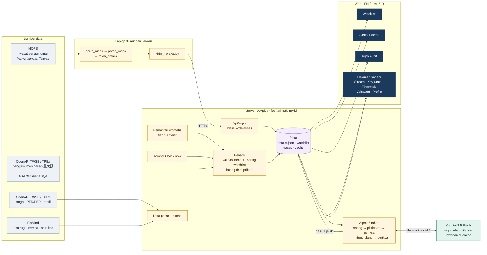
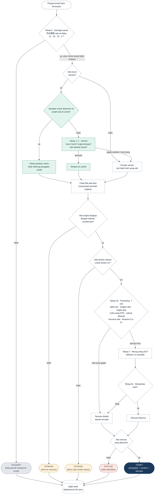
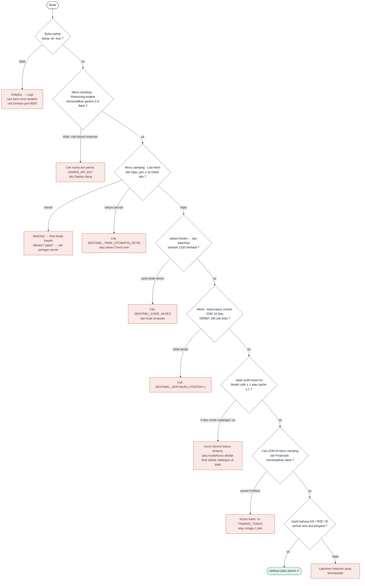

# Diagram alur FEAF

Tiga diagram, disusun dari kode per 10 Nov 2026. Gambarnya ada di `docs/diagram/`.
Kalau kode berubah, diagram ini ikut diubah: diagram ini spesifikasi, bukan ilustrasi.

1. [Alur sistem](#1-alur-sistem): data datang dari mana, lewat komponen apa, tampil di mana
2. [Flowchart agent](#2-flowchart-agent-satu-pengumuman): nasib satu pengumuman dari awal sampai akhir
3. [Flowchart pengecekan](#3-flowchart-pengecekan-aplikasi): urutan cek bahwa aplikasi di server benar-benar jalan

---

## 1. Alur sistem

| Kotak | Berkas |
|---|---|
| Penarik, watchlist, impor | `app/tarik.py`, `scripts/tarik.py` |
| Pemantau otomatis, rute web | `app/main.py` |
| Agent | `app/agent/pipeline.py`, `screen.py`, `extract.py`, `verify.py`, `recompute.py` |
| Gemini + cache jawaban | `app/agent/llm.py` |
| Data pasar | `app/pasar.py` |
| Riwayat dari laptop | `scripts/spike_mops.py`, `parse_mops.py`, `fetch_details.py`, `kirim_riwayat.py` |

**Yang perlu diingat:** OpenAPI pengumuman diperbarui sekitar sekali sehari (berisi
pengumuman hari sebelumnya). Riwayat lama dan pengumuman real-time hanya ada di MOPS,
yang hanya bisa diakses dari jaringan Taiwan.

---

## 2. Flowchart agent (satu pengumuman)

Model hanya dipakai di **satu** kotak hijau (tahap 1–2). Semua keputusan terbit atau
tidak diambil oleh kode yang bisa diperiksa.

**Status di kode vs di brief hal. 7:** kode sekarang memakai `dilewati / ditahan /
ditolak / terbit`. Brief memakai ARCHIVED / HELD FOR REVIEW / REJECTED / PUBLISHED, dan
di brief verifier yang gagal masuk **HELD**, bukan ditolak. Penyamaan ini ada di daftar
tugas berikutnya; diagram ini akan diperbarui bersamanya.

---

## 3. Flowchart pengecekan aplikasi

Urutan cek setelah deploy, atau saat ada yang terasa tidak beres. Ikuti dari atas.

