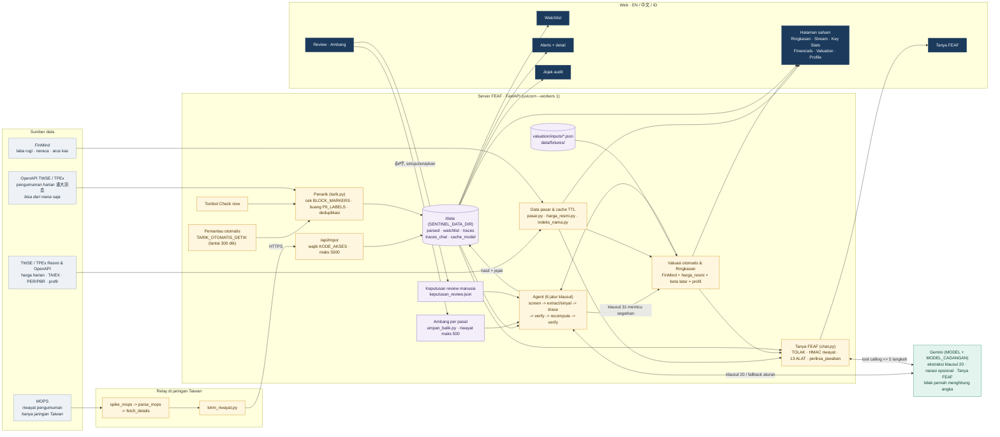
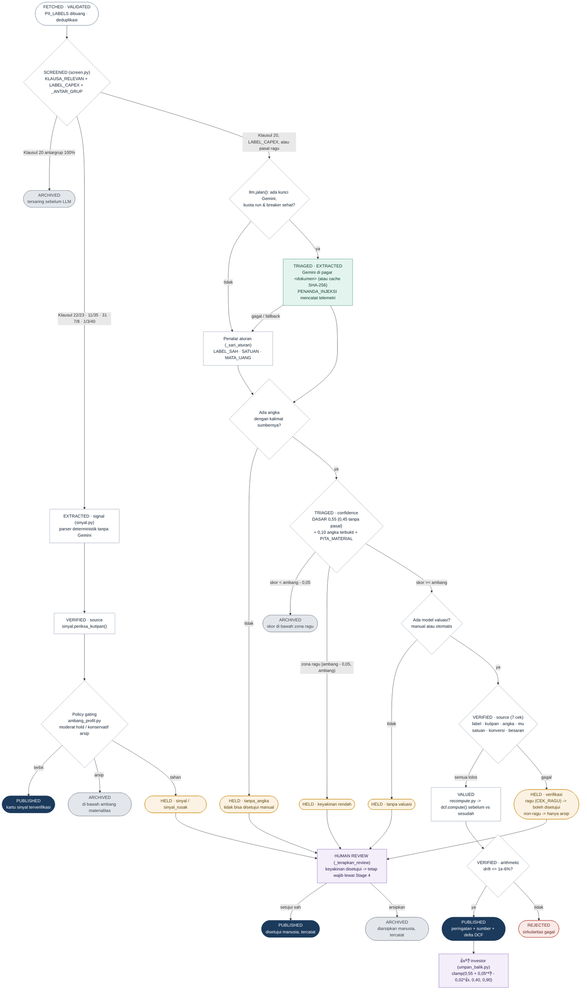
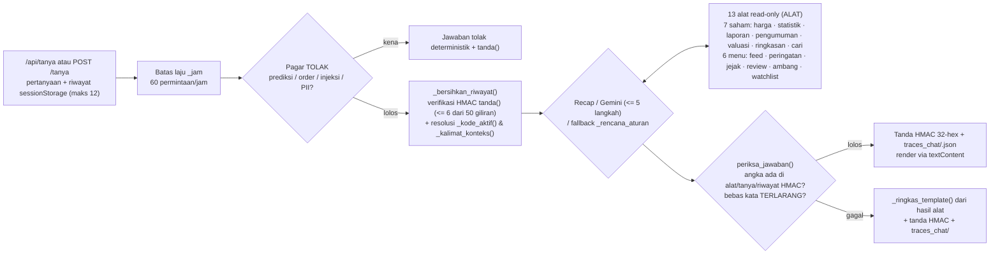
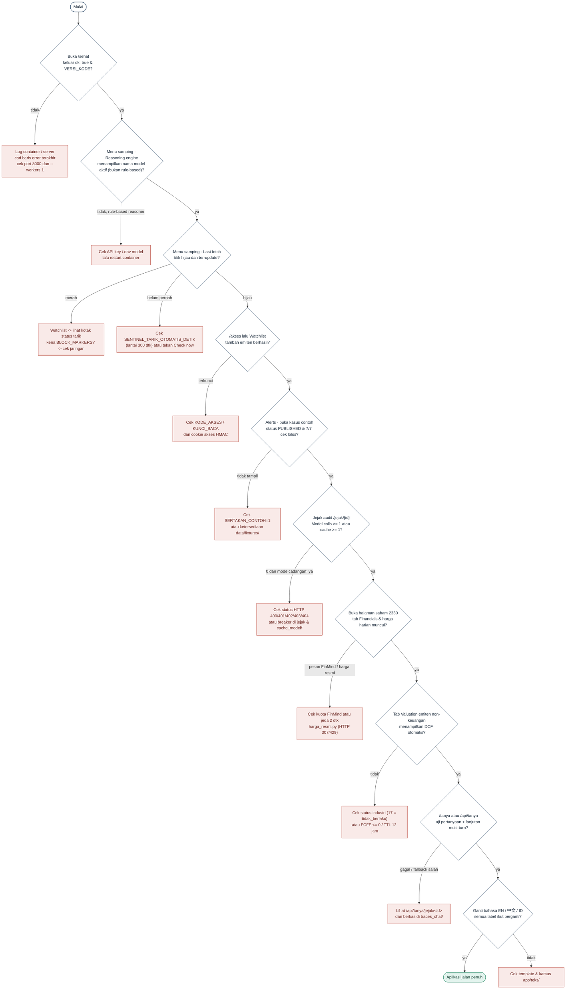

# Diagram alur FEAF

Tiga diagram spesifikasi dan alur chat multi-turn, disusun dari kode `v1.1.0` per 13 Nov 2026 (rincian teknis lengkap ada di [`docs/system-design.md`](system-design.md)).
Kalau kode berubah, diagram ini ikut diubah: diagram ini spesifikasi, bukan ilustrasi. Gambar statis versi awal ada di `docs/diagram/` dan perlu dirender ulang secara terpisah bila dipakai di luar Markdown.

1. [Alur sistem](#1-alur-sistem): data datang dari mana, lewat komponen apa, tampil di mana
2. [Flowchart agent](#2-flowchart-agent-satu-pengumuman): nasib satu pengumuman melalui jalur valuasi maupun jalur sinyal deterministik, plus alur Tanya FEAF
3. [Flowchart pengecekan](#3-flowchart-pengecekan-aplikasi): urutan cek bahwa aplikasi di server benar-benar jalan

---

## 1. Alur sistem

| Kotak / Subsistem | Berkas Utama |
|---|---|
| Konfigurasi & versi | `app/config.py`, `app/versi.py` |
| Penarik, watchlist, impor, baca-simpan | `app/tarik.py`, `app/store.py`, `scripts/tarik.py` |
| Pemantau otomatis, middleware baca, rute web & API | `app/main.py` |
| Agent valuasi & 6 jalur sinyal | `app/agent/pipeline.py`, `screen.py`, `extract.py`, `sinyal.py`, `triase.py`, `verify.py`, `recompute.py` |
| Ambang 👍/👎, review manusia, profil risiko | `app/umpan_balik.py`, `app/review.py`, `app/ambang_profil.py` |
| Valuasi otomatis, harga resmi, ringkasan, sitasi | `app/valuasi_otomatis.py`, `app/harga_resmi.py`, `app/ringkasan.py`, `app/sitasi.py`, `scripts/dcf.py` |
| Data pasar & indeks pencarian emiten | `app/pasar.py`, `app/indeks_nama.py` |
| Tanya FEAF (server & UI browser) | `app/chat.py`, `app/static/chat.js`, `app/templates/_panel_chat.html` |
| Gemini + cache SHA-256 + circuit breaker | `app/agent/llm.py` |
| Riwayat dari laptop di jaringan Taiwan | `scripts/spike_mops.py`, `parse_mops.py`, `fetch_details.py`, `kirim_riwayat.py` |

**Catatan sumber data:** OpenAPI pengumuman harian TWSE/TPEx bisa diambil dari mana saja dengan jeda pembaruan berkala, sedangkan riwayat MOPS lama hanya bisa ditarik dari jaringan Taiwan lalu dikirim ke `/api/impor`.

---

## 2. Flowchart agent (satu pengumuman)

Pada pipeline pengumuman, pemanggilan LLM dibatasi hanya pada ekstraksi jalur valuasi (Klausul 20, override `LABEL_CAPEX`, atau pasal tak terbaca) dengan fallback aturan deterministik. Jalur sinyal (`22/23`, `11/35`, `31`, `7/8`, `1/3/40`) bekerja sepenuhnya secara deterministik di `app/agent/sinyal.py`. Seluruh keputusan akhir dicatat ke `DATA_DIR/traces/<id>.json`.

### Alur Tanya FEAF (multi-turn, 13 alat)

---

## 3. Flowchart pengecekan aplikasi

Urutan cek setelah deploy, atau saat ada perilaku yang janggal. Ikuti dari atas.

