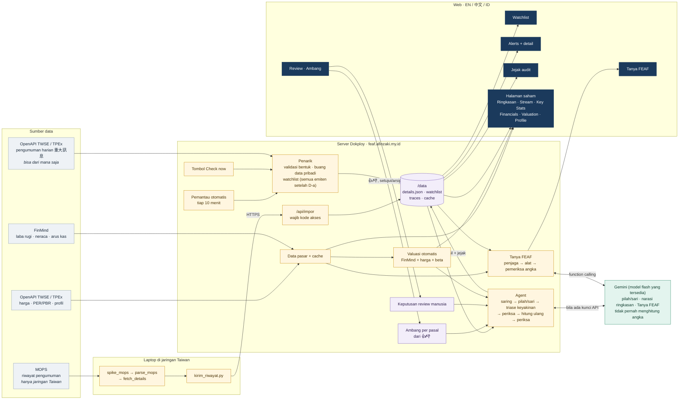
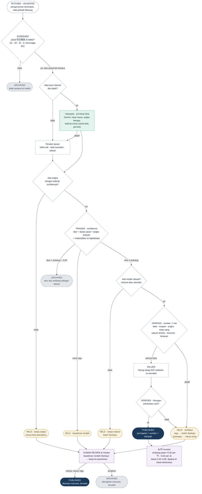
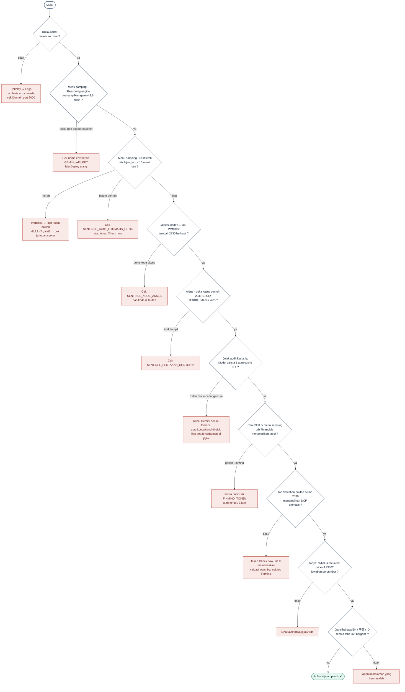

# Diagram alur FEAF

Tiga diagram, disusun dari kode per 11 Nov 2026 dini hari (setelah A2, B2, C1, D3, D4). Gambarnya ada di `docs/diagram/`.
Kalau kode berubah, diagram ini ikut diubah: diagram ini spesifikasi, bukan ilustrasi.

1. [Alur sistem](#1-alur-sistem): data datang dari mana, lewat komponen apa, tampil di mana
2. [Flowchart agent](#2-flowchart-agent-satu-pengumuman): nasib satu pengumuman dari awal sampai akhir
3. [Flowchart pengecekan](#3-flowchart-pengecekan-aplikasi): urutan cek bahwa aplikasi di server benar-benar jalan

---

## 1. Alur sistem

| Kotak | Berkas |
|---|---|
| Penarik, watchlist, impor | `app/tarik.py`, `scripts/tarik.py` |
| Pemantau otomatis, rute web | `app/main.py` |
| Agent | `app/agent/pipeline.py`, `screen.py`, `extract.py`, `triase.py`, `verify.py`, `recompute.py` |
| Ambang 👍/👎, review | `app/umpan_balik.py`, `app/review.py` |
| Valuasi otomatis | `app/valuasi_otomatis.py`, `scripts/dcf.py` |
| Tanya FEAF | `app/chat.py` |
| Gemini + cache jawaban | `app/agent/llm.py` |
| Data pasar | `app/pasar.py` |
| Riwayat dari laptop | `scripts/spike_mops.py`, `parse_mops.py`, `fetch_details.py`, `kirim_riwayat.py` |

**Yang perlu diingat:** OpenAPI pengumuman diperbarui sekitar sekali sehari (berisi
pengumuman hari sebelumnya). Riwayat lama dan pengumuman real-time hanya ada di MOPS,
yang hanya bisa diakses dari jaringan Taiwan.

---

## 2. Flowchart agent (satu pengumuman)

Model hanya dipakai di **satu** kotak hijau. Semua keputusan terbit, tahan, atau arsip
diambil kode yang bisa diperiksa, dan setiap langkah tercatat di jejak audit
(`data/traces/<id>.json`) dengan nama state brief hal. 7.

Tanya FEAF (chatbot) punya alurnya sendiri: penjaga menolak prediksi, order, dan data
pribadi → Gemini memanggil alat data, maksimal 5 langkah → pemeriksa memastikan setiap
angka ada di hasil alat dan tidak ada kata beli/jual → bila ditolak, jawaban template
dari hasil alat yang sama. Jejaknya di `data/traces_chat/`.

---

## 3. Flowchart pengecekan aplikasi

Urutan cek setelah deploy, atau saat ada yang terasa tidak beres. Ikuti dari atas.

