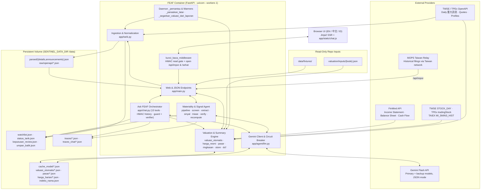
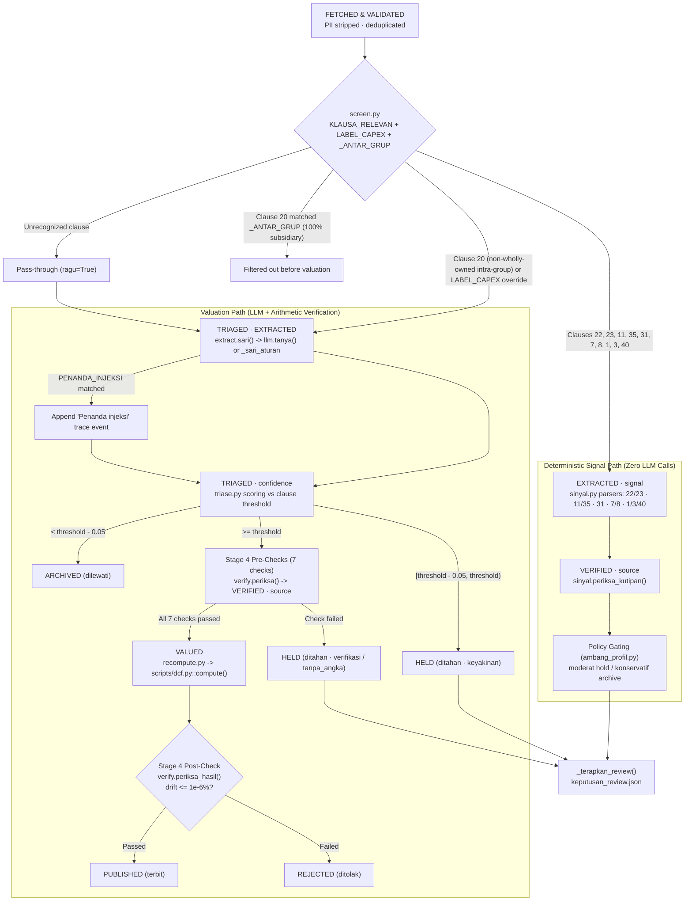
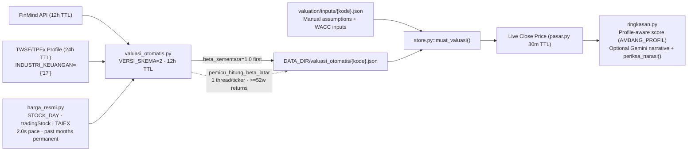
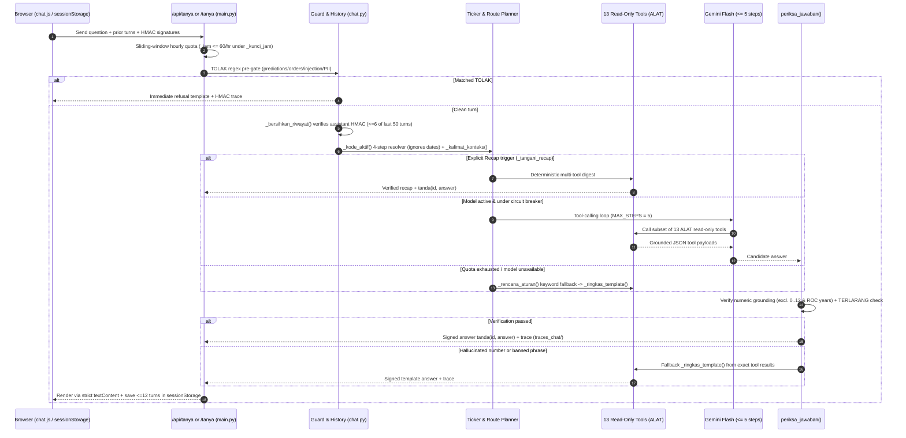

# FEAF System Design

**Version:** `v1.1.0` (`app/versi.py`)
**Audience:** Engineering reviewers, competition judges, and operators

FEAF (Financial Equity Alert & Filing Intelligence) is a single-node FastAPI system that ingests Taiwan exchange material disclosures (`重大訊息`), filters and verifies them against deterministic rules and arithmetic before publishing alerts, builds auto-refreshed DCF valuations from official market prices and financial statements, and exposes a tool-grounded conversational assistant (Ask FEAF).

---

## 1. Design Goals and Explicit Non-Goals

| Category | Commitment | Mechanism in Codebase |
|---|---|---|
| Grounded numbers | Every displayed financial figure, delta, valuation, and chat number comes from Python arithmetic or tool output | [`scripts/dcf.py`](../scripts/dcf.py), [`app/agent/verify.py`](../app/agent/verify.py), [`app/chat.py`](../app/chat.py) |
| Fail-closed publication | Unverified or out-of-tolerance items never enter the published feed automatically | `HELD` / `REJECTED` states in [`app/agent/pipeline.py`](../app/agent/pipeline.py) |
| Auditability | Every filing decision and chat turn writes a persistent trace artifact | `DATA_DIR/traces/<id>.json`, `DATA_DIR/traces_chat/<id>.json` |
| Bilingual/zero-DB portability | Server-rendered HTML and atomic JSON storage on a single disk volume | Jinja2 templates + `SENTINEL_DATA_DIR` (`/data`) |
| PII hygiene | Issuer officer names and personal identifiers are stripped prior to persistence and excluded from public indexes | `PII_LABELS` in [`app/tarik.py`](../app/tarik.py), `PROFIL_DISIMPAN` in [`app/pasar.py`](../app/pasar.py), `KOLOM_DISETUJUI` in [`app/indeks_nama.py`](../app/indeks_nama.py) |

### Explicit Non-Goals

- **No trade execution or investment advice:** Guardrails (`TOLAK`, `TERLARANG`, `KATA_TERLARANG`) reject buy/sell directives, price targets, and order instructions across both summary narration and Ask FEAF.
- **No horizontal multi-worker cluster state:** Runtime locks, rate windows, model circuit breakers, background monitors, and fallback session secrets run in one process (`uvicorn ... --workers 1` in [`Dockerfile`](../Dockerfile)).
- **No external database server:** Persistence relies on atomic temp-file writes and `os.replace` over JSON files on `SENTINEL_DATA_DIR`.

---

## 2. System Context and Component Architecture

### Runtime Topology and Container Boundaries

The production image ([`Dockerfile`](../Dockerfile)) builds on `python:3.12-slim`, sets `TZ=Asia/Taipei`, switches to non-root user `sentinel` (`uid 10001`), mounts `/data` as `SENTINEL_DATA_DIR`, and exposes port `8000` with a Docker `HEALTHCHECK` probing `/sehat`. Reverse proxy headers are trusted (`--proxy-headers --forwarded-allow-ips *`).

---

## 3. Subsystem 1: Material Filing Pipeline

### 3.1 Ingestion, De-duplication, and PII Stripping

[`app/tarik.py`](../app/tarik.py) fetches `t187ap04_L` (TWSE) and `mopsfin_t187ap04_O` (TPEx) via HTTP and inspects responses against `BLOCK_MARKERS` to detect HTTP 200 geo-block or HTML error pages before parsing. Raw snapshots are saved under `DATA_DIR/raw/openapi/<YYYYMMDDTHHMMSSZ>-{twse,tpex}.json`.

Before writing `PARSED_DIR/details.json` and `PARSED_DIR/announcements.json`:
1. Fields listed in `PII_LABELS` are stripped from each disclosure body.
2. Filings are deduplicated using `(code, date, 6-digit-time, whitespace-stripped subject)`.
3. Remote MOPS relays or operators can push records via `/api/impor`, which authenticates `KODE_AKSES` and validates payload size against `MAKS_IMPOR = 5000`.
4. [`app/store.py`](../app/store.py) reads `DATA_DIR/parsed/` first (`_pick`), falling back to `data/fixtures/` (and optionally merging fixtures when `SERTAKAN_CONTOH` is enabled) so cold boots always serve functional sample filings without network access.

### 3.2 Clause Routing and Dual Execution Lanes

Every incoming filing passes through [`app/agent/screen.py`](../app/agent/screen.py), which maps MOPS `符合條款` clause numbers via `KLAUSA_RELEVAN` into six operational domains and two execution paths:

#### Six Clause Lanes and Responsibilities

| Lane | Clauses | Executor | Extracted Signal / Output |
|---|---|---|---|
| Valuation & CapEx | `20` (and `LABEL_CAPEX`: `資本支出預算金額`, `資本支出金額`) | `extract.py` -> `triase.py` -> `verify.py` -> `recompute.py` | Metric (`capex`, `cash`, `debt`), amount normalized to M NTD, DCF sensitivity deltas |
| Guarantees & Lending | `22`, `23` | `sinyal.py` (`_penerima` multi-recipient parser) | Multi-recipient signal extraction, verified against source quote and `PINJAMAN_PERHATIAN = 0.40` / profile policy |
| Capital & Dilution | `11`, `35` | `sinyal.py` | Capital-lane signal extraction, verified against source quote |
| Financial Reports | `31` | `sinyal.py` (`KURUNG` bracketed negative parser) | Quarterly financial report signal; triggers watchlist valuation refresh in `main.py` |
| Severe Events | `1`, `3`, `40` | `sinyal.py` (skips person names) | High-severity disclosure signal verified against source quote |
| Governance Changes | `7`, `8` | `sinyal.py` (role/change type only; skips `姓名`, `異動原因`) | Governance role/change-type alert without storing officer names or departure reasons |

### 3.3 Extraction, Confidence Triage, and Threshold Calibration

1. **Structured Extraction ([`app/agent/extract.py`](../app/agent/extract.py)):** Calls Gemini (`llm.tanya`) under `<dokumen>...</dokumen>` isolation delimiters (`SISTEM`) or falls back to deterministic rule extraction (`_sari_aturan` + `llm.meta_cadangan`) when quota is exhausted or `llm.jalan(0)` is active. `PENANDA_INJEKSI` scans input text for prompt-injection phrases and records non-fatal telemetry (`· Penanda injeksi`) on the trace. Recognized fields are normalized across `LABEL_SAH`, `MATA_UANG`, and 11 unit multipliers in `SATUAN` converting to million NTD.
2. **Confidence Formula ([`app/agent/triase.py`](../app/agent/triase.py)):** Scoring is deterministic rather than LLM-reported:
   - Base score: `DASAR = 0.55` (`DASAR_TANPA_PASAL = 0.45` when no clause matched).
   - Source-verified figure bonus: `+0.10` (`BOBOT_ANGKA`) when `verify.sumber_terbukti` confirms numeric presence.
   - Materiality band (`PITA_MATERIAL`): `>= 2%` adds `+0.20`, `>= 0.5%` adds `+0.10`, `>= 0.05%` subtracts `-0.05`, `< 0.05%` subtracts `-0.20`.
   - Total score is clamped to `[0.01, 0.99]`.
   - Decision (`putuskan()`): scores `>= threshold` advance (`lanjut`), scores within `[threshold - 0.05, threshold)` (`ZONA_RAGU`) stop in `HELD`, and lower scores archive (`ARCHIVED`).
3. **Feedback-Derived Thresholds ([`app/umpan_balik.py`](../app/umpan_balik.py)):** Analyst thumbs-up/down votes recorded in `umpan_balik.json` adjust the effective clause threshold:
   $$\text{threshold} = \text{clamp}(0.55 + 0.05 \cdot \text{down} - 0.02 \cdot \text{up},\; 0.40,\; 0.90)$$
   Each clause supports manual lock and reset while preserving up to `RIWAYAT_MAKS = 500` history records.

### 3.4 Stage 4 Verification and Human Review Constraints

Before touching DCF numbers, [`app/agent/verify.py`](../app/agent/verify.py) executes 7 pre-calculation checks in `periksa()`:

| Check Key | Verification Scope |
|---|---|
| `cek.label` | Metric label is listed in `LABEL_SAH` and maps via `PENERAPAN` |
| `cek.kutipan` | Evidence quote verifies against the source filing text |
| `cek.angka` | Extracted raw figure is evidenced in the source quote (`sumber_terbukti`) |
| `cek.mu` | Currency matches `MATA_UANG` |
| `cek.satuan` | Scale unit matches `SATUAN` (11 multipliers to million NTD) |
| `cek.konversi` | Unit conversion and normalized million-NTD figure are consistent |
| `cek.besaran` | Normalized magnitude stays within `PITA_BAWAH = 0.2` and `PITA_ATAS = 3.0` |

After [`app/agent/recompute.py`](../app/agent/recompute.py) calls `scripts/dcf.py::compute()` before and after applying the extracted `capex`, `cash`, or `debt` delta, `periksa_hasil()` verifies mathematical circularity and checks that drift remains within `BATAS_DRIFT_PERSEN = 1e-6`%.

Human reviewers record decisions in `DATA_DIR/keputusan_review.json` (`<id>#<jenis>`). `_terapkan_review()` in [`app/agent/pipeline.py`](../app/agent/pipeline.py) and [`app/review.py`](../app/review.py) enforce three invariants so human action cannot forge unverified numbers:
- Approving a `keyakinan` hold advances the filing into `verify.periksa()` and `recompute`; it cannot skip Stage 4 verification.
- Approving a `verifikasi` hold is permitted only when every failed check belongs to `CEK_RAGU = {"cek.mu", "cek.konversi", "cek.besaran"}`.
- `tanpa_angka` and `sinyal_rusak` holds cannot be approved into the published valuation feed.

---

## 4. Subsystem 2: Auto-Valuation, Official Pricing, and Summary Engine

FEAF maintains per-issuer DCF baselines for all covered watchlist symbols and reconciles manual worksheets with automated financial pulls.

### Key Valuation Mechanics

1. **Layer Precedence ([`app/store.py`](../app/store.py)):** `muat_valuasi()` loads automated DCF inputs (`valuasi_otomatis/{kode}.json`) and merges manual `assumptions`, `wacc_inputs.risk_free_rate`, `wacc_inputs.equity_risk_premium`, and any missing `balance_sheet` fields from `valuation/inputs/{kode}.json`.
2. **Sector and Validity Gates ([`app/valuasi_otomatis.py`](../app/valuasi_otomatis.py)):** Issuers classified in banking/financials (`INDUSTRI_KEUANGAN = {"17"}`) are tagged `tidak_berlaku` rather than forced through an inappropriate industrial FCFF model. Issuers with `FCFF <= 0` or `EV <= 0` are marked `tidak_bisa_dihitung`.
3. **Non-Blocking Beta Regression:** Cold valuation construction uses a provisional `beta = 1.0` (`beta_sementara`) so HTTP responses return immediately. `pemicu_hitung_beta_latar()` spawns at most one background worker per symbol (guarded by `_kunci_thread_beta` and `_thread_aktif`) to pull official monthly close series (`app/harga_resmi.py`, rate-limited at 2.0s per request under `_kunci_jaringan` with `[5, 10, 20]`s backoff on HTTP 307/429) and regress at least `MIN_MINGGU_BETA = 52` weekly stock vs TAIEX returns.
4. **Profile-Aware Scoring and Summary Narration ([`app/ringkasan.py`](../app/ringkasan.py)):** Recomputes intrinsic value at the live market close using `AMBANG_PROFIL` (`konservatif`, `moderat`, `agresif` from [`app/ambang_profil.py`](../app/ambang_profil.py)). Optional Gemini prose narration (`INSTRUKSI_NARASI`) is checked by `periksa_narasi()` for numeric agreement and banned advisory words (`KATA_TERLARANG`), falling back to deterministic templates if rejected.
5. **Valuation Refresh Trigger (`app/main.py`):** Arrival of a new Clause 31 quarterly financial report schedules background valuation rebuilds via `_segarkan_valuasi_dari_laporan()`, throttled by `_kode_perlu_valuasi(maks=5)` with a 6-hour per-ticker cooldown.

---

## 5. Subsystem 3: Ask FEAF Multi-Turn Assistant

[`app/chat.py`](../app/chat.py) implements a guarded, read-only conversational interface (`PROMPT_VERSION = "chat-2026-11-12.1"`) served synchronously to the browser via `asyncio.to_thread()` from `/tanya` (HTML no-JS form fallback) and `/api/tanya` (JSON API), backed by [`app/static/chat.js`](../app/static/chat.js) and [`app/templates/_panel_chat.html`](../app/templates/_panel_chat.html).

### Multi-Turn Verification and Tool Surface

1. **Client-Held Signed History (Zero Server Session Store):** Browser memory retains up to 12 messages in `sessionStorage["feaf_chat"]`. When sent back to `/api/tanya`, `_bersihkan_riwayat()` inspects at most the last 50 submitted items, discards any past user turn matching `TOLAK`, accepts up to 6 turns whose prior assistant answers carry a valid 32-hex HMAC-SHA256 signature from `tanda(id, jawaban)` (keyed by `CHAT_RAHASIA`), and passes verified text as conversational context. Users cannot spoof historical assistant claims to jailbreak numeric checks.
2. **13 Read-Only Tools (`ALAT`):**
   - **7 Equity and Search Tools:** `harga` (official/market price), `statistik` (PER/PBR/dividend yield), `laporan` (FinMind statements + MOPS citations via [`app/sitasi.py`](../app/sitasi.py)), `pengumuman` (recent filings for symbol), `valuasi` (DCF + manual overrides), `ringkasan` (profile score + investment summary), `cari` (ticker/alias lookup via [`app/indeks_nama.py`](../app/indeks_nama.py)).
   - **6 Workspace Inspection Tools:** `feed` (published feed stream), `peringatan` (all filings and signal alerts), `jejak` (stage-by-stage trace lookup), `review` (pending human review items), `ambang` (current per-clause thresholds and feedback stats), `watchlist` (covered TWSE/TPEx symbols).
3. **Numeric Grounding Verifier (`periksa_jawaban`):** Scans generated assistant text and rejects any number that does not appear in tool outputs (`hasil_alat`), the user's `pertanyaan`, or verified prior assistant context (`_teks_asisten_sah`), permitting trivial counts (`0..12`) and ROC calendar conversions (`v - 1911`). It also blocks advisory terms matching `TERLARANG`. Any rejection falls back deterministically to `_ringkas_template()` built strictly from `hasil_alat`.
4. **Rate Limiting:** An in-memory sliding window (`_jam` protected by `_kunci_jam`) enforces `MAX_PER_HOUR = 60` requests.

---

## 6. Data Model and Disk Persistence Contracts

All mutable application state resides under `SENTINEL_DATA_DIR` (`/data` in Docker). Multi-threaded writers protect shared JSON documents with `threading.Lock` and atomic temp-file writes (`<path>.<pid>.<tid>.tmp` or `.tmp` followed by `os.replace`).

| Path under `DATA_DIR` | Owner Module | Schema / Keying | Retention / TTL |
|---|---|---|---|
| `parsed/details.json`, `parsed/announcements.json` | `tarik.py`, `store.py` | Deduplicated disclosures (`id_pengumuman`, stripped PII) | Overwritten on each pull; falls back to `data/fixtures/` |
| `raw/openapi/<UTC>-{twse,tpex}.json` | `tarik.py` | Raw exchange OpenAPI JSON payloads | Append-only audit snapshots |
| `watchlist.json`, `status_tarik.json` | `tarik.py` | Tracked tickers and last pull/status telemetry | Updated per pull |
| `traces/<id>.json` | `agent/pipeline.py` | `Jejak` stage sequence, checks, deltas, outcome state | Per filing trace |
| `traces_chat/<TS>-<6hex>.json` | `chat.py` | Sanitized prompt, tool calls, raw/verified reply, fallback flags | Per chat turn |
| `keputusan_review.json` | `review.py` | Map keyed by `<id>#<jenis>` (`keyakinan` / `verifikasi` decisions) | Persistent under `_kunci_berkas` |
| `umpan_balik.json` | `umpan_balik.py` | `suara` counts, per-`pasal` locks, `riwayat` (max 500 entries) | Persistent under `_kunci_berkas` |
| `cache_model/<sha256>.json` | `agent/llm.py` | Cached JSON responses keyed by SHA-256 of `(provider, model, VERSI_PROMPT, SISTEM, instruction, document)` | Persistent deterministic cache (`temperature=0`) |
| `valuasi_otomatis/<kode>.json` | `valuasi_otomatis.py` | `VERSI_SKEMA = 2` auto DCF inputs, `beta_sementara`, status tags | `TTL_VALUASI = 43200s` (12h) |
| `pasar/<name>.json` | `pasar.py` | Quotes/ratios, 25-column sanitized profiles, FinMind financials | `1800s` (30m) quotes, `43200s` (12h) FinMind, `86400s` (24h) profiles |
| `harga_harian/{TWSE\|TPEx}-<kode>-<YYYYMM>.json` & `TAIEX-<YYYYMM>.json` | `harga_resmi.py` | Official monthly closing bars | Permanent for past months; `12h` for current month |
| `indeks_nama.json` | `indeks_nama.py` | Sanitized symbol + name + `ALIAS_POPULER` index | `7d` TTL |

---

## 7. Concurrency, Caching, and LLM Resilience

### Synchronization Primitives

| Lock / Mechanism | Module | Purpose |
|---|---|---|
| `_kunci_jalan` | `app/main.py` | Serializes manual/scheduled pipeline runs |
| `_kunci_cache` | `app/main.py` | Guards in-memory processed filing cache across page loads |
| `_kunci_panaskan` | `app/main.py` | Non-blocking lock ensuring background feed warming runs at most once concurrently |
| `_kunci_model` (`RLock`) | `app/agent/llm.py` | Synchronizes global 404 model blacklist (`_gagal_404`) and dynamic model replacement |
| `_lokal` (`threading.local`) | `app/agent/llm.py` | Per-run call budget (`jalan(maks)`), consecutive failure counter, runtime deadline, and temporary backup model override (`_lokal.model_sementara`) |
| `_kunci_berkas` | `app/review.py`, `app/umpan_balik.py` | Prevents concurrent lost updates on `keputusan_review.json` and `umpan_balik.json` |
| `_kunci_jam` | `app/chat.py` | Synchronizes 60/hour sliding rate limiter `_jam` |
| `_kunci_jaringan` | `app/harga_resmi.py` | Enforces 2.0s minimum spacing between upstream official stock-price requests |
| `_kunci_thread_beta` | `app/valuasi_otomatis.py` | Ensures max 1 background weekly-beta computation thread per ticker |

### LLM Fault Isolation and Cold-Start Guarantees

- **Zero-Model Startup (`_hasil_awal_tanpa_model`):** At FastAPI lifespan boot, `app/main.py` executes the initial pipeline pass inside `llm.jalan(0)`. Existing filings resolve instantly from `DATA_DIR/cache_model/` or deterministic rules (`_sari_aturan` + `sinyal.py`) without blocking server readiness on Gemini latency.
- **Per-Run Circuit Breaker (`llm.jalan`):** Active batch passes limit total consecutive failures (`GAGAL_BERUNTUN_MAKS = 3`) and elapsed wall time (`BATAS_DETIK_PER_JALAN = 90.0`), plus per-run call budgets (`MODEL_MAKS_PER_JALAN`).
- **Error Classification and Model Cascade:**
  - HTTP `400`, `401`, `402`, `403` halt the active model immediately rather than burning retries.
  - Transient errors retry with linear-backed intervals `1.5 * (percobaan + 1)` up to `RETRY_MAKS = 2`.
  - Repeated HTTP `404` responses trigger `_gagal_404` blacklisting and `_cari_pengganti()` (up to `GANTI_MAKS = 3`) before cascading through `MODEL_CADANGAN` via `_lokal.model_sementara`.
- **Background Daemon (`_pemantau`):** If `TARIK_OTOMATIS_DETIK > 0`, a daemon thread wakes at intervals floored at `300` seconds to pull fresh filings, process them, and trigger `_segarkan_valuasi_dari_laporan()` for Clause 31 changes.

### Single-Worker Constraint

[`Dockerfile`](../Dockerfile) launches Uvicorn with `--workers 1`. In-memory pipeline caches (`_cache`, `_jalan_terakhir`, `_valuasi_dicoba`, `_laporan_diproses`), `chat._jam` rate windows, the `_pemantau` daemon, and the ephemeral random `CHAT_RAHASIA` fallback live inside a single process. Scaling horizontally past 1 worker requires setting an explicit `SENTINEL_CHAT_RAHASIA`, moving rate limits and background polling out of the web worker process, and sharing storage semantics cleanly.

---

## 8. Security, Privacy, and Access Control

1. **Access Control Middleware (`kunci_baca_middleware` in [`app/main.py`](../app/main.py)):** When `KUNCI_BACA` is configured, read routes require an HMAC-signed cookie `akses` verified by `_boleh_ubah()`, returning HTTP `401` (`kunci.html` or JSON). Public operational paths (`/akses`, `/sehat`, `/static/*`, `/bahasa/*`) remain reachable, while `/api/impor` authenticates separately via `KODE_AKSES`.
2. **Untrusted Disclosure Isolation:** Filing text and tool inputs are never trusted as instructions. `app/agent/llm.py` wraps untrusted document bodies inside `<dokumen>...</dokumen>` XML fences (`SISTEM`), `app/agent/extract.py` flags injection strings via `PENANDA_INJEKSI`, and Stage 4 verification enforces structural validity and arithmetic before anything reaches `PUBLISHED`.
3. **XSS and DOM Hygiene:** Jinja2 autoescaping handles SSR templates; [`app/static/chat.js`](../app/static/chat.js) renders every chat bubble strictly using `textContent` (avoiding `innerHTML` on model or user strings); and [`app/templates/_panel_chat.html`](../app/templates/_panel_chat.html) splits `rk.disclaimer` across `data-d1` and `data-d2`.
4. **PII Filtering by Whitelist and Blacklist:** Upstream OpenAPI and FinMind payloads drop sensitive columns pre-disk (`PII_LABELS` in `tarik.py`, 25-column `PROFIL_DISIMPAN` whitelist removing fields such as `董事長` and `發言人` in `pasar.py`, and `KOLOM_DISETUJUI` in `indeks_nama.py`). Clauses `7`, `8`, `1`, `3`, `40` discard personal names and personal departure reasons (`姓名`, `異動原因`).
5. **Credential Redaction:** `_catat_galat()` in [`app/agent/llm.py`](../app/agent/llm.py) redacts API secrets before recording error diagnostics or trace payloads.

---

## 9. Deployment, Observability, and Verification

- **Health Check (`/sehat`):** Reports system status, queue/pull diagnostics, and `VERSI_KODE` (a live SHA-256 hash computed over `app/*.py`) so deployments detect code drift cleanly.
- **Audit Views:** Web and API routes expose filing traces (`/jejak/{id}`) and Ask FEAF turn traces (`/api/tanya/jejak/{id}`) backed by `DATA_DIR/traces/` and `DATA_DIR/traces_chat/`.
- **Offline Verification Suite:** All unit, security, and rendering tests in `tests/` execute without network access against deterministic mocks and `data/fixtures/`, alongside `scripts/qa_halaman.py` for end-to-end HTML route smoke verification and evaluation harnesses in `eval/`.
